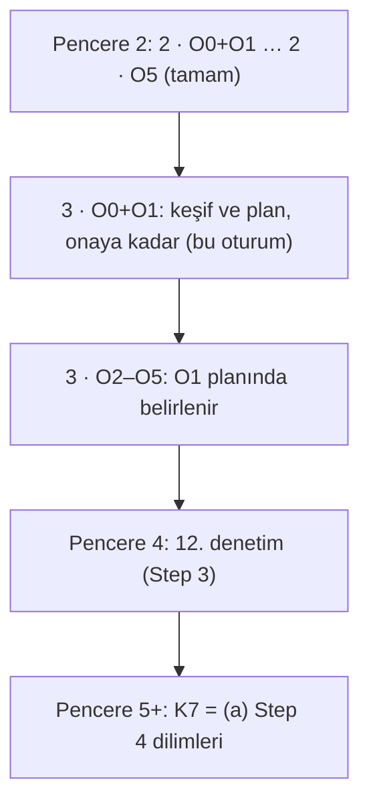

# NEXT_PROMPT — ishtar (yeni oturum için)

> **Kullanım notu:** Yeni pencereyi depo kökünde (`C:\Users\ahmet\Documents\Projeler\ishtar`) aç, omp'u buradan başlat, iki `---` çizgisi arasını ilk mesaj olarak yapıştır.
> 2026-11-14'te, Pencere 2 · O5 kapanışında yazıldı (W6); `2 · O5`'in sonuç cümlelerini kapanış commit'inden hemen önce orkestratör ekledi (I2b). Bu oturum **Pencere 3 · O0+O1 — Planlama koşusu 21 (Step 1 + Step 2)** aşamasını yürütür (`ORCHESTRATION_PLAN.md` §0, §1, §7): keşif ve plan, kullanıcı onayına kadar. Bu bir özettir: nihai kaynak dosyalardır. Plan döngüyü, durumu, görevleri, Pencere 3 girdilerini (§7) ve sözleşmeyi (Ek A) tutar; kanonik kayıt `Planner-docs/Planing-Ledger.md`, tarihçe `PROJECT_LOG.md`.

---

## 0. Rol, proje kimliği ve ilk kurallar

Bu projede çalışmaya devam ediyorsun. `ishtar`, kullanıcının kendi Xiaomi 13 Ultra'sı (SM8550, Sony IMX989) için root tabanlı kamera özelleştirmesidir: `ishtar-cam-modes` KernelSU modülü (v2.2, versionCode 13), `ishtar-aon-fix` (v1.1) ve yapılandırılmış AGC (Google Camera portu `org.codeaurora.snapcam`). Yöntem: ikili dosya sökümü (disassembly), md5 korumalı offset tablosu, bind-mount. Bu işlerin hepsi AOSPA Android 15 (Vauxite) üzerinde kuruldu ve ölçüldü.

**2026-11-13 dönüm noktası.** Kullanıcı ROM derleme fikrinden vazgeçti; telefon HyperOS 4 çalıştırıyor (`OS4.0.0.44.WMACNXM`). Bu **gözlemlendi** (2026-11-13); ROM 2026-09-23 derlemesi. Aynı gün salt-okunur ölçüldü (`snapshots/20261113-1819__IMPL96__hyperos4-readonly-probe.txt`):
- Kamera HAL'i (`camera.qcom.so`) farklı bir ikili; AOSPA'daki 16 noktalı 50MP yaması uymaz.
- IMX989 sensör dosyası AOSPA'dakiyle aynı.
- Projenin modülleri kurulu değil; AGC'nin yamasız V9.6 sürümü kurulu.

Bu olgular Pencere 1 açılışında yeniden okundu (Ek A `OPN`). Pencere 2 cihaza komut göndermedi; telefonun bugünkü durumu Pencere 2'de teyit edilmedi. Faz 7/8'in (kiralık sunucuda derleme, Android 16 kamera işi, kernel LTS) amacı kalmadı; resmî kapanışı bu oturumla başlayan planlama koşusu 21'in işidir.

**Dört ilke:**
1. **Her oturum planın tek aşamasını yürütür** (plan §0). Aşama, `ORCHESTRATION_PLAN.md` §1'deki ilk `pending` satırdır: `3`. Pencere 3'ün aşama satırları henüz yok; bu oturum `3 · O0+O1`'dir ve satırları ekler (plan §1). Bu dosya yalnız giriş özetidir.
2. **Süreklilik sohbette değil, depodaki dosyalardadır.** Prompt ile dosya çelişirse dosya kazanır; çelişki kullanıcıya söylenir.
3. **Cihazın tek doğru kaynağı cihazdır;** iddia yalnız ölçümle kurulur. Kurulum, mod değiştirme, deklanşör ve izin diyaloğu gibi fiziksel eylemler kullanıcıdadır ve onay ister.
4. **Döngü (kullanıcı kararı, 2026-11-14; plan §0):** `O0`+`O1` kullanıcının plan onayıyla ("onay") biter. Onaydan sonra beklenmedik bir durum yoksa kapanış sorulmadan yapılır: §1'de `3 · O0+O1` satırı `done` olur; `PROJECT_LOG.md` §2.6 ve §11 yazılır; bu dosya sıradaki aşama `3 · O2` için yeniden yazılır; bayt/boru kontrolü ve kimlik taraması yapılır; yerel kapanış commit'i atılır; kullanıcıya yeni pencere açması söylenir. Beklenmedik durumda kapanış yapılmaz; kullanıcıya sade bir dille ne olduğu, neden önemli olduğu ve iki ya da üç seçenek önerisiyle sorulur. `main`'in fast-forward'ı ve her push ayrı onay ister.

Kullanıcıyla **Türkçe** konuş; soruları kısa, açık ve teknik terime boğmadan yaz. `Planner-docs/` ve `docs/` gövdeleri İngilizce'dir (ClaudeQB sözleşmesi). `ishtar-cam-modes/` içindeki kullanıcı yüzeyleri (`Kullanim.txt`, `webroot/index.html`, `module.prop`) bilinçli olarak TR/EN'dir (`Main-Planing.md` R11).

**Gönderilen orkestrasyon şablonu hakkında:** kullanıcının genel şablonundaki Faz 0–5, plandaki `O0`–`O5` aşamalarıyla aynıdır; bu oturum şablonun Faz 0'ına (keşif) ve Faz 1'ine (plan; onaya kadar dur) denk gelir. `scout`, `task`, `reviewer`, `security-reviewer` ve `sonic` bu ortamda vardır; `librarian`, `designer`, `isolated` ve `outputSchema` yoktur (plan §3): yalıtım ayrık dosya sahipliğiyle sağlanır, dönüş bloğu görev metninde istenir. Şablonun "yeni branch" maddesi için: Pencere 2'nin tek çalışma dalı `integrate/impl-96` idi; plan Pencere 3 için dal belirtmez, karar O1 planında verilir ve kullanıcı onaylar. Dosya kazanır.

## 1. Süreklilik sistemi ve adlandırma

ClaudeQB adımları: Step 1 (ana plan) → Step 1.5 (otopsi, ontoloji, kavrayış) → Step 2 (alt planlar) → Step 3 (denetim) → Step 4 (uygulama koşuları). Değişen alt plan, Step 3 denetimi onu okumadan Step 4 kuyruğuna girmez. Kimlikler: `IMPL-NN` uygulama koşusu, `DEC-NN` karar, `FIND-…` bulgu, `AUDIT-FIX-NN` denetim bulgusu, `Faz n.m` / `Fn.m-NN` alt plan ve iş kalemi (şema ve sözlük: PROJECT_LOG §10). Durum yalnız sabit sözlükten yazılır (`planned`, `ready`, `ready_with_warnings`, `in_progress`, `implemented`, `verified`, `blocked`, `superseded`); bileşik değer ayrıştırıcıyı bozar (`AUDIT-FIX-11`).

| Seri | Son | Sıradaki |
|---|---|---|
| Uygulama koşusu | `IMPL-96` (2026-11-13, Pencere 1, C1) | **`IMPL-97`** (Pencere 5+) |
| Planlama koşusu | 20 (2026-09-14) | **21** (bu oturumla başlar, Pencere 3) |
| Step 3 denetimi | 11. (2026-09-14, `PASS_WITH_WARNINGS`) | **12.** (Pencere 4) |
| Karar | `DEC-32` (ledger §8'e Pencere 1'de yazıldı) | **`DEC-33`** (sonraki boş numara; K9'un kararı "sonraki DEC"tir, plan §2) |

Karar eşlemesi (plan §2): `DEC-27` depo taşıma; `DEC-28` ROM derleme bırakıldı, HyperOS 4; `DEC-29` K1 (`Kullanim.txt`); `DEC-30` K5+K6 (üç depo silinir); `DEC-31` K8 (kimlik redaksiyonu); `DEC-32` K7 = (a).

**Pencere, aşama, oturum (plan §0).** *Pencere N*, §1'deki plan fazıdır (ad tarihseldir). Her faz aşamalarla yürür: `O0` keşif, `O1` plan (kullanıcı onayına kadar), `O2` kontrat, `O3` paralel uygulama, `O4` entegrasyon ve geçitler, `O5` son inceleme ve kapanış. *Oturum* bir sohbet penceresidir: `O0`+`O1` bir oturumda, `O2`–`O5` her biri ayrı oturumda. Kimlik biçimi `Pencere 3 · O0+O1` (kısaca `3 · O0+O1`). Tek başına "Faz N" hep ClaudeQB proje fazıdır (1–9); alt plan `Faz n.m`, iş maddesi `Fn.m-NN`. `50MP-Entegrasyon-Plani.md`'deki "Faz 10" ayrı bir numaralamadır (PROJECT_LOG §3.4); koşu 21 yeni faz açarsa her yerde "ClaudeQB Phase 10" diye yazılır (plan §7, Step 1). Görev kimlikleri (`W1`–`W6`, `T3`, `I1`, `REV`, `SEC`; Pencere 2'de ayrıca `K0`, `SEC-A1`–`SEC-A3`, `SEC-B`, `REV-1`–`REV-3`, `I2a`, `I2b`, `GATE`, `FIX`, `FF`, `RID`, `PUSH`, `LSR`) ve Ek A olgu kimlikleri (A.2: `G`, `D`, `V`, `REL`, `T3`, `TRAP`, `M1`, `E`, `AUD11`, `OPN`; A.6: `OPN2`, `G4b`, `G8b`, `L653`, `LSH`, `SH8`, `CDATE`, `RID0`, `SEC0`, `SMK-O`, `O2OPN`, `G8c`, `G1b`, `CLOG`, `LMAP`, `C1MAP`, `O3OPN`, `G12b`, `O4OPN`, `O5OPN`) yalnız plana aittir; Pencere 3'ün görev kimliklerini O1 planı belirler. Ek A'daki `K3` ve `K4` satırları kullanıcı karar etiketlerini (`K1`–`K9`) yeniden kullanır. `R1`–`R12` Main-Planing risk kimlikleridir (plan §3, Adlandırma).

| Dosya | Rol |
|---|---|
| `ORCHESTRATION_PLAN.md` | **Plan** (kök, LF; C2'de 660 satır, ≈ 138 KB). §0 döngü; §1 durum (Pencere 3'ün aşama satırları bu oturumda eklenir); §2 kararlar; §3 kurallar ve geçitler; §6 Pencere 2 (kayıt); **§7 Pencere 3'ün kaynağı** (sekiz açılış sorusu, "Açılışta ayrıca", Step 1, ledger, Index, Ontology, Step 2, aday alt planlar, geçitler, doğrulayıcı tuzakları, ClaudeQB süreci; Pencere 3'ün aşama ve görev tablosu da buraya eklenir); §8–§9 sonraki pencereler; §10 kapsam dışı bulgular (koşu 21 ya da 12. denetim); Ek A sözleşme (A.5 kimlik kontrolü ve betiği; A.6 Pencere 2 olguları, son satır `O5OPN`) |
| `Planner-docs/Planing-Ledger.md` | Kanonik kayıt (CRLF, 653 satır; Pencere 2'de düzenlenmedi). Koşu 21 ona yazar (yalnız orkestratör; plan §7 "Ledger"): §2 koşu satırı, §3 snapshot, §4 durum satırları; silme yapıldıysa `DEC-30` yürütme notu; `DEC-32`'ye koşu 21 atfı; K9 için yeni DEC. Güncel çapalar Ek A.6 `LMAP` |
| `PROJECT_LOG.md` | Proje günlüğü (özet). §1–§10'u `2 · O3`'te W5 düzeltti; §2.6 ve §11 her aşama kapanışında yazılır; `2 · O5`'in incelemeleri ve sonuçları §11'in `2 · O5` girdisinde. Pencere 3 açılışında push ve depo silme durumunu anlatan cümleler güncellenir (plan §7, "Açılışta ayrıca") |
| `NEXT_PROMPT.md` | Bu dosya; her aşama kapanışında yeniden yazılır |
| `snapshots/20261113-1819__IMPL96__hyperos4-readonly-probe.txt`, `…-1821__IMPL96__hyperos4-smoke-baseline.txt` | HyperOS 4'ün ilk ölçümü (commit `70946ff`; probe satır 42, 190, 191 redakte). Snapshot adındaki saat güvenilmez (UTC ya da UTC+3; bu çiftte UTC+3); esas olan başlıktaki UTC zaman damgasıdır: smoke'ta `taken` satırı, probe'da 1. satır (E7) |
| `Planner-docs/Main-Planing.md` (CRLF), `Sub-Planing-Index.md`, `Faz-*-Plans/`, `Project-Ontology.md` (bayt korumalı; 2 NUL), `Project-Comprehension.md` (soru 7), `Autopsy.md` (CRLF; Step 1.5, soru 8) | 9 faz ve R1–R12; 42 alt plan; alt planların haritası ve sözlük. `Main-Planing.md` yalnız Step 1'de (orkestratör; metni kullanıcı onaylar) yazılır; Step 1.5 çalışırsa `Autopsy.md`'yi, kanıt varsa Ontology ve Comprehension'ı yazabilir. Faz 7/8 koşu 21'de tarihli notla emekli edilir |
| `Planner-docs/Sub-Planing-Audit.md` | 11. denetim `PASS_WITH_WARNINGS`; kuyruğu (`Faz7.2` → `7.3` → `8.1` → `8.3`) 2026-11-13'ten beri geçersiz; 12. denetim Pencere 4 |
| `docs/build-environment.md`, `docs/pre-rental-plan.md` | Kiralama runbook'u ve planı; başlarında "Historical as of 2026-11-13" notu (`03b0898`; 8 satır, eski satır atıfları +8 kayar: Ek A.6 `SH8`) |
| `docs/rom-build-device-notes.md` | AOSPA A15'in 2026-09-20 ölçümü; §10'da 2026-11-13 notları. Açık girdi `:79-84` (K3) IMPL-96 satırında kapandı |
| `docs/agc-12mp-configuration.md`, `docs/recovery-runbook.md`, `docs/release-checklist.md`, `docs/release-manifest.md` | AGC pin kaydı; kurtarma yolu; C/PC kontrol listesi; üretilmiş manifest (elle düzenlenmez). Hepsi AOSPA A15 dönemi |
| `docs/reverse-engineering-toolchain.md:220` | Hetzner ifadesi (soru 7); Step 1 ve Step 2 bu belgeye yazamaz |
| `scripts/smoke.sh`, `ishtar-cam-modes/post-fs-data.sh` | Salt-okunur cihaz enstrümanı (alanları modül kuruluyken anlamlı); modülün boot betiği ve md5 korumaları |
| `README.md`, `UNTRACKED-BY-DESIGN.md` | Pencere 1'de düzeltildi; `UNTRACKED-BY-DESIGN.md:36` `2 · O3`'te düzeltildi (REV-3: Faz 1.1'de 86 dosya, Ek A.6 `G12b`); kalan kaymalar plan §10'da; C1'in satır eşlemesi Ek A.6 `C1MAP` |
| `../ishtar-arsiv/` (repo dışı) | Yedekler: `impl-96-unredacted.bundle` (redakte edilmemiş dal ucu, §3), iki açık deponun aynaları |
| `C:/Users/ahmet/.claude/plugins/cache/claudeqb/claudeqb/0.2.1/skills/claudeqb/` | `SKILL.md`; `references/` altında Step 1, Step 1.5 ve Step 2 yönergeleri (`First-Planner.md`, `Autopsy-Planner.md`, `Second-Planner.md`) ve `handoffs/run-step2.md`, `run-step3.md`, `run-step4.md` (Step 1 için handoff dosyası yok); `scripts/validate_planner_docs.py`. Koşu 21 bunlara karşı çalışır |

## 2. Okuma sırası (Pencere 3 · O0+O1)

1. Bu dosya; sonra `ORCHESTRATION_PLAN.md`: §0, §1, §2, §3, **§7 (tamamı)**, §8–§9, §10 ve Ek A.1, A.2, A.5, A.6.
2. `git status`, `git log --oneline -8`, `git branch -vv`, `git ls-remote origin`.
3. `PROJECT_LOG.md`'yi orkestratör bütün okumaz: §2.6'yı ve §11'in son girdisini (`2 · O5`) okur; push ve depo silme cümlelerinin yerleri plan §7'de (alıntıyla bulunur).
4. Ledger bütün okunmaz; yalnız `:raw:N-N`; çapalar Ek A.6 `LMAP`. `Main-Planing.md`, Index, Audit ve alt planlar O0'da scout'larla ya da aralıklarla okunur.
5. ClaudeQB dosyaları mutlak yolla (§1 tablosunun son satırı): `SKILL.md`, `First-Planner.md`, `Autopsy-Planner.md` (Step 1.5; soru 8), `Second-Planner.md`, `workflow-quality.md`, `handoffs/run-step2.md`, doğrulayıcı.

**Büyük dosya uyarısı:** ledger satırları 1–9 KB (en büyüğü ≈ 8,8 KB; `:raw:N-M`); C2'de `PROJECT_LOG.md` 1.134 satır (≈ 177 KB), plan 660 satır (≈ 138 KB). `task` ajanları 100K bağlamlıdır; bu dosyalar onlara bütün verilmez.

## 3. Mevcut durum (2026-11-14, Pencere 2 sonu)

Ayrıntı: plan Ek A.2 ve A.6.

- **Git:** çalışma dalı **`integrate/impl-96`**; ucu C2 `Window 2: project log sweep and handoff for planning run 21` (hash bu dosyaya yazılmaz; `git log -1 --format=%h --grep '^Window 2:'`). Altında `Window 2 O4 follow-up: anchor the O2 commit lookups`, `Window 2 O4: integration and gates`, `Window 2 O3: project log sweep and pre-push reviews`, `Window 2 O2: contract for the project log sweep and the run 21 handoff`, `Window 2 O0-O1: approved plan, discovery facts, stage-per-session loop`, C1 `IMPL-96: repository move, ROM-build retirement, HyperOS 4 baseline`, `c2abd46`, `b603516` (C0), `775b321`, `03b0898`, `70946ff`, `7fa0a51`. `2 · O5` açılışında (Ek A.6 `O5OPN`): dal 74 commit; `main` 63 (`7fa0a51`); `origin/main` 62 (`587e3b5`); push edilmemiş 12 commit; etiket yok; 350 izlenen dosya. C2 bir commit ekler. Plana göre C2'den sonra aynı oturumda: `main`'in C2'ye fast-forward'ı (onay) → RID → push `git push origin main integrate/impl-96` (onay) → LSR. Sonuçları sohbette raporlanır; bu dosyaya girmez; Pencere 3 açılışında `git ls-remote origin` ile yeniden doğrulanır ve kaydedilir. İkisi de onaylanıp yapıldıysa beklenen: yerel `main` = C2; `git ls-remote origin` → `refs/heads/main` ve `refs/heads/integrate/impl-96` = C2. Yapılmadıysa `main` = `7fa0a51`, uzakta yalnız `main` = `587e3b5`.
- **Redaksiyon:** K8 (`DEC-31`) ile dal yeniden kuruldu. Eski hash'ler (`37edb5f`, `6a20999`, `fcceaab`) yalnız redakte edilmemiş bundle'da (`../ishtar-arsiv/impl-96-unredacted.bundle`, 77.094 B, sha256 `b9fa9c5cd5d0ae78f9f051ab62ecbfc2d9b2fa2fecd33f40247ef88bf58f6cd3`, `git bundle verify` OK, önkoşulu `7fa0a51`) ve yerel reflog'da durur; yeni yazılan hiçbir belge eski hash'i atamaz.
- **GitHub:** `origin` özel `ahmetxa/ishtar_cam_modes`. Silinecek üç depo (`ahmetxa/ishtar` özel; `ahmetxa/android_local_manifests` ve `ahmetxa/android_device_xiaomi_ishtar` açık) `2 · O5` açılışında, 2026-11-14T20:07:24Z'de hâlâ 200 (`O5OPN`; önceki ölçümler 07:23:21Z, 10:03:48Z, 13:45:22Z ve 19:34:57Z); kapanış commit'inden önce 21:11:12Z'de yine 200. Silmeyi kullanıcı yapar, ajan yalnız ölçer (404 = silinmiş). Aynalar `../ishtar-arsiv/` altında.
- **Ledger:** 653 satır, CRLF, NUL 0 (L653). C1'in eklediği 9 satır yüzünden eski atıflar kayar: `:524`'e kadar aynı, `:525`–`:548` için +1, `:549`–`:601` için +3, `:602` ve sonrası için +9 (LSH); güncel çapalar `LMAP`'te. Pencere 2 ledger'a yazmadı; koşu 21 yazar (yalnız orkestratör; plan §7 "Ledger").
- **Kimlik kontrolü tabanı (RID0):** plan Ek A.5 betiğiyle, `git log --all -p` ve 350 izlenen dosya üzerinde: değer taşıyan 6 anahtar satırının hepsi `<redacted>`; Luhn adayı 0; anahtarı yalnız düzyazıda anan 9 satır (karar 5a gereği hata sayılmaz). Geçti. Sonraki ölçümler aynı betikle, hepsi `value_lines=6`, `NOT_REDACTED=0`, `LUHN15=0` → geçti: `2 · O2` kapanışından önce `prose_mentions=13`; `2 · O3` kapanışından önce 15; `2 · O4` kapanışından önce 16 (9 geçmişte, 7 ağaçta); `2 · O5` kapanışından önce 16. Düzyazıda anahtar anan yeni satırlar sayıyı artırabilir; bu hata değildir. RID, kapanış commit'inden ve `main`'in fast-forward'ından sonra, push'tan hemen önce aynı betikle çalışır; sonucu sohbette raporlanır.
- **Push aralığı taraması (SEC0):** 7 commit'in bütün ara hâllerinde sır, özel anahtar, parola ataması, sunucu adresi, MAC adresi ya da Luhn adayı yok; IPv4 biçimli iki eşleşme sürüm dizgisi; probe öteki telefonun serisini kaydetmemiş, emülatör yalnız adb port adıyla geçiyor. Bu bir ön taramaydı. SEC-A1–A3 (`2 · O3`; push aralığının 9 commit'i, ara hâller dahil): P0–P2 yok; tek P3 (SEC-A3: belgelerdeki yerel yollar Windows kullanıcı adını içeriyor; depo özel ve aynı yollar push edilmiş ağaçta da var; kabul, işlem yok; plan §10). SEC-B (`2 · O5`; iki security-reviewer: `2 · O2` kapanışından sonraki üç commit, ara hâller ve commit üstverisi dahil, ve kapanış commit'ine giren `git diff HEAD`): bulgu yok.
- **Plan (ClaudeQB):** 42 alt plan Pencere 2'de değişmedi (ledger §4 kanoniktir): 34 `verified`, 3 `implemented` (`Faz4.6`, `Faz6.1`, `Faz8.1`), 3 `planned` (`Faz7.2`, `Faz7.3`, `Faz8.3`), 2 `superseded` (`Faz4.1`, `Faz4.7`). Doğrulayıcı taban değeri (V1): `error_count=0`, `warning_count=1` (`P2:1,P3:9`), `subplan_count=42`; `2 · O4` GATE'inde (19:42Z) ve `2 · O5`'te FIX'ten sonra (20:56Z) V1–V3 taban değerdeydi. 11. denetim (2026-09-14, `PASS_WITH_WARNINGS`; AUD11): 35 `COMPLETE`, 4 kuyrukta (`Faz7.2` → `Faz7.3` → `Faz8.1`'in uyum yarısı → `Faz8.3`), 2 `SUPERSEDED` (`Faz4.1`, `Faz4.7`), 1 `DEFERRED` (`Faz4.6`); kuyruk 2026-11-13'ten beri geçersiz (`DEC-28`). Ledger'da açık kararlar: `DEC-09` (koşullu); K9 bu oturumun başında sorulur.
- **Pencere 2 (plan §6):** onaylı plan (kararlar 1a–5a ve I2a/I2b ayrımı, 2026-11-14; §6.1); aşamalar ve görevler §6.3; sıra, kapanış başlıkları ve SEC/REV girdi komutları §6.4. Kısa sonuçlar: `2 · O2` (K0) envanteri betikle ve iki salt-okur scout'la doğrulayıp düzeltti; envanter 97 madde (karar 8: kullanıcı onayıyla 15 yer eklendi). `2 · O3` W5 ile envanterin 97 maddesini karşıladı; SEC-A1–A3 ve REV-3'te P0/P1 yok; REV-3'ün P2'si (`UNTRACKED-BY-DESIGN.md:36`) düzeltildi. `2 · O4`: I2a sahiplik kontrolü geçti; GATE (19:42Z) V1–V3 taban değerde. Ayrıntı plan §1, §10 ve PROJECT_LOG §11'de.
- **Pencere 2 · O5 (sonuç):** açılış ölçümü Ek A.6 `O5OPN`'dedir. W6 bu dosyayı iki parçayla yazdı: A (başlık ve §0–§3) bir `task` ajanıydı, 100K bağlamı aştı ve `partial` döndü; B (§4–§11) geniş bağlamlı salt-okur bir ajanın taslağıydı, A'nın iki maddesinin düzeltmesiyle birlikte orkestratör `edit` ile uyguladı ve betikle doğruladı. REV-2'nin plan parçası ve SEC-B'nin `PROJECT_LOG.md` parçası W6'ya bağlı olmadığı için W6 ile paralel çalıştı; öteki parçalar W6'dan sonra. REV-1 (`PROJECT_LOG.md`, iki parça), REV-2 (plan değişiklikleri ve bu dosya) ve SEC-B'de P0/P1 yok; SEC-B'de hiç bulgu yok. P2/P3 bulguları düzeltici task'larla (FIX: `PROJECT_LOG.md`'de 30, bu dosyada 14 satır içi düzeltme) ve plana işlenerek giderildi; plan §7'ye Step 1.5 (Autopsy) ve `autopsy` kipi eklendi. FIX olduğu için geçitler yeniden çalıştı (20:56Z): taban değerde. Ayrıntı PROJECT_LOG §11 (`2 · O5` girdisi), plan §1 ve §10.
- **Telefon (`dc27e5d0`; son ölçüm 2026-11-13; Pencere 2'de teyit edilmedi):**

| Konu | Değer | Kapsam |
|---|---|---|
| ROM | HyperOS `OS4.0.0.44.WMACNXM`, Android 17 (SDK 37), güvenlik yaması 2026-09-01; vendor/odm parmak izi `Xiaomi/ishtar/ishtar:13/TKQ1.221114.001/OS4.0.0.44.WMACNXM:user/release-keys`; build `CP2A.260605.016`; vendor yaması 2026-02-01 | ölçüldü (D1, D2, D11; Pencere 1 açılışında yeniden okundu, OPN) |
| Kernel / root | `5.15.215-KylinKernel-260925-Release`; SELinux Enforcing; `su` bağlamı `u:r:ksu:s0`; verifiedbootstate `orange`; KernelSU `4.3.0-r1` (`ksud 4.3.0-r1 (uapi: 6)`) | ölçüldü (D3; `ksud` Pencere 1 açılışında yeniden okundu) |
| Kamera HAL | `/odm/lib64/hw/camera.qcom.so` md5 `2a955e68ad043380675529edb64a40f7`, 27.305.440 B; AOSPA stoku `c3fa63a8…` (27.268.688 B) değil | ölçüldü (D4; Pencere 1 açılışında yeniden okundu) |
| Sensör | `/odm/lib64/camera/com.qti.sensormodule.ishtar_semco_imx989_wide.bin` md5 `9e4d0fe1a8bf2eb4146c9917a0ac2c4c`, 1.062.250 B (`EXPECT_MD5` ve `EXPECT_SIZE` ile aynı) | ölçüldü (D5; Pencere 1 açılışında yeniden okundu) |
| AON | `/vendor/lib64/camera/aon_front.pb` → `/odm/lib64/camera/aon_front.pb` symlink'i ROM'da hazır | ölçüldü (D6) |
| Modüller | `ishtar_cam_modes`, `ishtar_aon_fix` kurulu değil; 13 başka modül (FreePPS, advsettings-en, box_for_root (devre dışı), NeoZygisk, unlimitedphotos ve sekiz `*-morphe` uygulama modülü) | ölçüldü (D7; `/data/adb/modules` mtime 2026-10-26, Pencere 1 açılışında yeniden okundu) |
| Kameralar | 13 aygıt; hal0 standart akışlarda en fazla 4096x3072; 8192x6144 vendor etiketlerinde ve kullanımdan kalkmış `android.scaler.availableRawSizes`'ta | aygıt sayısı ve hal0 akış satırları ölçüldü (smoke COMPARABLE bloğu); 8192x6144 vendor etiketi taraması **yalnız probe snapshot'ında** (D8) |
| AGC | `org.codeaurora.snapcam` versionName `8.4.300.414775575.18` = yamasız `AGC8.4.300_V9.6_snap.apk` (md5 `fa4066eb…`); `pref_camera_resolution=full` → 12,58 MP türetiliyor (4096x3072); **`prefs.trap.armed = 10`** (değer 37); `agc.pref_48m` prefs dosyasında yok | ölçüldü (D9; smoke COMPARABLE bloğu 15:21:35Z tabanıyla bayt-bayt aynı) |
| Diğer uygulamalar | `com.android.camera` (`1+6.4.000380.1`); `com.xiaomi.module.evaluation` 1.55 (Open Camera kimliği **AOSPA kanıtından**, `FIND-4.4-02`; probe bunu adlandırmıyor); proje kutucuk uygulaması (`com.ishtar.cammodes`) yok; `com.rifsxd.ksunext` ve `me.weishu.kernelsu` paketi yok | paket listesi ölçüldü (D10); Open Camera kimliği **AOSPA kanıtı** |
| Kod okuma (ölçülmedi) | Modül HyperOS 4'te: sensör koruması geçer (`EXPECT_MD5`), yani sensör katmanı bağlanır; HAL koruması (`post-fs-data.sh:101-107`) kapalı başarısız olur ve HAL katmanını atlar; `setmode.sh:52-58`, `:79-83` `cameraserver`, `vendor.camera-provider` ve `vendor.camera-provider-2-7-ext` servislerini durdurup başlatır; probe'da ilk iki servis çalışıyor, üçüncü yerine `vendor.camera-provider-2-7-ext-uvc` var; kutucuk uzun basışı `com.rifsxd.ksunext` ister (`WebUiActivity.java:15`) | [ÇIKARIM] (M1) |

- **Sürüm:** v2.2 / versionCode 13 değişmedi; `dist/ishtar-cam-modes-v2.2.zip` md5 `e95789572311cc95266d3ab4045cdcba` (REL, E6). `Kullanim.txt` hâlâ v1.9 içeriği; K1=(b) (`DEC-29`) gereği bir sonraki sürümde düzeltilecek.
- **Eski taban (AOSPA A15) tarihseldir:** kanonik iddia `F3.11-09`, `docs/agc-12mp-configuration.md` ve `docs/rom-build-device-notes.md` §1–§9 o ROM'a aittir. AOSPA kanıtı HyperOS 4'e genellenmez, tersi de geçerli.

## 4. Sıradaki aşama



### 4.1 Pencere 3 · O0+O1 — Planlama koşusu 21 (bu oturum)

Kaynak: plan §7 (tamamı), §0 ve §3. Bu oturumda depoda yalnız plan, `PROJECT_LOG.md` ve bu dosya değişir; ledger ve `Planner-docs/` dokunulmaz. Plan ve bütün git işlemleri orkestratöründür (plan §3); alt ajanlar salt-okurdur.

1. **Açılış ölçümü (salt-okur):** dal ve uç; commit sayıları (dal, `main`, `origin/main`, `origin/main..HEAD`); etiketler; izlenen dosya sayısı (`git ls-files` satır sayısı); `git ls-remote origin`; üç depo için `gh api repos/ahmetxa/<ad>` (200 ya da 404, UTC zamanıyla). Değerler alt ajanlar başlamadan plan Ek A'ya bir açılış satırı olarak yazılır (A.6'daki `O5OPN` biçiminde, İngilizce).
2. **Push doğrulaması ve kayıt (plan §7, "Açılışta ayrıca"):** C2'nin tam hash'i `git log -1 --format=%H --grep '^Window 2:'` ile bulunur; `git ls-remote origin`'deki `refs/heads/main` ve `refs/heads/integrate/impl-96` bununla, yerel `main` `git branch -vv` ile karşılaştırılır. Sonuç kaydedilir. PROJECT_LOG'un push durumunu anlatan cümleleri (§2.1, §3.5 giriş cümlesi, §4 Push satırı, §8'de iki satır, §9) bu sonuca göre güncellenir; yerler plan §7'de, alıntıyla bulunur.
   - Bir depo 404 veriyorsa PROJECT_LOG'da silme durumunu anlatan yerler (§1, §2.1, §4'te `DEC-01` notu ve `DEC-30`, §8, §9; yerler plan §7'de) güncellenir; ledger'daki `DEC-30` yürütme notu koşu 21'de yazılır.
   - FF ya da push yapılmamışsa bu da kaydedilir ve kullanıcıya sorulur (her push ayrı onay): FF yalnız `git fetch . integrate/impl-96:main`; push'tan önce Ek A.5 kimlik kontrolü bütün ref'ler ve izlenen dosyalar üzerinde yeniden çalışır; push yalnız `git push origin main integrate/impl-96`; ardından `git ls-remote origin` ile hash karşılaştırması.
3. **Açılış soruları (plan §7; başlamadan, kısa ve sade):** plan §7'deki sırayla, teknik terime boğmadan:
   1. **K9:** 50MP HAL katmanı HyperOS 4 HAL'inde (`2a955e68…`) yeniden türetilsin mi? Faz 3/4 benzeri statik analiz gerekir (R10 bağlam riski); türetilmezse HAL katmanı HyperOS 4'te devre dışı kalır, sensör katmanı sürer.
   2. **Kutucuk/WebUI zinciri:** uzun basış `com.rifsxd.ksunext`'e bağlı ve bu ROM'da yok; kurulu KernelSU `4.3.0-r1`'in yöneticisi ve WebUI desteği önce ölçülür. Zincir uyarlansın mı, kaldırılsın mı?
   3. **AGC tuzakları:** 10 tuzak 37 değerinde kurulu. HyperOS 4 için yeni, korumalı bir temizleme prosedürü kapsama girsin mi? Var olan tek prosedür (`docs/phase3-preconditions.md:71-119`) AOSPA'ya özel ve yedeksiz.
   4. **v2.3 kapsamı:** `Kullanim.txt` (`DEC-29`), modül içindeki bayat yorumlar, tile-app `versionName`.
   5. **Faz 8'in emekliliği:** K7 = (a)'nın seçeneği Faz 8'i belirler: (i) yeni faz ("ClaudeQB Phase 10") seçilirse Faz 7 ve 8 tümüyle emekli olur; (ii) Faz 8'in kamera yarısı seçilirse Faz 8 ancak kısmen emekli olur, başlığı (`Main-Planing.md:221`) ve yol haritası satırı (`:126`) yeniden yazılır.
   6. **`Faz6.2`'nin VAL-BUILD bağı:** ledger `:98` (`Faz6.2`, `verified`) "`VAL-BUILD` still deferred to Phase 7 by design" diyor; Index `:177` doğrulamayı Faz 7'ye bağlıyor. Faz 7 emekli olunca bu doğrulama düşer mi, yeni bir alt plana mı taşınır?
   7. **Step 1'in yazamadığı Hetzner satırları** (`AUDIT-FIX-57`): `Project-Comprehension.md` (`CQ-13` `:25`, `EV-20` `:51`) ve `docs/reverse-engineering-toolchain.md:220`. Bunları kim, ne zaman düzeltir (koşu 21'de orkestratör ya da plan §10 yoluyla 12. denetim)?
   8. **Oturum düzeni:** ClaudeQB Step 2'yi yeni bir oturuma devreder; Step 1 ile Step 2'nin aynı oturumda yapılması kullanıcının açık isteğini gerektirir (`SKILL.md:11`, `workflow-quality.md:120`). Koşu 21'in Step 2'si sınırlı olacak (yalnız yeni alt planlar), oysa `run-step2.md:27` bütün ana fazları ve destek belgelerini tam okumayı ister. Emsaller (ledger §2): koşu 10, 13–15, 19 ve 20 "bounded amendment"; koşu 12 "Step 2 + Step 1 amendment — bounded"; yeni alt plan yaratan sınırlı Step 2: koşu 18 (yalnız Faz 7 ve 8); Step 1 değişikliği: koşu 17 (`Main-Planing.md` ve Ontology). Step 1.5'in (Autopsy) bu koşuda atlanıp atlanmayacağı da sorulur (§7, ClaudeQB oturumları); çalışırsa soru 7'deki Comprehension satırları onun yazma sınırı içindedir. Aynı oturum ve sınırlı Step 2 onaylanıyor mu?

   Yanıtlar plana (§2 karar tablosu ve §7) yazılır; K9'un kararı sonraki DEC'tir.
4. **O0 keşif (salt-okur):** scout'larla `Planner-docs/` (`Main-Planing.md`, CRLF; Index; Audit; Faz 7/8 alt planları; Ontology, 2 NUL; Comprehension; `Autopsy.md`, CRLF), ClaudeQB referansları ve doğrulayıcı; scout'ların kabuğu yoktur. Ledger yalnız `:raw:N-N` ile okunur (`LMAP` çapaları: `Faz6.2` `:98`, `Faz7.2` `:100`, `Faz7.3` `:101`, `Faz8.1` `:102`, `Faz8.3` `:104`; `DEC-27`…`DEC-32` `:605`–`:610`). Sonraki aşamaların ihtiyaç duyduğu keşif olguları oturum bitmeden plana yazılır (plan §0 adım 2 ve 8; Pencere 2'de Ek A.6). Soru 2'deki ölçüm (kurulu KernelSU yöneticisi ve WebUI desteği) salt-okunurdur; ne zaman yapılacağını (O0'da mı, aday alt plan 1'de mi) kullanıcıyla birlikte O1 planı belirler; yapılırsa yalnız `platform-tools/adb.exe -s dc27e5d0` ile, fiziksel eylem olmadan.
5. **O1 plan:** Pencere 3'ün aşama satırları (`3 · O0+O1` ve `3 · O2`…`3 · O5`) plan §1'e, aşama ve görev tablosu plan §7'ye yazılır (Pencere 2'nin §6.3 biçiminde: Aşama, #, Ajan, Hedef ve kapsam, Yazma yetkisi, Kabul kriteri, Bağımlı); içerik plan §7'nin maddelerine ve soruların yanıtlarına göredir (4.2). Görev kimlikleri ve çalışma dalı da O1 planında belirlenir (§0, §1). Plan kullanıcıya tablo hâlinde gösterilir; kullanıcı "onay" yazana kadar kapanış yapılmaz; `3 · O2`'ye bu oturumda geçilmez. Bu oturum keşif ve plan aşamasıdır (plan §0): `Main-Planing.md`, alt planlar ve ledger kayıtları O1 planının belirlediği sonraki aşamalarda yazılır.
6. **Kapanış (onaydan sonra, sorulmadan; plan §0 adım 4):** plan §1'de `3 · O0+O1` satırı `done` ve kapanış commit'inin başlığıyla; PROJECT_LOG §2.6 ve §11 girdisi; bu dosya `3 · O2` için yeniden yazılır; değişen dosyalarda bayt/boru kontrolü ve kimlik taraması (Ek A.5); yerel kapanış commit'i (başlık fazı ve aşamayı adlandırır, Pencere 2'nin `Window 2 O0-O1: …` kalıbı gibi; gövdede başka bir aşamanın başlığı yazılmaz); kullanıcıya `git show --stat` özeti ve yeni pencere çağrısı.

Kabul (bu oturum): plan Ek A'da açılış satırı; PROJECT_LOG'daki push ve silme cümleleri ölçülen sonuca göre güncel; soruların yanıtları planda (§2, §7); plan §1'de Pencere 3'ün aşama satırları ve §7'de onaylı aşama ve görev tablosu; ledger ve `Planner-docs/` dokunulmamış.

### 4.2 Sonraki aşamalar (özet; plan §7)

O1 planı bu işleri `3 · O2`–`3 · O5`'e dağıtır; ayrıntı, biçim kuralları ve doğrulayıcı tuzakları plan §7'de (özeti §10'da).

- **Step 1 — `Main-Planing.md`** (CRLF; yalnız orkestratör; metni kullanıcı onaylar): Faz 7 ve 8 yol haritasından silinmez; satırlar ve bölümler yerinde, tarihli notla emekli edilir ("Retired 2026-11-13 by `DEC-28`"). K7 = (a) için (i) yeni faz ("ClaudeQB Phase 10", klasör `Faz-10-Plans`) ya da (ii) Faz 8'in kamera yarısı (yeni alt planlar `Faz8.4` ve sonrası; başlık `:221` ve yol haritası satırı `:126` yeniden yazılır, ilk hücre `8` kalır). R8 gerçekleşti, R9 konusuz. Hetzner ifadeleri `AUDIT-FIX-57` (`:75`, `:211`, `:265`); aynı değişikliğe bağlı `AUDIT-FIX-41` (`:277`) ve `AUDIT-FIX-42` (`:22`, `:61`, `:288`). §4'teki hedef son durum K7 = (a)'ya göre yeniden yazılır.
- **Step 1.5 (Autopsy; soru 8):** ClaudeQB var olan projede Step 1'den sonra kendiliğinden çalışır; `Autopsy.md` (CRLF) ve kanıt varsa Ontology ile Comprehension'ı yazabilir (§7, ClaudeQB oturumları). Atlanıp atlanmayacağını kullanıcı söyler.
- **Ledger, Index, Ontology (orkestratör):** ledger §2'ye koşu 21 satırı, §3'e snapshot; §4'te `Faz7.2`, `Faz7.3`, `Faz8.1`, `Faz8.3` → `superseded` (kanıtlı `Superseded By`; bugün dördünde de `-`), `Faz6.1` koşu 21'in kararıyla, `Faz6.2` soru 6'ya göre, yeni alt planlar `planned`; silme yapıldıysa `DEC-30` yürütme notu; `DEC-32`'ye koşu 21 atfı; K9 için yeni DEC. Index'te emekli alt planlar üstü çizili ve "Do not revive" notlu, yeni girdiler eklenir. Ontology (bayt-korumalı): değişmez 10 (gerçekleşti) ve 11 (`:429`; emekli; Hetzner). Comprehension ve `docs/reverse-engineering-toolchain.md:220`: sahibi soru 7'ye göre.
- **Step 2 — yeni alt planlar:** taslakları paralel `task` ajanları aynı oturumda `local://`'a yazar; son `Faz-N-Plans/*.md` dosyalarını orkestratör yazar. Aday alt planlar (koşu 21 kesinleştirir): (1) HyperOS 4 kamera yığınının salt-okunur ölçümü (servis adları, `chcon` etiketleri, `/data/adb/ksu/.allowlist`, yönetici ve WebUI); (2) sensör katmanı, v2.2 değişmeden, smoke bracket ile (kurulum kullanıcıda); (3) 50MP HAL katmanının yeniden türetilmesi (yalnız K9 = evet); (4) kutucuk/WebUI zinciri; (5) v2.3 sürümü (AON modülünün HyperOS 4'te gereksizliği dahil); (6) AGC tuzak denetimi ve korumalı temizleme (kullanıcı kapsama alırsa).
- **Geçitler:** Step 1 ile Step 2 arasında `--mode step1 --strict` ve, Step 1.5 çalışırsa, `--mode autopsy --strict`; Step 2'den sonra `--mode step2 --strict` ve `--mode step3-preflight --strict` (`subplan_count` yeni toplamı gösterir; §8).

### 4.3 Kullanıcıya kalan eylemler

1. **Depo silme (kullanıcı, `DEC-30`):** üç depo için iki yol.
   - GitHub'da *Settings → General → Danger Zone → Delete this repository*.
   - Ya da kullanıcı kendi terminalinde `"C:/Users/ahmet/AppData/Local/Microsoft/WinGet/Packages/GitHub.cli_Microsoft.Winget.Source_8wekyb3d8bbwe/bin/gh.exe" auth refresh -h github.com -s delete_repo` çalıştırır, tarayıcıda onaylar ve üç depoyu kendisi `gh repo delete ahmetxa/<ad> --yes` ile siler. **Ajan hiçbir depoyu silmez;** yalnız ölçer. Silinecek depolar yalnız `ahmetxa/ishtar`, `ahmetxa/android_local_manifests` ve `ahmetxa/android_device_xiaomi_ishtar`'dır; `origin` olan `ahmetxa/ishtar_cam_modes` silinmez.
   - Her silmeden sonra `gh api repos/ahmetxa/<ad>` 404 vermeli. Sonuç PROJECT_LOG'a ve koşu 21 ledger'ına yazılır.
2. **Bu oturumdaki onaylar:** O1 sonunda plan onayı ("onay"). `2 · O5`'te FF ya da push yapılmadıysa yeniden sorulur (yalnız `git fetch . integrate/impl-96:main` ve `git push origin main integrate/impl-96`). Bu oturumda cihaz eylemi yok.

### 4.4 Pencere 4–5+ (özet; plan §8–§9)

Her faz plan §0'daki aşama döngüsüyle yürür.

- **Pencere 4 — 12. denetim (Step 3):** `run-step3.md`; yalnız `Sub-Planing-Audit.md` yazılır. Beklenen: `Faz7.2`, `7.3`, `8.1`, `8.3` SUPERSEDED; `Faz4.6` DEFERRED.
- **Pencere 5+ — K7 = (a) Step 4 dilimleri:** `run-step4.md`; 12. denetimin kuyruğu, pencere başına bir dilim; kimlikler `IMPL-97`'den devam eder.

## 5. Kullanıcı kararları

Kaynak: plan §2 ve §6.1.

| Karar | Durum | Karar kaydı / pencere |
|---|---|---|
| K1 `Kullanim.txt` | **(b)**: bir sonraki sürümde düzeltilir | `DEC-29` (ledger §8, Pencere 1'de yazıldı) |
| K2 ROM derleme | **Bırakıldı**; telefon HyperOS 4'te, 2026-11-13'te gözlendi (ROM 2026-09-23) | `DEC-28` (ledger §8, Pencere 1) |
| K3 kernel iddiası | **Kapandı** (düştü); `docs/rom-build-device-notes.md:79-84` açık girdisi IMPL-96 satırında kapandı | IMPL-96 satırı (Pencere 1) |
| K4 temizlik | **Uygulandı** (beş öğe; PROJECT_LOG §2.1, plan Ek A K4) | IMPL-96 satırı (Pencere 1) |
| K5/K6 üç depo | **Silinecek**; silmeyi kullanıcı yapar; `2 · O5` açılışında, 2026-11-14T20:07:24Z'de ve kapanış commit'inden önce 21:11:12Z'de üçü de duruyordu (`O5OPN`; PROJECT_LOG §11); bu oturumun açılışında yeniden ölçülür | `DEC-30` (ledger §8, Pencere 1); yürütme notu koşu 21'de (ledger) |
| K7 HyperOS 4 yönü | **(a)**: modülü HyperOS 4'e uyarla; kapsam planlama koşusu 21'de kesinleşir | `DEC-32` (ledger §8, Pencere 1) |
| K7 = (a) seçeneği: (i) yeni faz ya da (ii) Faz 8'in kamera yarısı | **Açık**; soru 5 | koşu 21 (Step 1) |
| K8 probe'daki cihaz kimlikleri | **A, yürütüldü**: push'tan önce redaksiyon; push edilmemiş üç commit yeniden kuruldu; tek kayıtlı istisna (değişmez 16) | `DEC-31` (ledger §8, Pencere 1) |
| `DEC-07`, `DEC-08`, `DEC-22`, `DEC-24`, `DEC-25`, `DEC-26` | **Konusuz** (`DEC-28` ile) | ledger §8 notları (Pencere 1); PROJECT_LOG §4 (W5, `2 · O3`) |
| `DEC-09` | Koşullu; yalnız tetiklenirse | — |
| **K9** 50MP HAL yeniden türetme | **Açık**; bu oturumun başında sorulur (soru 1) | sonraki DEC (`DEC-33` ya da sonrası) |
| Pencere 2 planı | **Onaylandı** (2026-11-14, "onaylıyorum"): kararlar 1a–5a; I2a/I2b ayrımı | plan §6.1 |
| Döngü | **Kabul edildi** (2026-11-14): her aşama ayrı oturumda (`O0`+`O1` birlikte); kapanışta `NEXT_PROMPT.md` ve yerel commit sorulmadan; FF ve push ayrı onay; beklenmedik durumda sade soru | plan §0 |
| `main` fast-forward'ı (C2'ye) | `2 · O5`'te C2'den sonra ayrı onayla sorulacaktı; sonuç Pencere 3 açılışında `git branch -vv` ile ölçülür ve kaydedilir | — |
| **Push** `main` ve `integrate/impl-96` | `2 · O5`'te FF ve RID'den sonra ayrı onayla sorulacaktı; sonuç Pencere 3 açılışında `git ls-remote origin` ile ölçülür ve kaydedilir | — |
| **Pencere 3 planı** | **Açık**; O1 sonunda "onay" | plan §1, §7 |
| Depo hijyeni ve IMPL-96 kaydı (Pencere 0 planındaki "O2 kapsamı"; plan §5) | Onaylandı (plan onayı, 2026-11-13); Pencere 1'de C1 ile yürütüldü | IMPL-96 satırı (Pencere 1) |
| K0 envanter genişletmesi (15 yer) | **Eklendi** (2026-11-14, "ekle"); envanter 97 madde | plan §6.1 karar 8, §6.5.1 |

## 6. Değişmezler — asla yapma listesi

Madde 1–10, modülün ve AGC'nin AOSPA A15'te ölçülmüş kurallarıdır. HyperOS 4'te geçerlilikleri ölçülmeden varsayılmaz, ama ihlal de edilmez.

1. AGC'de 50 MP hedefini yeniden açma (`DEC-14`, Ontology değişmez 6); yalnız bir duvar hakkında yeni kanıtla. `FIND-3.10-03` bir istisnadır, yetenek değil.
2. Geniş RAW tablosunu daraltma (`IMPL-49`/`-50`).
3. `pref_camera_picturesize_back_key`'i doğrudan yazma (türetilmiş, `IMPL-52`). AOSPA pin'i: `pref_48m_key=0` + `pref_camera_resolution=full`, iki soğuk başlatma, sonra oku (`FIND-3.10-04`); prefs'e `sed -i` yok. HyperOS 4'te `agc.pref_48m` anahtarı prefs dosyasında **yok** (D9); pin yazımı yedek ve açık onay gerektirir.
4. Kökteki `.agc` dosyalarını içe aktarma; tuzak değere göre denetlenir (değişmez 8; `FIND-3.10-02` açık). HyperOS 4'te tuzaklar zaten kurulu (`prefs.trap.armed = 10`, değer 37). **Tek kayıtlı temizleme prosedürü `docs/phase3-preconditions.md:71-119`'dadır ve güvenli değildir** (TRAP): yedek adımı yok; `:99`'daki `cat /data/local/tmp/p.xml > $PREFS` yönlendirmesi orijinal dosyayı yazmadan önce keser; süzülmüş geçici dosyanın (`:96-97`) boş olmadığı hiçbir yerde denetlenmez; sahip ve SELinux etiketi AOSPA'ya özel sabit (`:83-85`, `:110`). `docs/agc-12mp-configuration.md`'de temizleme prosedürü yoktur. Temizlemek AGC tercihlerine yazmaktır: yedek + onay ister.
5. Kamera yığınını yanlış sırada yeniden başlatma: istemci HAL'den önce (değişmez 3).
6. `50mp` ↔ DCG/LN dışlamasını kaldırma: DCG için kaldırılabilir (`dcgB-m0-12bit.bin`, md5 `80b53215356c57b156f2bb2918cf067a`) ama kullanıcı korudu (değişmez 4).
7. Ölçmeden iddia bildirme: arka kamera kanıtından ön kameraya, AOSPA A15 kanıtından HyperOS 4'e genelleme yapma.
8. Sapmaları sessizce yutma (§7).
9. Depoya ya da pakete sokma: 27 MB `camera.qcom.so` (HyperOS 4'ünki dahil), `*.keystore`, `*.jks`, `*.apk`, `*.zip`, `blobs/*.bin`, `candidates/*.bin` (`.gitignore`, değişmez 9). `.gitignore`'da `*.so` kuralı yok (§10).
10. `Faz4.1`/`Faz4.7`'yi canlandırma, `Faz4.6`'yı yeni karar olmadan tamamlama; `ln2`/`ln4` çökmesi ve AGC'nin siyah videosu bilinen sınırdır (`FIND-2.3-02`, `-03`).
11. Fiziksel cihaz eylemi yapma (flaş, deklanşör, izin diyaloğu, kayıt, kurulum, modül etkinleştirme ya da devre dışı bırakma); yalnız salt-okunur adb devredilir.
12. Yanlış cihaza komut gönderme: bilgisayara birden çok cihaz bağlı olabilir; her adb komutu `-s dc27e5d0` ile, betikler `ANDROID_SERIAL=dc27e5d0` ile çalışır.
13. HyperOS 4'te onaysız ve smoke öncesi/sonrası ölçümü olmadan modül kurma, mod değiştirme, `setmode.sh` / `action.sh` çalıştırma ya da AGC tercihlerine yazma.
14. ROM ya da kernel derlemesi başlatma: fikir 2026-11-13'te bırakıldı; yeniden açmak kullanıcının yeni kararıdır.
15. Depoya sır yazma: token, anahtar, parola, sunucu adresi; imza varsayılanı adıyla anılmaz (`DEC-10`). Başka cihazların seri numaralarını kayda geçirme.
16. Git geçmişini yeniden yazma (rebase, amend, force-push): ledger commit hash'lerini anar. **Tek kayıtlı istisna K8'dir (`DEC-31`):** push edilmemiş üç commit, redaksiyon için yeniden kuruldu; başka hiçbir yeniden yazma yapılmaz.
17. GitHub'a yalnız açık refspec ile push: `git push origin main integrate/impl-96`. `--all` ve `--mirror` asla. Geçmiş GitHub MCP dosya araçlarıyla gönderilmez (§10). Silinmesine karar verilen depolara push yapılmaz; `ahmetxa/ishtar_cam_modes` özel kalır.
18. `Kullanim.txt`, sürüm yerlerini (`module.prop`, `customize.sh`, `CHANGELOG.md`) ve `docs/release-manifest.md`'i sürüm prosedürü dışında değiştirme.
19. Redakte edilmiş kimlik değerlerini hiçbir dosyaya, rapora ya da mesaja yazma. Değerlerin yerine anahtarı ve satırı yaz (IMEI ve `persist.sys.miui.sno`). Redaksiyonsuz özgün yalnız `../ishtar-arsiv/impl-96-unredacted.bundle`'da ve yerel reflog'da durur; bu değerleri geri kazanmaya çalışma. Kimlik taraması yalnız sayıları ve konumları basar (plan Ek A.5).

## 7. Çalışma disiplini

- **Oturum döngüsü (plan §0):**
  1. **Açılış:** bu dosya → plan; `git status`, `git log --oneline -8`, `git branch -vv`; §1'deki ilk `pending` satır ve fazın bölümü (Pencere 3: §7). Önkoşul tutmuyorsa bu beklenmedik bir durumdur. Tutuyorsa aşamayı ayrı bir "başla" beklemeden yürüt.
  2. **Yürütme:** yalnız o aşamanın görevleri. Sonraki aşamaların ihtiyaç duyduğu her çıktı oturum bitmeden depoya yazılır; `local://` oturumlar arasında taşınmaz.
  3. **Doğrulama:** aşamanın kabul kriterleri. Pencere 3'ün geçitleri (plan §7) O1 planının belirlediği aşamada çalışır; kırmızı bir ağaçla kapanış yapılmaz.
  4. **Kapanış (beklenmedik durum yoksa, sorulmadan):** §1 satırı `done` ve commit başlığı; `PROJECT_LOG.md` §2.6 ve §11 girdisi; bu dosya sıradaki aşama için yeniden yazılır (`O0`+`O1`'de onaydan sonra, `3 · O2` için); bayt/boru kontrolü ve kimlik taraması; yerel commit; kullanıcıya `git show --stat` özeti ve yeni pencere çağrısı. Oturum kendiliğinden sıradaki aşamaya geçmez.
  5. **Onay kapıları (her zaman sorulur):** `O1` plan onayı, `main` fast-forward'ı, her push, cihaz eylemleri, AGC tercihlerine yazma. Depoları kullanıcı siler.
  6. **Beklenmedik durum:** kapanış yok, commit yok, bu dosya yeniden yazılmaz. Kullanıcıya sade bir dille: ne oldu, neden önemli, iki ya da üç seçenek ve önerin. Liste plan §0 adım 6'da.
  7. **Aşama sığmazsa:** doğrulanmış noktada dur; §1'de `in_progress` ve kalan iş; bu dosyayı aynı aşamanın devamı için yaz; commit.
- **Alt ajan sınırı (plan §3):** ajan türleri `scout`, `task`, `reviewer`, `security-reviewer` ve `sonic`. Sıcak noktalar yalnız orkestratörün: ledger, `Main-Planing.md`, `Sub-Planing-Index.md`, `Sub-Planing-Audit.md`, `Project-Ontology.md`, `CHANGELOG.md`, sürüm yerleri (`module.prop`, `customize.sh`), `docs/release-manifest.md`, `.gitignore`, `.gitattributes`, `snapshots/`, plan ve bütün git işlemleri; alt ajanlar bunlar için yalnız `local://` taslağı üretir. Step 2'de alt plan taslaklarını ajanlar `local://`'a yazar, son dosyaları orkestratör yazar (plan §7). Her ajan yalnız sahip olduğu dosyaya yazar; başka dosyada sorun görürse raporlar. Doğrulayıcı, test, format, git, `gh` ya da adb ajanlar tarafından çalıştırılmaz. Aynı anda en fazla 4 uygulama ajanı. Dönüş bloğu zorunlu. `task` ajanları 100K bağlamlıdır: büyük yazma işi bölünür ya da geniş bağlamlı salt-okur bir ajana taslak yazdırılır (§9, §10).
- **Öncelik:** depo ledger'a üstündür; çelişki kaydedilir (ledger §1).
- **Kayıt (planlama koşusu; plan §7 "Ledger", yalnız orkestratör):** §2'ye koşu satırı; §3'e snapshot (`SNAP-…-MAIN`, Step 2 varsa `-SUBPLANS`); değişen §4 durumları sabit sözlükten yazılır, eski içerik aynı satırın serbest metin hücresinde tarihli notla korunur; §8'de bir kararın durumu değişirse yeni durum başa yazılır, eskisi **`Previous status, kept:`** ile tutulur (Ek A.4); §6'da değişiklikler **tarihli `Superseded …` notlarıyla** eklenir. Uygulama koşusu kuralı (ledger §5'e tek satır, kanıt dosya adlarıyla; alt plan değiştirmez) Pencere 5+ içindir.
- **Bayt kuralları:** ledger, `Main-Planing.md` ve `Autopsy.md` CRLF; CRLF dosyada ilk `edit`'ten sonra bayt sayımıyla CRLF'nin korunduğu doğrulanır, korunmuyorsa durulur. Ledger satırı baştan sona yeniden yazılır; uygulamadan sonra her değişen satır için difflib ile "yalnız ekleme" kontrolü (plan §3); boru sayısı korunur (§4 satırları 10, §8 satırları 7 boru). Ontology bayt-korumalıdır (`AUDIT-FIX-22`). Alt planlar, `docs/`, `README.md`, `UNTRACKED-BY-DESIGN.md` ve kökteki belgeler LF; satır sonu dönüştürme yok.
- **Ölçüm:** cihaz değişikliği `smoke.sh` ile önce ve sonra ölçülür; yalnız `BEGIN COMPARABLE`…`END COMPARABLE` karşılaştırılır. Öngörü ve karar kuralı önceden yazılır. Snapshot adı `YYYYMMDD-HHMM__<etiket>__<açıklama>`; ad saati güvenilir değildir, başlıktaki `taken` (UTC) esas alınır (E7).
- **"Declare, don't absorb":** sapma ledger'a ya da yeni bir `DEC`'e yazılır; kullanıcı hükmeder.
- **Commit:** aşama kapanış commit'i döngü kuralıyla onay sorulmadan; başka her commit onayla. Ledger, denetim, `Main-Planing.md`, `CHANGELOG.md`, sürüm yerleri, `.gitignore` ve git işlemleri alt ajana verilmez. Commit gövdesinde başka bir aşamanın başlığını yazma; aramalar satır başına bağlanır (`--grep '^…:'`; gövdede bu başlıkla başlayan satır olmamalı; §10).
- **ClaudeQB oturumları:** Step 2 için `/claudeqb:claudeqb Read and return the exact canonical handoff from references/handoffs/run-step2.md, then execute it.`, Step 3 için `run-step3.md`, Step 4 için `run-step4.md` aynı kalıpla. Step 1'in handoff dosyası yoktur. Slash komutunu Claude Code'da kullanıcı yazar; omp altında dosyalar mutlak yolla okunur, doğrulayıcı `py -3 <mutlak yol>` ile çalışır. Yazma sınırları (plan §7 "ClaudeQB süreci"): Step 1 yalnız `Main-Planing.md`'yi yazar (`First-Planner.md:10-11`, `:363-364`); Step 2 yalnız `Planner-docs/` altına yazar (`Second-Planner.md:20-25`) ve `Main-Planing.md`'yi düzenleyemez (`:61`). Var olan bir projede ClaudeQB Step 1'den sonra Step 1.5'i (Autopsy) kendiliğinden çalıştırır (`SKILL.md:78-79`); Step 1.5 `Planner-docs/Autopsy.md`'yi (CRLF), kanıt varsa `Project-Ontology.md` ve `Project-Comprehension.md`'yi de yazabilir (`SKILL.md:93`); Step 1 ve Step 1.5 var olan ledger'ı güncelleyebilir (`Second-Planner.md:45`). Bu projede Step 1.5 yalnız koşu 2'de çalıştı (ledger `:18`); Step 1 değişiklikleri (koşu 12, 16, 17) onu atladı; koşu 21 için soru 8. Step 4 önkoşulu: strict doğrulayıcıda `p0_findings=0`, `p1_findings=0` ve 12. denetim; Pencere 4'ten önce Step 4 başlatılmaz. 11. denetimin §14 kiralama promptu kullanılmaz.

## 8. Doğrulama komutları

```bash
py -3 C:/Users/ahmet/.claude/plugins/cache/claudeqb/claudeqb/0.2.1/skills/claudeqb/scripts/validate_planner_docs.py --root . --mode all
py -3 C:/Users/ahmet/.claude/plugins/cache/claudeqb/claudeqb/0.2.1/skills/claudeqb/scripts/validate_planner_docs.py --root . --mode step4 --strict
py -3 scripts/build-release.py --self-test
ANDROID_SERIAL=dc27e5d0 MSYS_NO_PATHCONV=1 "C:/Program Files/Git/bin/bash.exe" scripts/smoke.sh -o AD
```

| Komut | Beklenen (2026-11-13'ten beri taban; `2 · O4`'te 2026-11-14 19:42Z'de ve `2 · O5`'te FIX'ten sonra 20:56Z'de yeniden ölçüldü, aynı) |
|---|---|
| Doğrulayıcı `--mode all` | `error_count=0`, `warning_count=1` (`step4_has_nonblocking_warnings=P2:1,P3:9`), `p0_findings=0`, `p1_findings=0`, `subplan_count=42`, `secret_findings=0`; çıkış 0 |
| Doğrulayıcı `--mode step4 --strict` | Yalnız bilinen `strict_warning=step4_has_nonblocking_warnings=P2:1,P3:9`: **beklenen taban değer, regresyon değil**; geçit `p0_findings=0`, `p1_findings=0`; çıkış 1 |
| `--self-test` | `SELF-TEST: PASS`; VAL-BUILD2 sha256 `407fb9be180d96ff0fc6d409d27ad35d4b3de10e0ea3dea8e53a1daee33cb2e0`; A1, A2, A3 PASS; yalnız geçici dizinlere yazar |
| `smoke.sh` (HyperOS 4, modül yokken) | `agc.apk.md5 = fa4066eb…`, `prefs.trap.armed = 10`, `agc.pref_48m = absent`, `agc.pref_resolution = full`, `agc.photo_size.back.derived = 4096x3072`. `sensor.*`/`hal.*` alanları geçersiz (`d41d8cd9…` boş girdinin md5'i) |
| Kimlik taraması (plan Ek A.5 betiği) | `NOT_REDACTED=0`, `LUHN15=0` → `PASS`; taban (RID0): `value_lines=6`, `prose_mentions=9`; `2 · O2` kapanışı öncesi 13; `2 · O3` kapanışı öncesi 15; `2 · O4` kapanışı öncesi 16; `2 · O5` kapanışı öncesi 16. Düzyazıda anahtar anan yeni satırlar `prose_mentions`'ı artırabilir; bu hata değildir |

**Koşu 21 kipleri (plan §7):** aynı doğrulayıcı `--mode step1 --strict` ve `--mode autopsy --strict` ile (Step 1 ile Step 2 arasında anlamlı olan ikisi; `autopsy` yalnız Step 1.5 çalışırsa; bu kip `validate_step1`'e ek olarak `Autopsy.md`'yi (zorunlu), Ontology'yi, ledger'ı ve Comprehension'ı denetler, klasör kontrolü yapmaz; doğrulayıcı `:1330-1333`), Step 2'den sonra `--mode step2 --strict` ve `--mode step3-preflight --strict` ile (`subplan_count` yeni toplamı gösterir). Kipler: `step1`, `autopsy`, `step2`, `step3-preflight`, `step3`, `step4`, `all`. `autopsy` kipinin bugünkü taban değeri bilinmiyor; Pencere 3'te ölçülür. Koşu 21 alt plan sayısını değiştirir; yeni taban o fazda yazılır (plan §3).

Geçitlerin hangi aşamada çalışacağını O1 planı belirler (plan §0 adım 3); yukarıdaki değerlerden koşu 21'in öngörülen değişiklikleri dışındaki sapma beklenmedik durumdur. Kapanışta değişen dosyalar bayt/boru kontrolünden ve kimlik taramasından geçer (plan §0 adım 4). `3 · O0+O1`'de cihaz değişikliği olmadığı için smoke bracket gerekmez; soru 2'deki salt-okur ölçüm yapılırsa yalnız `platform-tools/adb.exe -s dc27e5d0` ile.

**Kimlik taraması:** betik plan Ek A.5'tedir. Betiği `write` aracıyla `%TEMP%` altına yazıp depo kökünde `py -3 <yol>` ile çalıştır (`2 · O3` ve `2 · O4`'te böyle çalıştı); Git Bash'te `py -3 - <<'EOF'` … `EOF` biçimi de olur. Betik değer basmaz; yalnız sayıları ve `not redacted:` / `luhn candidate:` satırlarında dosya adı ile satır numarasını yazar. Değerleri hiçbir çıktıya yazma ve geri kazanmaya çalışma.

`smoke.sh -o` yalnız **ad** alır ve `snapshots/` önekini kendisi ekler (`scripts/smoke.sh` `:38`, `:284`); önek verilmez. Önekle verilirse `snapshots/snapshots/` dizini olmadığı için dosya yazılmaz ama betik yine `stored:` basar [ÇIKARIM: çalıştırılmadı] (Ek A.6 `SMK-O`). Düz `py -3 scripts/build-release.py` `docs/release-manifest.md`'nin üzerine yazar; sürüm prosedürü dışında çalıştırılmaz.

## 9. Ortam

- **İşletim sistemi:** Windows (win32 10.0.28000), NTFS; WSL yok; ROM derleme yok.
- **Python:** `py -3` = CPython 3.14.10; `python`/`python3` bu kabukta Store stub'ıdır.
- **Git Bash:** `C:/Program Files/Git/bin/bash.exe`; `smoke.sh` bununla, `MSYS_NO_PATHCONV=1` ve `ANDROID_SERIAL=dc27e5d0` ile çalışır.
- **adb:** `platform-tools/adb.exe` 37.0.1 (vendored, PATH'te başka adb yok). 2026-11-13'te bilgisayara üç cihaz bağlıydı (ishtar `dc27e5d0`, başka bir telefon, bir emülatör).
- **Telefon:** HyperOS 4, KernelSU `4.3.0-r1`; `su` kabukta çalışıyor (2026-11-13 ölçümü; Pencere 2'de teyit edilmedi).
- **GitHub CLI:** `gh` 2.100.0 PATH'te değil ama tam yolla çalışıyor ve `ahmetxa` olarak giriş yapmış: `C:/Users/ahmet/AppData/Local/Microsoft/WinGet/Packages/GitHub.cli_Microsoft.Winget.Source_8wekyb3d8bbwe/bin/gh.exe`. Kapsamlar: `repo`, `workflow`, `gist`, `read:org` (`delete_repo` yok). `gh api -i repos/ahmetxa/<ad>` ilk satırda HTTP durumunu verir (`HTTP/2.0 200 OK` ya da 404); `--jq '[.full_name, .visibility, .default_branch] | @tsv'` görünürlüğü ve varsayılan dalı verir (`2 · O4`).
- **Git kimlik yardımcısı:** Git Credential Manager; push yalnız onayla ve açık refspec'le çalıştırılır, ardından `git ls-remote origin` ile doğrulanır.
- **git-lfs** 3.8.1 kurulu, kullanılmıyor.
- **omp araç notları (2026-11-14):** `eval` aracının Python çekirdeği yok (JS/Bun var); Python işleri bash'ten `py -3` ile yapılır. `bash` aracı komut içindeki `grep`, `tail` ve `cat` kullanımını engelleyebiliyor: arama ve okuma için `grep` ve `read` araçlarını ya da `py -3` betiğini kullan; süreç değiştirme `<(…)` bu kabukta çalışmıyor (`2 · O5`). Scout ajanlarının kabuğu yoktur. `bash` aracında `py -3 - > local://ad.txt <<'EOF'` biçiminde uzun betik çıktısı `local://` dosyasına yönlendirilip `read` ile okunabilir (`2 · O2`'de kullanıldı). `bash` aracı `cat > dosya <<'EOF'` gibi heredoc ile dosya yazmayı engelleyebiliyor: betiği `write` aracıyla `%TEMP%` (`C:\Users\ahmet\AppData\Local\Temp`) altına yazıp `py -3 <yol>` ile çalıştır (`2 · O3`, `2 · O4`). `task` alt ajanları 100K bağlamlı bir modelde çalışıyor ve ajan başına model seçimi kapalı (`task.perCallModel: off`); `reviewer` ve `security-reviewer` daha geniş bağlamlı ama salt-okur. Büyük bir yazma işi tek `task` ajanına verilmez: `2 · O3`'te W5 ardışık parçalara bölündü; `2 · O5`'te W6'nın ilk parçası (≈ 67 KB girdiyle) yine 100K bağlama ulaştı, bu yüzden §4–§11 geniş bağlamlı salt-okur bir ajana taslak olarak yazdırıldı ve orkestratör `edit` ile uyguladı.

## 10. Bilinen tuzaklar

- `python` Store stub'ıdır, `py -3` kullan. Doğrulayıcı depoda yok; `SKILL.md`'deki `python3` komutu burada çalışmaz.
- **`local://` taslakları oturumlar arasında taşınmaz.** Pencere 2'nin SEC/REV girdileri ve betik çıktıları yok; sonuçları plan §1, §10, Ek A.6 ve PROJECT_LOG §11'de. Keşif olguları ve onaylı plan oturum bitmeden plana yazılır; Step 2 taslakları aynı oturumda tüketilir (plan §0 adım 8, §7).
- **C2'den sonraki sonuçlar depoda yok:** `2 · O5`'in geçit değerleri ve SEC/REV hükümleri C2'den hemen önce yazıldı (I2b; plan §6.1 karar 6). FF, RID, push ve LSR C2'den sonraki adımlardır; sonuçları depoya girmez, sohbette raporlanır (plan §6.4). Bu oturumun açılışında ölçülür ve kaydedilir (§4.1 adım 2); o ana kadar dosyalardaki push cümleleri bayat olabilir.
- **`--grep` kalıbı satır başına bağlanır (`^` gövde satırlarını da eşler; yalnız konu satırının bulunması gövdede bu başlıkla başlayan satır olmamasına dayanır):** `git log --grep 'Window 2 O2'` iki commit döndürür (`2 · O0+O1` commit'inin gövdesi O2 aşamasını adıyla anıyor); `'^Window 2 O2:'` kullan (plan §10, `O4`). C2 için `git log -1 --format=%h --grep '^Window 2:'` (tam hash `--format=%H`); `O5OPN`'de bu arama hiçbir commit döndürmüyordu, C2'den sonra yalnız C2'yi bulur. Commit gövdesinde başka bir aşamanın başlığı yazılmaz.
- **Tablo hücrelerinde `|` yok:** plan, PROJECT_LOG ve ledger tablolarına eklenen not ve alıntılarda dikey çizgi boru sayısını bozar (ledger §4 satırları 10, §8 satırları 7 boru).
- **Satır kaymaları:** C1 ledger'a 9 satır ekledi (Ek A.6 `LSH`, doğrulanmış çapalar `LMAP`); `03b0898` iki belgeye 8 satır ekledi (`SH8`); README ve UNTRACKED atıflarının C1 eşlemesi `C1MAP`'te. Plan §7 ve §10'daki PROJECT_LOG satır numaraları `2 · O3` kapanışına göredir; `2 · O4` §2.6'yı aynı satır sayısıyla yazdı; `2 · O5`'te REV-1'in P2/P3 bulguları §1–§10'da satır içi düzeltildi (satır sayısı değişmedi), I2b §2.6'yı aynı satır sayısıyla ve §11 girdisini yazdı: yerler alıntıyla bulunur, numara tahmin edilmez. `Planner-docs/` Pencere 2'de değişmedi; plan §7'deki `Main-Planing.md`, Index, Audit, Comprehension ve Ontology numaraları ile `LMAP` çapaları da her düzenlemeden önce içerikle doğrulanır (Ek A girişi).
- **`task` ajanının bağlamı (100K):** plan ve PROJECT_LOG (boyutlar §2'de) tek ajana bütün verilmez. `2 · O3`'te W5'in tek ajanlı ilk denemesi bu yüzden bozuldu; `2 · O5`'te W6'nın ilk parçası ≈ 67 KB girdiyle 100K bağlama ulaştı. Gereken bölümler `local://` dosyasıyla verilir; büyük yazma işi bölünür ya da geniş bağlamlı salt-okur bir ajana taslak yazdırılır ve orkestratör `edit` ile, betik denetimiyle uygular.
- **Kimlik kontrolü harfiyen okunursa düzyazı satırlarında kalır:** plan ve ledger anahtar adlarını düzyazıda anıyor. Kural değer taşıyan satırlar içindir (karar 5a, Ek A.5). Betikteki `D15` deseni yalnız bitişik 15 haneyi yakalar; boşluk ya da tireyle bölünmüş bir IMEI sayılmaz (SEC-A3 gözlemi; plan §10 → koşu 21 ya da sonraki plan revizyonu).
- **`smoke.sh` `-s` seçeneğine sahip değil.** Birden çok adb cihazı bağlıyken `ANDROID_SERIAL` verilmezse alanlar boş kalır ve betik yine 0 ile çıkar [ÇIKARIM]. Her komutu `ANDROID_SERIAL=dc27e5d0` ile çalıştır; `adb devices -l` ile kontrol et.
- **Snapshot adlarındaki saat güvenilir değildir (E7):** ad, operatörün yazdığı saattir (UTC ya da UTC+3); esas olan başlıktaki UTC zaman damgasıdır (smoke'ta `taken`, probe'da 1. satır).
- **`.gitignore`'da `*.so` ya da `camera.qcom.so` kuralı yok;** değişmez 9 yalnız build-release A2 kontrolü ve disiplinle korunuyor. HyperOS 4 HAL'i analiz için kopyalanacaksa (K9) önce kural eklenmesi önerilir.
- `smoke.sh` modül kurulu değilken `sensor.*`/`hal.*` için anlamsız değer üretir; gerçek md5'ler probe snapshot'ındadır.
- `dumpsys media.camera`'da statik metadata "Camera HAL device … static information" bölümlerindedir ("dynamic info" başlıklarında değil).
- Ledger satırları 1–9 KB (en büyüğü ≈ 8,8 KB): `:raw:N-M` ile parça parça oku.
- `Project-Ontology.md`'de 2 NUL bayt var (`:313`, `:316`, §6 tablosunda); `grep` orada sessizce sonuç vermeyebilir (`AUDIT-FIX-22`).
- Cihaza dair belgelerin çoğu AOSPA A15 dönemine aittir; bayat belgelerin listesi PROJECT_LOG §8.
- **Koşu 21 doğrulayıcı tuzakları** (plan §7; `2 · O2`'de kaynağında doğrulandı). En önemlileri:
  - Faz 7/8 satırları ve bölümleri silinmez, ilk hücre `~~7~~` yapılmaz: tarihli notla emekli edilir. Silmek `extra_phase_folder_without_main_phase` uyarısı verir; `--strict` her uyarıyı hataya çevirir.
  - Yol haritası (§6) tablosunda ilk hücresi sayı olan her satır faz sayılır; emeklilik notları ilk sütuna sayı koymaz.
  - `superseded` §4 satırı kanıtlı bir `Superseded By` ister; boş hücre, `-`, `none`, `n/a` ve `unknown` kanıt sayılmaz.
  - Denetim durumu dosyadaki ilk durum eşleşmesinden okunur ve değer ayıraçtan hemen sonra gelmelidir: `**Overall audit status: PASS_WITH_WARNINGS.**` eşleşir, `**Overall audit status:** PASS_WITH_WARNINGS` eşleşmez.
  - Seçenek (i): klasörü olmayan yeni yol haritası satırı (`missing_phase_folder`) ve alt plansız klasör (`phase_has_no_subplans`) `--strict` olmadan da hatadır; ikisi `--mode step2` ve üstünde çalışır.
  - Alt plan dosya adı `FazN.M-` önekiyle başlar (büyük F); önekten sonrası küçük harfli kebab-case olmalı (değilse `invalid_subplan_filename`); H1 ayıracı yalnız `—` ya da `-` (en dash `–` `missing_or_invalid_h1` hatası verir).
  - Uygulama sözleşmesinde `Purpose` ve `Validation Command IDs` kanıtlı olmalı (`-` ya da `none` hata); aynı uzun `Description` ya da `Planned Work Breakdown` gövdesi üç ya da daha çok dosyada `repeated_section_body` uyarısı verir.
  - Dosyası olmayan alt plana ledger §4 satırı `missing_ledger_subplan` uyarısı verir: satırlar Step 2 dosyaları yazdıktan sonra eklenir. §4 tablosundaki boş satır tabloyu böler; ardından gelen satırlar başlıksız kalır ve sessizce okunmaz.
  - `--mode step4 --strict` kuyruğu yalnız denetim dosyasından okur: 11. denetimin geçersiz kuyruğuyla da p0/p1 geçidi geçer (çıkış yine 1, yalnız bilinen `strict_warning`; V2); Pencere 4'ten önce Step 4 başlatılmaz.
- **"Faz 10" ad çakışması:** `50MP-Entegrasyon-Plani.md`'deki "Faz 10" ayrı bir numaralamadır (PROJECT_LOG §3.4); seçenek (i)'deki yeni faz her yerde "ClaudeQB Phase 10" diye yazılır, klasörü `Faz-10-Plans` (plan §7, Step 1).
- **Comprehension ve toolchain (soru 7):** `AUDIT-FIX-57`'nin `Project-Comprehension.md` satırları (`CQ-13` `:25`, `EV-20` `:51`) Step 1'in sınırı dışındadır; Step 2 `Planner-docs/` altına yazabilir ama Comprehension plan §3'teki (bu dosyada §7, "Alt ajan sınırı") sıcak nokta listesinde yok; Step 1.5 çalışırsa onun yazma sınırı içindedir (soru 8). `docs/reverse-engineering-toolchain.md:220` Step 1'in de Step 2'nin de sınırı dışında. Sahibi ve zamanı soru 7'nin yanıtıyla belirlenir.
- **GitHub'a geçmiş aktarımı yalnız kabuktan `git push origin main integrate/impl-96` ile yapılır.** GitHub MCP'nin `push_files` / `create_or_update_file` araçları yeni API commit'leri üretir; hash'ler değişir ve ledger atıfları kırılır.
- **Plan §10'daki kapsam dışı bulgular** (ledger kayma listesi, `docs/patch-table-format.md:57`, `docs/recovery-runbook.md:68-70`, modül içi bayat yorumlar, `build-release.py --self-test` geçici dizinleri, `docs/agc-12mp-configuration.md:380-381`, README ve UNTRACKED'deki Pencere 1 keşif listesi, AGC ve Open Camera `lastUpdateTime` tarihi, probe'daki vendor etiketi notu; `O2`'de eklenen Hetzner ve ledger atıf maddeleri; `O3`'te eklenen REV-3 P3 (ledger `DEC-29`…`DEC-32` "Raised by" hücreleri), SEC-A3 maddeleri ve W5'in envanter dışı gözlemleri; `O4`'te eklenen iki madde; varsa `O5` maddeleri) Pencere 2'de düzeltilmedikçe koşu 21 ya da 12. denetimde ele alınır.

## 11. İlk mesajda ne yapmalı

1. Bu dosyayı bütün oku; sonra `ORCHESTRATION_PLAN.md`'nin §0, §1, §2, §3, §7 (tamamı), §8–§9, §10 ve Ek A.1, A.2, A.5, A.6 bölümlerini oku.
2. Açılış kontrolleri (salt-okur):
   - `git status` temiz; dal `integrate/impl-96`; `git log -1 --format=%s` = `Window 2: project log sweep and handoff for planning run 21`; plan §1'de `2 · O5` ve Pencere 2 `done`.
   - `git branch -vv`: yerel `main` = C2 ise FF yapılmış, `7fa0a51` ise yapılmamış; ikisi de kaydedilir.
   - `git ls-remote origin`: push yapıldıysa `refs/heads/main` ve `refs/heads/integrate/impl-96` = C2; yapılmadıysa yalnız `refs/heads/main` = `587e3b5`: kaydedilir ve kullanıcıya sorulur.
   - Üç depo için `gh api repos/ahmetxa/<ad>`: 200 ya da 404 (ikisi de beklenen sonuçtur; kaydedilir).
   - Bunların dışında tutmayan her şey beklenmedik durumdur: kapanış yapma, kullanıcıya sade bir dille sor.
3. Kullanıcıya kısa bir Türkçe "hazırım" özeti ver: bu oturumda neyi ölçtüğün, neyi yalnız dosyalardan bildiğin (cihaz olguları 2026-11-13 ölçümüdür, teyit edilmedi), sıradaki iş `3 · O0+O1` ve hangi adımlarda onay isteyeceğin (plan onayı; gerekirse FF ve push).
4. Açılış sorularını (K9 ve öteki yedi) **başta**, kısa ve sade sor (§4.1 adım 3); yanıtlardan sonra O0 keşif ve O1 plan (§4.1 adım 4–5); plan tablo hâlinde gösterilir ve "onay" beklenir. `3 · O2`'ye bu oturumda geçme.

---
