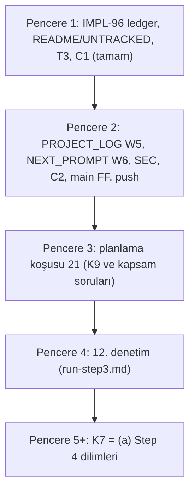

# NEXT_PROMPT — ishtar (yeni oturum için)

> **Kullanım notu:** Yeni pencereyi depo kökünde (`C:\Users\ahmet\Documents\Projeler\ishtar`) aç, omp'u buradan başlat, iki `---` çizgisi arasını ilk mesaj olarak yapıştır.
> 2026-11-13'te, Pencere 1 kapanışında yeniden yazıldı. Bu pencere **Pencere 2 — Kapanış ve yayın**'ı yürütür (`ORCHESTRATION_PLAN.md` §6). Bu bir özettir: nihai kaynak dosyalardır. Plan durumu, görevleri ve sözleşmeyi (Ek A) tutar; kanonik kayıt `Planner-docs/Planing-Ledger.md`, tarihçe `PROJECT_LOG.md`.

---

## 0. Rol, proje kimliği ve ilk kurallar

Bu projede çalışmaya devam ediyorsun. `ishtar`, kullanıcının kendi Xiaomi 13 Ultra'sı (SM8550, Sony IMX989) için root tabanlı kamera özelleştirmesidir: `ishtar-cam-modes` KernelSU modülü (v2.2, versionCode 13), `ishtar-aon-fix` (v1.1) ve yapılandırılmış AGC (Google Camera portu `org.codeaurora.snapcam`). Yöntem: ikili dosya sökümü (disassembly), md5 korumalı offset tablosu, bind-mount. Bu işlerin hepsi AOSPA Android 15 (Vauxite) üzerinde kuruldu ve ölçüldü.

**2026-11-13 dönüm noktası.** Kullanıcı ROM derleme fikrinden vazgeçti; telefon HyperOS 4 çalıştırıyor (`OS4.0.0.44.WMACNXM`). Bu **gözlemlendi** (2026-11-13); ROM 2026-09-23 derlemesi. Aynı gün salt-okunur ölçüldü (`snapshots/20261113-1819__IMPL96__hyperos4-readonly-probe.txt`):
- Kamera HAL'i (`camera.qcom.so`) farklı bir ikili; AOSPA'daki 16 noktalı 50MP yaması uymaz.
- IMX989 sensör dosyası AOSPA'dakiyle aynı.
- Projenin modülleri kurulu değil; AGC'nin yamasız V9.6 sürümü kurulu.

Bu olgular Pencere 1 açılışında (2026-11-13 17:22–17:25 UTC, salt-okunur) yeniden okundu; Ek A OPN satırı. Faz 7/8'in (kiralık sunucuda derleme, Android 16 kamera işi, kernel LTS) amacı kalmadı; resmî kapanışı planlama koşusu 21 yapacak.

**Üç ilke:**
1. **Her pencere planın tek fazını yürütür.** Faz, `ORCHESTRATION_PLAN.md` §1'deki ilk `pending` satırdır. Plan durumu, görev tablosunu ve sözleşmeyi (Ek A) tutar. Bu dosya yalnız giriş özetidir.
2. **İlk kural:** süreklilik sohbette değil, depodaki dosyalardadır. Prompt ile dosya çelişirse dosya kazanır; çelişkiyi kullanıcıya söyle.
3. **Cihazın tek doğru kaynağı cihazdır;** iddia yalnız ölçümle kurulur.

Kullanıcıyla **Türkçe** konuş. `Planner-docs/` ve `docs/` gövdeleri İngilizce'dir (ClaudeQB sözleşmesi). `ishtar-cam-modes/` içindeki kullanıcı yüzeyleri (`Kullanim.txt`, `webroot/index.html`, `module.prop`) bilinçli olarak TR/EN'dir (`Main-Planing.md` R11).

## 1. Süreklilik sistemi ve adlandırma

ClaudeQB adımları: Step 1 (ana plan) → Step 1.5 (otopsi, ontoloji, kavrayış) → Step 2 (alt planlar) → Step 3 (denetim) → Step 4 (uygulama koşuları). Değişen alt plan, Step 3 denetimi onu okumadan Step 4 kuyruğuna girmez. Kimlikler: `IMPL-NN` uygulama koşusu, `DEC-NN` karar, `FIND-…` bulgu, `AUDIT-FIX-NN` denetim bulgusu, `Faz n.m` / `Fn.m-NN` alt plan ve iş kalemi (şema ve sözlük: PROJECT_LOG §10). Durum yalnız sabit sözlükten yazılır (`planned`, `ready`, `ready_with_warnings`, `in_progress`, `implemented`, `verified`, `blocked`, `superseded`); bileşik değer ayrıştırıcıyı bozar (`AUDIT-FIX-11`).

| Seri | Son | Sıradaki |
|---|---|---|
| Uygulama koşusu | `IMPL-96` (2026-11-13, Pencere 1, C1) | **`IMPL-97`** (Pencere 5+) |
| Planlama koşusu | 20 (2026-09-14) | **21** (Pencere 3) |
| Step 3 denetimi | 11. (2026-09-14, `PASS_WITH_WARNINGS`) | **12.** (Pencere 4) |
| Karar | `DEC-32` (ledger §8'e Pencere 1'de yazıldı) | **`DEC-33`** (sonraki boş numara) |

Karar eşlemesi (plan §2; Pencere 1'de kaydedildi): `DEC-27` depo taşıma; `DEC-28` ROM derleme bırakıldı, HyperOS 4; `DEC-29` K1 (`Kullanim.txt`); `DEC-30` K5+K6 (üç depo silinir); `DEC-31` K8 (kimlik redaksiyonu); `DEC-32` K7 = (a).

**Pencere N** = `ORCHESTRATION_PLAN.md` §1'deki faz numarası (Pencere 0–5+). Bu, ClaudeQB'nin "Faz n" (proje fazları 1–9) ve bu oturumun `O0`–`O5` orkestrasyon aşamalarından **ayrıdır**. Tek başına "Faz N" hep ClaudeQB proje fazıdır; alt plan `Faz n.m`, iş maddesi `Fn.m-NN`. `50MP-Entegrasyon-Plani.md`'deki ClaudeQB öncesi "Faz 10" ayrı bir numaralamadır (PROJECT_LOG §3.4). Görev kimlikleri (`W1`–`W6`, `T3`, `I1`, `REV`, `SEC`) ve Ek A olgu kimlikleri (`G`, `D`, `V`, `REL`, `T3`, `TRAP`, `M1`, `E`, `AUD11`, `OPN`) yalnız plana aittir; Ek A'daki `K3` ve `K4` satırları kullanıcı karar etiketlerini (`K1`–`K9`) yeniden kullanır, plana özgü değildir. `R1`–`R12` Main-Planing risk kimlikleridir (plan §3, Adlandırma).

| Dosya | Rol |
|---|---|
| `ORCHESTRATION_PLAN.md` | **Pencere planı** (kök, LF): §0 protokol, §1 durum, §2 kararlar, §3 kurallar, §4–§9 pencereler, §10 kapsam dışı bulgular, Ek A sözleşme (kimlikler, olgular, ledger çapaları, push kuralları). C0 commit'i ile eklendi; Pencere 1'de §1, §3 (Adlandırma), §5.1 (W3 `:143` ve W4 `:61` hedefleri), §6 (W5, SEC ve sıra), §10, Ek A.2, A.4 notu ve A.5 (sıra) güncellendi |
| `Planner-docs/Planing-Ledger.md` | **Kanonik kayıt** (CRLF, 653 satır): §2 planlama koşuları, §4 durum matrisi, §5 IMPL satırları (IMPL-96 eklendi), §6 durum (dated notlar), §7 yeniden planlama girdileri (`DEC-28` üst girdisi), §8 kararlar (`DEC-27`…`DEC-32` eklendi, `DEC-01` güncellendi). Pencere 2'de **düzenlenmez** |
| `PROJECT_LOG.md` | Proje günlüğü (özet): §2 durum (§2.1 K4 temizliği, §2.3 HyperOS 4 ölçümü), §4 kararlar, §8 bayat belgeler, §10 şema, §11 oturum günlüğü. Pencere 2'de W5 ile bayat ifadeleri düzeltilir |
| `NEXT_PROMPT.md` | Bu dosya; her pencere sonunda sıradaki pencere için yeniden yazılır |
| `snapshots/20261113-1819__IMPL96__hyperos4-readonly-probe.txt`, `…-1821__IMPL96__hyperos4-smoke-baseline.txt` | HyperOS 4'ün ilk ölçümü (commit `70946ff`; probe satır 42, 190, 191 redakte). Snapshot adındaki saat güvenilmez (UTC ya da UTC+3; bu çiftte UTC+3); esas olan başlıktaki UTC zaman damgasıdır: smoke'ta `taken` satırı, probe'da 1. satır (E7) |
| `Planner-docs/Main-Planing.md`, `Sub-Planing-Index.md`, `Faz-*-Plans/`, `Project-Ontology.md` | 9 faz ve R1–R12; 42 alt planın haritası; alt planlar; sözlük ve §7'de 11 değişmez. Faz 7/8 artık amaçsız (Pencere 3) |
| `Planner-docs/Sub-Planing-Audit.md` | 11. denetim. Kuyruğu (`Faz7.2` → `7.3` → `8.1` → `8.3`) 2026-11-13'ten beri geçersiz; 12. denetim Pencere 4 |
| `docs/build-environment.md`, `docs/pre-rental-plan.md` | Kiralama runbook'u ve planı; başlarında "Historical as of 2026-11-13" notu (commit `03b0898`) |
| `docs/rom-build-device-notes.md` | AOSPA A15'in 2026-09-20 ölçümü; §10'da 2026-11-13 notları. Açık girdi `:79-84` (K3) IMPL-96 satırında kapandı; kapanış notu `:239-240` (§10) |
| `docs/agc-12mp-configuration.md`, `docs/recovery-runbook.md`, `docs/release-checklist.md`, `docs/release-manifest.md` | AGC pin kaydı; kurtarma yolu; C/PC kontrol listesi; üretilmiş manifest (elle düzenlenmez). Hepsi AOSPA A15 dönemi. `release-checklist.md:165` ve `agc-12mp-configuration.md:202` Pencere 1'de T3 ile düzeltildi |
| `scripts/smoke.sh`, `ishtar-cam-modes/post-fs-data.sh` | Salt-okunur cihaz enstrümanı (alanları modül kuruluyken anlamlı); modülün boot betiği ve md5 korumaları |
| `README.md`, `UNTRACKED-BY-DESIGN.md` | Pencere 1'de W3/W4 ile düzeltildi; kalan kayma plan §10'da (`README.md` ve `UNTRACKED-BY-DESIGN.md` için Pencere 1 keşif listesi) |
| `../ishtar-arsiv/` (repo dışı) | Yedekler: `impl-96-unredacted.bundle` (redakte edilmemiş dal ucu, §3), iki açık deponun aynaları |
| `C:/Users/ahmet/.claude/plugins/cache/claudeqb/claudeqb/0.2.1/skills/claudeqb/` | `SKILL.md`, `scripts/validate_planner_docs.py`, `references/handoffs/run-step2.md`, `run-step3.md`, `run-step4.md` |

## 2. Okuma sırası

Pencere 2 başında (plan §0 adım 1):
1. `NEXT_PROMPT.md` (bu dosya), sonra `ORCHESTRATION_PLAN.md`.
2. `git status`, `git log --oneline -8`, `git branch -vv`.
3. Plan §0 (protokol), §1 (durum tablosu: ilk `pending` faz, Pencere 2), §3 (kurallar), §6 (Pencere 2), Ek A.2 (olgular) ve Ek A.5 (push kuralları).
4. W5 için yalnız plan §6'daki W5 satırında adı geçen PROJECT_LOG yerleri, **alıntıyla** bulunur (satır numarasıyla değil). PROJECT_LOG asla bütün okunmaz.
5. Ledger Pencere 2'de düzenlenmez; okunursa yalnız `:raw:N-M` ile. Ek A.4 çapaları Pencere 1'e aitti.

**Ledger ve büyük dosya uyarısı:** ledger satırları 1–9 KB arasındadır (en büyüğü ≈ 8,8 KB), numaralar her düzenlemede kayar. Dosyayı asla bütün okuma; `read` aracında `:raw:N-M` kullan. Değişen satır baştan sona yeniden yazılır.

## 3. Mevcut durum (2026-11-13, Pencere 1 sonu)

Ayrıntı: plan Ek A.2 (G1–G12, K4, D1–D11, V1–V3, REL, T3, TRAP, M1, E1–E13, K3, AUD11, OPN).

- **Git:** `main` 63 commit, ucu `7fa0a51` (planlama koşusu 20 + 11. denetim, değiştirilmeden). `7fa0a51` HEAD değil, `main`'in ucudur. **Push edilmedi.** Çalışma dalı **`integrate/impl-96`** = `main` üzerine `70946ff` (IMPL-96 snapshot'ları; probe satır 42, 190, 191 redakte), `03b0898` (tarihsel notlar: `docs/build-environment.md`, `docs/pre-rental-plan.md`, `docs/rom-build-device-notes.md`), `775b321` (`PROJECT_LOG.md`, `NEXT_PROMPT.md`), `b603516` (C0: `ORCHESTRATION_PLAN.md`), `c2abd46` (C0 takip commit'i) ve C1 (`IMPL-96: repository move, ROM-build retirement, HyperOS 4 baseline`; hash bu dosyaya ve plana yazılmaz, `git log --grep` ile bulunur). `587e3b5`'ten sonra hiçbir commit push edilmedi. Etiket yok (E8). Ağaç temiz olmalı.
- **Redaksiyon:** K8 (`DEC-31`) ile dal yeniden kuruldu. Eski hash'ler (`37edb5f`, `6a20999`, `fcceaab`) yalnız redakte edilmemiş bundle'da (`../ishtar-arsiv/impl-96-unredacted.bundle`, 77.094 B, sha256 `b9fa9c5cd5d0ae78f9f051ab62ecbfc2d9b2fa2fecd33f40247ef88bf58f6cd3`, `git bundle verify` OK, önkoşulu `7fa0a51`) ve yerel reflog'da durur; yeni yazılan hiçbir belge eski hash'i atamaz. Maskeli tarama: redakte değerler tüm ref'lerde 0 kez geçiyor (Ek A G11, Pencere 0 ölçümü).
- **GitHub:** `origin` özel `ahmetxa/ishtar_cam_modes` (G3); `git ls-remote origin` → `refs/heads/main` = `587e3b5` (62 commit) (G4). Silinecek üç depo Pencere 1 açılışında (2026-11-13T17:22:43Z) hâlâ `gh api` ile 200 döndü (G8, OPN); silmeyi kullanıcı yapar. Eski `ishtar-eski` remote'u yerelden kaldırıldı; tek dalı `main@f8a05ca` (IMPL-89) `main`'in atasıdır (G6). Aynalar `../ishtar-arsiv/android_local_manifests.git` ve `../ishtar-arsiv/android_device_xiaomi_ishtar.git` (`git fsck` exit 0; G9).
- **Silinecek depolar (K5/K6, `DEC-30`):** `ahmetxa/ishtar` (özel), `ahmetxa/android_local_manifests` (açık), `ahmetxa/android_device_xiaomi_ishtar` (açık). Üçü de Pencere 1 açılışında 200; silme ölçümü `gh api repos/ahmetxa/<ad>` ile yapılır (404 = silinmiş).
- **Ledger (IMPL-96 ile eklenenler; Pencere 1 kapanışı, CRLF, 653 satır):** §5'te IMPL-96 satırı (record-only; hiçbir alt plan ve durum değişmedi); §6'da dört paragrafa tarihli not (depo, v2.2/13, cihaz, derleme); §4'te `Faz6.1`, `Faz7.2`, `Faz7.3`, `Faz8.1`, `Faz8.3` hücrelerine tarihli not (durumlar değişmedi; `Updated At` 2026-11-13; `Faz7.2` Run ID'sine `IMPL-94` eklendi); §7'de üst girdi `DEC-28` (eski girdilere kapanış notları; vendor-blob tetikleyicisi ateşlendi); §8'de `DEC-27`…`DEC-32` satırları; `DEC-01`'de `Previous status, kept:`; `DEC-07`, `DEC-08`, `DEC-22`, `DEC-24`, `DEC-25`, `DEC-26` için "moot by `DEC-28`" notları. K3 IMPL-96 satırında kapandı.
- **Plan:** 42 alt plan değişmedi: 34 `verified`, 3 `implemented` (`Faz4.6`, `Faz6.1`, `Faz8.1`), 3 `planned` (`Faz7.2`, `Faz7.3`, `Faz8.3`), 2 `superseded` (`Faz4.1`, `Faz4.7`). IMPL-96 yalnız kayıttır. Doğrulayıcı taban değeri (V1): `error_count=0`, `warning_count=1` (`P2:1,P3:9`), `subplan_count=42`. 11. denetim `PASS_WITH_WARNINGS`; kuyruğu ROM derlemesine bağlıydı, 2026-11-13'ten beri geçersiz (AUD11, `DEC-28`). Ledger'da açık kararlar: `DEC-09` (koşullu), `K9` (Pencere 3).
- **Telefon (`dc27e5d0`; ölçüm kapsamı sütunda):**

| Konu | Değer | Kapsam |
|---|---|---|
| ROM | HyperOS `OS4.0.0.44.WMACNXM`, Android 17 (SDK 37), güvenlik yaması 2026-09-01; vendor/odm parmak izi `Xiaomi/ishtar/ishtar:13/TKQ1.221114.001/OS4.0.0.44.WMACNXM:user/release-keys`; build `CP2A.260605.016`; vendor yaması 2026-02-01 | ölçüldü (D1, D2, D11; Pencere 1 açılışında yeniden okundu, OPN) |
| Kernel / root | `5.15.215-KylinKernel-260925-Release`; SELinux Enforcing; `su` bağlamı `u:r:ksu:s0`; verifiedbootstate `orange`; KernelSU `4.3.0-r1` (`ksud 4.3.0-r1 (uapi: 6)`) | ölçüldü (D3; `ksud` Pencere 1 açılışında yeniden okundu) |
| Kamera HAL | `/odm/lib64/hw/camera.qcom.so` md5 `2a955e68ad043380675529edb64a40f7`, 27.305.440 B; AOSPA stoku `c3fa63a8…` (27.268.688 B) değil | ölçüldü (D4; Pencere 1 açılışında yeniden okundu) |
| Sensör | `/odm/lib64/camera/com.qti.sensormodule.ishtar_semco_imx989_wide.bin` md5 `9e4d0fe1a8bf2eb4146c9917a0ac2c4c`, 1.062.250 B (`EXPECT_MD5` ve `EXPECT_SIZE` ile aynı) | ölçüldü (D5; Pencere 1 açılışında yeniden okundu) |
| AON | `/vendor/lib64/camera/aon_front.pb` → `/odm/lib64/camera/aon_front.pb` symlink'i ROM'da hazır | ölçüldü (D6) |
| Modüller | `ishtar_cam_modes`, `ishtar_aon_fix` kurulu değil; 13 başka modül (FreePPS, advsettings-en, box_for_root (devre dışı), NeoZygisk, unlimitedphotos ve sekiz `*-morphe` uygulama modülü) | ölçüldü (D7; `/data/adb/modules` mtime 2026-10-26, Pencere 1 açılışında yeniden okundu) |
| Kameralar | 13 aygıt (Pencere 1 açılışında yeniden sayıldı); hal0 standart akışlarda en fazla 4096x3072; 8192x6144 vendor etiketlerinde ve kullanımdan kalkmış `android.scaler.availableRawSizes`'ta | aygıt sayısı ve hal0 akış satırları ölçüldü (smoke COMPARABLE bloğu; Pencere 1 açılışında ve kapanışında baseline ile aynı); 8192x6144 vendor etiketi taraması **yalnız probe snapshot'ında** (D8) |
| AGC | `org.codeaurora.snapcam` versionName `8.4.300.414775575.18` = yamasız `AGC8.4.300_V9.6_snap.apk` (md5 `fa4066eb…`); `pref_camera_resolution=full` → 12,58 MP türetiliyor (4096x3072); **`prefs.trap.armed = 10`** (değer 37); `agc.pref_48m` yok | ölçüldü (D9; Pencere 1 açılışında yeniden okundu; smoke COMPARABLE bloğu 15:21:35Z tabanıyla bayt-bayt aynı) |
| Diğer uygulamalar | `com.android.camera` (`1+6.4.000380.1`); `com.xiaomi.module.evaluation` 1.55 (Open Camera kimliği **AOSPA kanıtından**, `FIND-4.4-02`; probe bunu adlandırmıyor); proje kutucuk uygulaması (`com.ishtar.cammodes`) yok; `com.rifsxd.ksunext` ve `me.weishu.kernelsu` paketi yok | paket listesi ölçüldü (D10); Open Camera kimliği **AOSPA kanıtı** |
| Kod okuma (ölçülmedi) | Modül HyperOS 4'te: sensör koruması geçer (`EXPECT_MD5`), yani sensör katmanı bağlanır; HAL koruması (`post-fs-data.sh:101-107`) kapalı başarısız olur ve HAL katmanını atlar; `setmode.sh:52-58`, `:79-83` `cameraserver`, `vendor.camera-provider` ve `vendor.camera-provider-2-7-ext` servislerini durdurup başlatır; probe'da ilk iki servis çalışıyor, üçüncü yerine `vendor.camera-provider-2-7-ext-uvc` var (probe :15-18; probe'un özellik filtresi kayda alınmadı); kutucuk uzun basışı `com.rifsxd.ksunext` ister (`WebUiActivity.java:15`) | [ÇIKARIM] (M1) |

- **Sürüm:** v2.2 / versionCode 13 değişmedi; `dist/ishtar-cam-modes-v2.2.zip` md5 `e95789572311cc95266d3ab4045cdcba` (REL, E6). `Kullanim.txt` hâlâ v1.9 içeriği; K1=(b) (`DEC-29`) gereği bir sonraki sürümde düzeltilecek.
- **Eski taban (AOSPA A15) tarihseldir:** kanonik iddia `F3.11-09`, `docs/agc-12mp-configuration.md` ve `docs/rom-build-device-notes.md` §1–§9 o ROM'a aittir. AOSPA kanıtı HyperOS 4'e genellenmez, tersi de geçerli.

## 4. Sıradaki faz



### 4.1 Pencere 2 — Kapanış ve yayın (sıradaki iş)

Plan §6. Hedef: oturum belgelerinin bayat satırlarını temizlemek, NEXT_PROMPT'u koşu 21'e hazırlamak, dalı yayınlamak.

Önkoşul: Pencere 1 `done` (C1 var; `git log --grep` ile başlığından bulunur); ağaç temiz; dal `integrate/impl-96`. Pencere 2 cihaza komut göndermez; ölçülmüş olgular Ek A'dan alınır.

Görevler:
- **W5** (`ProjectLogUpdate`, `PROJECT_LOG.md`, yalnız Türkçe gövde, LF): bayat ifadeler alıntıyla bulunur, satır numarasıyla değil.
  - §1 "**2026-11-13 kullanıcı beyanı (ölçülmedi):**" → ölçüldü (`70946ff`), 2026-11-13'te gözlendi.
  - §2.3 "(yamasız APK'da bu anahtar yok)" → anahtar prefs dosyasında yok (yalnız prefs dosyasında yok; plan §10).
  - §3.5 "`origin/main`'den sonraki dört commit push edilmedi", "*(push edilmedi)*", "*(HEAD, push edilmedi)*" → yazım anındaki push durumu ve commit listesi (`7fa0a51`, `70946ff`, `03b0898`, `775b321`, C0 `b603516`, C0 takip commit'i `c2abd46`, C1 başlığıyla).
  - §4 "**Açık kararlar (2026-11-13):**" ve DEC-07/DEC-08 satırlarındaki "**AÇIK**" → konusuz (`DEC-28`).
  - §8 tablosunda IMPL-96 ile çözülen satırlar: 11. denetim "outstanding", "47 commit, 225 dosya, remote yok", "Telefon AOSPA A15 + KernelSU Next … ölçülmedi", README/UNTRACKED ve `release-checklist.md:165` satırları.
  - §9 R8 "Dosyalar farklıysa … ölçülmedi" → HAL farklı, sensör aynı (ölçüldü); K9 karar verir.
  - `docs/pre-rental-plan.md:N` ve `docs/build-environment.md:N` atıfları, `03b0898`'in eklediği sekiz satırlık not yüzünden +8 kaymış.
  - §2, §3.2 (IMPL-96 tamamlandı), §4 (`DEC-27`…`DEC-32` ledger'da).
  - §10'daki PROJECT_LOG bulguları: `PROJECT_LOG.md:823` izlenen dosya sayısı "344" → 350 (G12). `PROJECT_LOG.md:812` (`snapshots/snapshots/` anlatımı) plan §10'da açıkça W5'e atanmamış; kapsamı W5'te orkestratör kararlaştırır [ÇIKARIM].
  - Eski §11 girdilerine dokunulmaz.
  - Kabul: Türkçe, LF; kimlik değeri yok; ledger ile çelişki yok; her değişen cümle için alıntı çapası dosyada bir kez geçer.
- **W6** (`HandoffRewrite`, `NEXT_PROMPT.md`, Türkçe, LF): bu dosyayı Pencere 3 (koşu 21) için yeniden yazar. K9 ve §7'deki kapsam soruları başta; koşu 21 tuzakları (§10). Kabul: plan §3 ile tutarlı; kimlik değeri yok.
- **SEC** (`security-reviewer`, salt-okur): push'un göndereceği her şey: `origin/main..integrate/impl-96` (`7fa0a51` dahil) ve C2'ye girecek, henüz commit edilmemiş W5/W6 değişiklikleri (`git diff HEAD`). Sır, 15 haneli Luhn adayları, seri numaraları (kayıtta yalnız `dc27e5d0`), sunucu adresleri. Kabul: bulgu yok. Ek A.5 R-identity-check (`git log --all -p`; anahtarlı satırlar `<redacted>` olmalı; yalnız sayılar raporlanır, değerler yazılmaz) C2 ve fast-forward'dan sonra, push'tan hemen önce orkestratörce çalışır; böylece C2 de taranır.

Sıra: W5 ∥ W6 → SEC (commit'li aralık ve `git diff HEAD`) → geçitler (§8, orkestratör, faz sonunda bir kez) → C2 → `main`'in `integrate/impl-96`'ya fast-forward'ı → R-identity-check (tüm ref'ler, C2 dahil) → `git push origin main integrate/impl-96` → `git ls-remote origin` ile hash karşılaştırması.

**Onaylar (her biri ayrı, bu sırayla):**
1. **C2** `Window 2: project log sweep and handoff for planning run 21` (W5 ve W6 dosyaları, plan §1 satırı, `PROJECT_LOG.md` §11 girdisi, bu dosya). Commit kullanıcı onayıyla atılır; hash yazılmaz.
2. **Fast-forward** `main` → `integrate/impl-96` (yalnız ileri; geçmiş yeniden yazılmaz).
3. **Push** `git push origin main integrate/impl-96` (yalnız açık refspec; `--all` ve `--mirror` yok).
4. **`git ls-remote origin` karşılaştırması:** `refs/heads/main` ve `refs/heads/integrate/impl-96` hash'leri yerel hash'lerle karşılaştırılır; sonuç sohbette raporlanır ve bir sonraki pencerenin açılışında yeniden doğrulanır.

**Silinecek depolar:** `gh api repos/ahmetxa/<ad>` ile üç depo ölçülür (404 = silinmiş). Silinmişse PROJECT_LOG'a yazılır; ledger'daki `DEC-30` yürütme notu koşu 21'de eklenir.

Kabul (pencere): plan §6 kabul kriterleri; geçitler (§8) değişmez; push kararı kullanıcıdan alınmış.

### 4.2 Kullanıcıya kalan eylemler

1. **Depo silme (kullanıcı, `DEC-30`):** üç depo için iki yol.
   - GitHub'da *Settings → General → Danger Zone → Delete this repository*.
   - Ya da kullanıcı kendi terminalinde `"C:/Users/ahmet/AppData/Local/Microsoft/WinGet/Packages/GitHub.cli_Microsoft.Winget.Source_8wekyb3d8bbwe/bin/gh.exe" auth refresh -h github.com -s delete_repo` çalıştırır, tarayıcıda onaylar ve üç depoyu kendisi `gh repo delete ahmetxa/<ad> --yes` ile siler. **Ajan hiçbir depoyu silmez;** yalnız ölçer.
   - Her silmeden sonra `gh api repos/ahmetxa/<ad>` 404 vermeli. Sonuç PROJECT_LOG'a (W5 ya da sonrası) ve koşu 21 ledger'ına yazılır.
2. **Push kararı (Pencere 2):** `main` (C2'ye fast-forward edildikten sonra; şimdi `7fa0a51`) ve `integrate/impl-96`. Yalnız açık refspec: `git push origin main integrate/impl-96`; sonra `git ls-remote origin` ile hash karşılaştırması. Push öncesi R-identity-check ve güvenlik incelemesi (§8).

### 4.3 Pencere 3–5+ (özet; ayrıntı plan §7–§9)

- **Pencere 3 — planlama koşusu 21 (Step 1 + Step 2):** Açık sorular kullanıcıya **başta** sorulur: (1) K9 — 50MP HAL katmanı HyperOS 4 HAL'inde yeniden türetilsin mi (R10 bağlam riski); (2) kutucuk/WebUI zinciri (`com.rifsxd.ksunext`, bu ROM'da yok): kurulu KernelSU `4.3.0-r1` yöneticisi ve WebUI önce ölçülür; (3) yeni, korumalı AGC tuzak temizleme prosedürü kapsama girsin mi; (4) v2.3 kapsamı (`Kullanim.txt`, modül içindeki bayat yorumlar, tile-app `versionName`). Faz 7/8 "Retired 2026-11-13 by `DEC-28`" notuyla emekliye ayrılır; K7 = (a) için iki seçenek (yeni Faz 10 ya da Faz 8'in kamera yarısının yeniden hedeflenmesi) kullanıcı seçer.
- **Pencere 4 — 12. denetim (Step 3):** `run-step3.md`; yalnız `Sub-Planing-Audit.md` yazılır. Beklenen: `Faz7.2`, `7.3`, `8.1`, `8.3` SUPERSEDED; `Faz4.6` DEFERRED.
- **Pencere 5+ — K7 = (a) Step 4 dilimleri:** `run-step4.md`; 12. denetimin kuyruğu, pencere başına bir dilim; kimlikler `IMPL-97`'den devam eder.

## 5. Kullanıcı kararları

Kaynak: plan §2.

| Karar | Durum | Karar kaydı / pencere |
|---|---|---|
| K1 `Kullanim.txt` | **(b)**: bir sonraki sürümde düzeltilir | `DEC-29` (ledger §8, Pencere 1'de yazıldı) |
| K2 ROM derleme | **Bırakıldı**; telefon HyperOS 4'te, 2026-11-13'te gözlendi (ROM 2026-09-23) | `DEC-28` (ledger §8, Pencere 1) |
| K3 kernel iddiası | **Kapandı** (düştü); `docs/rom-build-device-notes.md:79-84` açık girdisi IMPL-96 satırında kapandı | IMPL-96 satırı (Pencere 1) |
| K4 temizlik | **Uygulandı** (beş öğe; PROJECT_LOG §2.1, plan Ek A K4) | IMPL-96 satırı (Pencere 1) |
| K5/K6 üç depo | **Silinecek**; silmeyi kullanıcı yapar; Pencere 1 açılışında üçü de duruyordu | `DEC-30` (ledger §8, Pencere 1); yürütme notu Pencere 2 (ölçüm) ve koşu 21 (ledger) |
| K7 HyperOS 4 yönü | **(a)**: modülü HyperOS 4'e uyarla; kapsam planlama koşusu 21'de kesinleşir | `DEC-32` (ledger §8, Pencere 1) |
| K8 probe'daki cihaz kimlikleri | **A, yürütüldü**: push'tan önce redaksiyon; push edilmemiş üç commit yeniden kuruldu; tek kayıtlı istisna (değişmez 16) | `DEC-31` (ledger §8, Pencere 1) |
| `DEC-07`, `DEC-08`, `DEC-22`, `DEC-24`, `DEC-25`, `DEC-26` | **Konusuz** (`DEC-28` ile) | §8 notları (Pencere 1); PROJECT_LOG §4 (Pencere 2, W5) |
| `DEC-09` | Koşullu; yalnız tetiklenirse | — |
| **K9** 50MP HAL yeniden türetme | **Açık**; Pencere 3'ün başında sorulur | sonraki DEC (`DEC-33` ya da sonrası) |
| **Push** `main` ve `integrate/impl-96` | **Açık**; Pencere 2'de sorulur (C2 ve fast-forward'dan sonra) | — |
| `O2` | Onaylandı | IMPL-96 satırı (Pencere 1) |

## 6. Değişmezler — asla yapma listesi

Madde 1–10, modülün ve AGC'nin AOSPA A15'te ölçülmüş kurallarıdır. HyperOS 4'te geçerlilikleri ölçülmeden varsayılmaz, ama ihlal de edilmez.

1. AGC'de 50 MP hedefini yeniden açma (`DEC-14`, Ontology değişmez 6); yalnız bir duvar hakkında yeni kanıtla. `FIND-3.10-03` bir istisnadır, yetenek değil.
2. Geniş RAW tablosunu daraltma (`IMPL-49`/`-50`).
3. `pref_camera_picturesize_back_key`'i doğrudan yazma (türetilmiş, `IMPL-52`). AOSPA pin'i: `pref_48m_key=0` + `pref_camera_resolution=full`, iki soğuk başlatma, sonra oku (`FIND-3.10-04`); prefs'e `sed -i` yok. HyperOS 4'te `agc.pref_48m` anahtarı **yok** (D9); pin yazımı yedek ve açık onay gerektirir.
4. Kökteki `.agc` dosyalarını içe aktarma; tuzak değere göre denetlenir (değişmez 8; `FIND-3.10-02` açık). HyperOS 4'te tuzaklar zaten kurulu (`prefs.trap.armed = 10`, değer 37). **Tek kayıtlı temizleme prosedürü `docs/phase3-preconditions.md:71-119`'dadır ve güvenli değildir** (TRAP): yedek adımı yok; `:99`'daki `cat /data/local/tmp/p.xml > $PREFS` yönlendirmesi orijinal dosyayı yazmadan önce keser; süzülmüş geçici dosyanın (`:96-97`) boş olmadığı hiçbir yerde denetlenmez; sahip ve SELinux etiketi AOSPA'ya özel sabit (`:83-85`, `:110`). `docs/agc-12mp-configuration.md`'de temizleme prosedürü yoktur. Temizlemek AGC tercihlerine yazmaktır: yedek + onay ister.
5. Kamera yığınını yanlış sırada yeniden başlatma: istemci HAL'den önce (değişmez 3).
6. `50mp` ↔ DCG/LN dışlamasını kaldırma: DCG için kaldırılabilir (`dcgB-m0-12bit.bin`, md5 `80b53215356c57b156f2bb2918cf067a`) ama kullanıcı korudu (değişmez 4).
7. Ölçmeden iddia bildirme: arka kamera kanıtından ön kameraya, AOSPA A15 kanıtından HyperOS 4'e genelleme yapma.
8. Sapmaları sessizce yutma (§7).
9. Depoya ya da pakete sokma: 27 MB `camera.qcom.so` (HyperOS 4'ünki dahil), `*.keystore`, `*.jks`, `*.apk`, `*.zip`, `blobs/*.bin`, `candidates/*.bin` (`.gitignore`, değişmez 9). `.gitignore`'da `*.so` kuralı yok (§10).
10. `Faz4.1`/`Faz4.7`'yi canlandırma, `Faz4.6`'yı yeni karar olmadan tamamlama; `ln2`/`ln4` çökmesi ve AGC'nin siyah videosu bilinen sınırdır (`FIND-2.3-02`, `-03`).
11. Fiziksel cihaz eylemi yapma (flaş, deklanşör, izin diyaloğu, kayıt, kurulum, modül etkinleştirme ya da devre dışı bırakma); yalnız salt-okunur adb devredilir.
12. Yanlış cihaza komut gönderme: bilgisayara birden çok cihaz bağlı olabilir; her adb komutu `-s dc27e5d0` ile, betikler `ANDROID_SERIAL=dc27e5d0` ile çalışır.
13. HyperOS 4'te onaysız ve smoke öncesi/sonrası ölçümü olmadan modül kurma, mod değiştirme, `setmode.sh` / `action.sh` çalıştırma ya da AGC tercihlerine yazma.
14. ROM ya da kernel derlemesi başlatma: fikir 2026-11-13'te bırakıldı; yeniden açmak kullanıcının yeni kararıdır.
15. Depoya sır yazma: token, anahtar, parola, sunucu adresi; imza varsayılanı adıyla anılmaz (`DEC-10`). Başka cihazların seri numaralarını kayda geçirme.
16. Git geçmişini yeniden yazma (rebase, amend, force-push): ledger commit hash'lerini anar. **Tek kayıtlı istisna K8'dir (`DEC-31`):** push edilmemiş üç commit, redaksiyon için yeniden kuruldu; başka hiçbir yeniden yazma yapılmaz.
17. GitHub'a yalnız açık refspec ile push: `git push origin main integrate/impl-96`. `--all` ve `--mirror` asla. Geçmiş GitHub MCP dosya araçlarıyla gönderilmez (§10). Silinmesine karar verilen depolara push yapılmaz; `ahmetxa/ishtar_cam_modes` özel kalır.
18. `Kullanim.txt`, sürüm yerlerini (`module.prop`, `customize.sh`, `CHANGELOG.md`) ve `docs/release-manifest.md`'i sürüm prosedürü dışında değiştirme.
19. Redakte edilmiş kimlik değerlerini hiçbir dosyaya, rapora ya da mesaja yazma. Değerlerin yerine anahtarı ve satırı yaz (IMEI ve `persist.sys.miui.sno`). Redaksiyonsuz özgün yalnız `../ishtar-arsiv/impl-96-unredacted.bundle`'da ve yerel reflog'da durur; bu değerleri geri kazanmaya çalışma. Push öncesi kontrol R-identity-check'tir (§8); yalnız geçti/kaldı, `<redacted>` dışında kalan anahtar satır sayısı ve Luhn adayı sayısı raporlanır; değerler hiçbir çıktıya yazılmaz.

## 7. Çalışma disiplini

- **Pencere protokolü (plan §0):**
  1. **Açılış:** `NEXT_PROMPT.md` → `ORCHESTRATION_PLAN.md`; `git status`, `git log --oneline -8`, `git branch -vv`; §1'deki ilk `pending` fazı ve bölümünü oku; önkoşul tutmuyorsa başlamadan kullanıcıya söyle.
  2. **Yürütme:** yalnız o fazın görev tablosu. Orkestratör planlar, dağıtır, entegre eder, doğrular; alt ajan kuralları plan §3'te.
  3. **Doğrulama:** fazın kabul kriterleri ve plan §3'teki geçitler. Kırmızı bir ağaçla kapanış yapılmaz.
  4. **Kapanış (R-closing):** pencerenin bütün dosyaları tek kapanış commit'inde (işin dosyaları, `ORCHESTRATION_PLAN.md` §1 satırı, `PROJECT_LOG.md` §11 girdisi, bu dosya); §1'deki satır `done` olur ve commit'i **başlığıyla** anar (`git log --grep`), hash yazılmaz (commit kendi hash'ini içeremez). Ek olarak §2, §3.2, §4 gerekirse güncellenir; bu dosyanın §3–§5 ve §11'i sıradaki faza göre yeniden yazılır. Diff kullanıcıya gösterilir, onayla commit edilir, yeni pencere önerilir.
  5. **Faz bir pencereye sığmazsa:** doğrulanmış bir noktada dur; §1'e `in_progress` ve kalan işi yaz; bu dosyayı güncelle; onayla commit et.
  6. `local://` taslakları pencereler arasında **taşınmaz**. Bir taslak ya aynı pencerede tüketilir ya da depodaki bir dosyaya yazılır.
- **Alt ajan sınırı (plan §3):** her ajan yalnız sahip olduğu dosyaya yazar; başka dosyada sorun görürse raporlar. Doğrulayıcı, test ya da format ajanlar tarafından çalıştırılmaz. Aynı anda en fazla 4 uygulama ajanı.
- **Öncelik:** depo ledger'a üstündür; çelişki kaydedilir (ledger §1).
- **Kayıt:** koşu sonunda ledger §5'e tek satır (kanıt dosya adlarıyla); değişen §4 satırı; eski durum **`Previous status, kept:`** ile §8'de tutulur; §6'da değişiklikler **tarihli `Superseded …` notlarıyla** (ör. `**Superseded on one point …**`) eklenir (`Previous, kept` biçimi kullanılmaz). Uygulama koşusu alt plan değiştirmez. Pencere 2 ledger'a yazmaz (W5 PROJECT_LOG'da çalışır).
- **Bayt kuralları:** ledger CRLF, bayt olarak ve benzersiz çapayla düzenlenir; boru sayısı korunur (§4 satırları 10, §8 satırları 7 boru). Alt planlar, `docs/`, `README.md`, `UNTRACKED-BY-DESIGN.md` ve kökteki belgeler LF; satır sonu dönüştürme yok; Ontology bayt-korumalıdır (`AUDIT-FIX-22`).
- **Ölçüm:** cihaz değişikliği `smoke.sh` ile önce ve sonra ölçülür; yalnız `BEGIN COMPARABLE`…`END COMPARABLE` karşılaştırılır. Öngörü ve karar kuralı önceden yazılır. Snapshot adı `YYYYMMDD-HHMM__<etiket>__<açıklama>`; ad saati güvenilir değildir, başlıktaki `taken` (UTC) esas alınır (E7).
- **"Declare, don't absorb":** sapma ledger'a ya da yeni bir `DEC`'e yazılır; kullanıcı hükmeder.
- **Commit:** kanıt ve değişiklik tek açıklayıcı mesajla, yalnız onayla. Ledger, denetim, `Main-Planing.md`, `CHANGELOG.md`, sürüm yerleri, `.gitignore` ve git işlemleri alt ajana verilmez.
- **ClaudeQB oturumları:** Step 4 için `/claudeqb:claudeqb Read and return the exact canonical handoff from references/handoffs/run-step4.md, then execute it.`, Step 3 için `run-step3.md`. Önkoşul: strict doğrulayıcıda `p0_findings=0`, `p1_findings=0`. 11. denetimin §14 kiralama promptu kullanılmaz.

## 8. Doğrulama komutları

```bash
py -3 C:/Users/ahmet/.claude/plugins/cache/claudeqb/claudeqb/0.2.1/skills/claudeqb/scripts/validate_planner_docs.py --root . --mode step4 --strict
py -3 scripts/build-release.py --self-test
ANDROID_SERIAL=dc27e5d0 MSYS_NO_PATHCONV=1 "C:/Program Files/Git/bin/bash.exe" scripts/smoke.sh -o AD
```

| Komut | Beklenen (2026-11-13, Pencere 1 açılışı ve sonrası) |
|---|---|
| Doğrulayıcı `--mode all` | `error_count=0`, `warning_count=1` (`step4_has_nonblocking_warnings=P2:1,P3:9`), `p0_findings=0`, `p1_findings=0`, `subplan_count=42`, `secret_findings=0` |
| Doğrulayıcı `--mode step4 --strict` | Yalnız bilinen `strict_warning=step4_has_nonblocking_warnings=P2:1,P3:9`: **beklenen taban değer, regresyon değil**; geçit `p0_findings=0`, `p1_findings=0` |
| `--self-test` | `SELF-TEST: PASS`; VAL-BUILD2 sha256 `407fb9be180d96ff0fc6d409d27ad35d4b3de10e0ea3dea8e53a1daee33cb2e0`; A1, A2, A3 PASS; yalnız geçici dizinlere yazar |
| `smoke.sh` (HyperOS 4, modül yokken) | `agc.apk.md5 = fa4066eb…`, `prefs.trap.armed = 10`, `agc.pref_48m = absent`, `agc.pref_resolution = full`, `agc.photo_size.back.derived = 4096x3072`. `sensor.*`/`hal.*` alanları geçersiz (`d41d8cd9…` boş girdinin md5'i) |

Pencere 2'de doğrulayıcı ve self-test yalnız faz sonunda bir kez, orkestratör tarafından çalıştırılır (plan §3); alt ajan çalıştırmaz. `smoke.sh` Pencere 2'de çalıştırılmaz: pencere cihaza komut göndermez (§4.1).

**R-identity-check (push öncesi; `ORCHESTRATION_PLAN.md` Ek A.5):** `git log --all -p` ile her ref'te ve izlenen dosyalarda `persist.sys.miui.sno` ile `ro.ril.miui.imei0`/`imei1` anahtarlı her satır `<redacted>` olmalı; Luhn denetimini geçen 15 haneli sayı bulunmamalı. Değerler bu dosyaya ya da herhangi bir çıktıya yazılmaz, geri kazanılmaya çalışılmaz. Raporlanan: geçti/kaldı, `<redacted>` dışında kalan anahtar satır sayısı ve Luhn adayı sayısı. Sıra (§4.1): SEC, C2'den önce `origin/main..integrate/impl-96`'yı (`7fa0a51` dahil) ve commit edilmemiş W5/W6 diff'ini inceler; bu kontrol C2 ve fast-forward'dan sonra, push'tan hemen önce çalışır.

`smoke.sh -o` yalnız **ad** alır ve `snapshots/` önekini kendisi ekler (`scripts/smoke.sh` `:38`, `:284`); önek verilmez. Bu hata Pencere 1'de T3 ile düzeltildi: `docs/release-checklist.md:165` ve `docs/agc-12mp-configuration.md:202` artık `-o <ad>` veriyor; doğru biçim `docs/release-checklist.md:414`. Düz `py -3 scripts/build-release.py` `docs/release-manifest.md`'nin üzerine yazar; sürüm prosedürü dışında çalıştırılmaz.

## 9. Ortam

- **İşletim sistemi:** Windows (win32 10.0.28000), NTFS; WSL yok; ROM derleme yok.
- **Python:** `py -3` = CPython 3.14.10; `python`/`python3` bu kabukta Store stub'ıdır.
- **Git Bash:** `C:/Program Files/Git/bin/bash.exe`; `smoke.sh` bununla, `MSYS_NO_PATHCONV=1` ve `ANDROID_SERIAL=dc27e5d0` ile çalışır.
- **adb:** `platform-tools/adb.exe` 37.0.1 (vendored, PATH'te başka adb yok). 2026-11-13'te bilgisayara üç cihaz bağlıydı (ishtar `dc27e5d0`, başka bir telefon, bir emülatör).
- **Telefon:** HyperOS 4, KernelSU `4.3.0-r1`; `su` kabukta çalışıyor.
- **GitHub CLI:** `gh` 2.100.0 PATH'te değil ama tam yolla çalışıyor ve `ahmetxa` olarak giriş yapmış: `C:/Users/ahmet/AppData/Local/Microsoft/WinGet/Packages/GitHub.cli_Microsoft.Winget.Source_8wekyb3d8bbwe/bin/gh.exe`. Kapsamlar: `repo`, `workflow`, `gist`, `read:org` (`delete_repo` yok).
- **Git kimlik yardımcısı:** Git Credential Manager; push Pencere 2'de onaylandıktan sonra çalıştırılır ve `git ls-remote origin` ile doğrulanır.
- **git-lfs** 3.8.1 kurulu, kullanılmıyor.

## 10. Bilinen tuzaklar

- `python` Store stub'ıdır, `py -3` kullan. Doğrulayıcı depoda yok; `SKILL.md`'deki `python3` komutu burada çalışmaz.
- **`local://` taslakları pencereler arasında taşınmaz;** bir sonraki pencere onları göremez. Taslak aynı pencerede tüketilir ya da depoya yazılır.
- **`smoke.sh` `-s` seçeneğine sahip değil.** Birden çok adb cihazı bağlıyken `ANDROID_SERIAL` verilmezse alanlar boş kalır ve betik yine 0 ile çıkar [ÇIKARIM]. Her komutu `ANDROID_SERIAL=dc27e5d0` ile çalıştır; `adb devices -l` ile kontrol et.
- **`smoke.sh -o` hatası düzeltildi (Pencere 1, T3):** `-o` yalnız ad alır; `docs/release-checklist.md:165` ve `docs/agc-12mp-configuration.md:202` artık ad veriyor. Bu satırlar yeniden `snapshots/` önekiyle yazılmamalı.
- **Snapshot adlarındaki saat güvenilir değildir (E7):** ad, operatörün yazdığı saattir (UTC ya da UTC+3; güvenilmez); esas olan başlıktaki UTC zaman damgasıdır (smoke'ta `taken`, probe'da 1. satır). README'deki "UTC" ifadesi Pencere 1'de bu kurala göre düzeltildi.
- **Scout ajanlarının kabuğu yoktur** (bash, py yok): bayt sayımı, md5 ve git ölçümleri orkestratörde betiklerle yapılır; alt ajana "ölçtüm" diye iş verilmez.
- **`.gitignore`'da `*.so` ya da `camera.qcom.so` kuralı yok;** değişmez 9 yalnız build-release A2 kontrolü ve disiplinle korunuyor. HyperOS 4 HAL'i analiz için kopyalanacaksa (K9) önce kural eklenmesi önerilir.
- `smoke.sh` modül kurulu değilken `sensor.*`/`hal.*` için anlamsız değer üretir; gerçek md5'ler probe snapshot'ındadır.
- `dumpsys media.camera`'da statik metadata "Camera HAL device … static information" bölümlerindedir ("dynamic info" başlıklarında değil).
- Ledger satırları 1–9 KB (en büyüğü ≈ 8,8 KB): `:raw:N-M` ile parça parça oku; numaralar kayar.
- `Project-Ontology.md`'de 2 NUL bayt var: `grep` sessizce sonuç vermeyebilir (`AUDIT-FIX-22`).
- Cihaza dair belgelerin çoğu AOSPA A15 dönemine aittir; bayat belgelerin listesi PROJECT_LOG §8.
- **Koşu 21 doğrulayıcı tuzakları:** Faz 7/8 satırlarını silmek `extra_phase_folder_without_main_phase` uyarısı üretir (`--strict` bunu hataya çevirir); emekli edilenler yerinde, tarihli notla kalır. `superseded` durumu `Superseded By` alanı dolu olmadan geçmez. Doğrulayıcı denetim durumunu dosyadaki **ilk `status:` eşleşmesinden** okur; başlıkta eski denetimin durumu alıntılanmaz.
- **GitHub'a geçmiş aktarımı yalnız kabuktan `git push origin main integrate/impl-96` ile yapılır.** GitHub MCP'nin `push_files` / `create_or_update_file` araçları yeni API commit'leri üretir; hash'ler değişir ve ledger atıfları kırılır. Push'tan sonra `git ls-remote origin` ile hash karşılaştırılır.
- **Plan §10'daki kapsam dışı bulgular** (ledger kayma listesi, `docs/patch-table-format.md:57`, `docs/recovery-runbook.md:68-70`, modül içi bayat yorumlar, `build-release.py --self-test` geçici dizinleri, `docs/agc-12mp-configuration.md:380-381`, `README.md` ve `UNTRACKED-BY-DESIGN.md`'deki Pencere 1 keşif listesi, AGC ve Open Camera `lastUpdateTime` tarihi, probe'daki vendor etiketi notu) Pencere 1'de **düzeltilmedi**. PROJECT_LOG kayması W5 (Pencere 2) ile ele alınır; kalanı koşu 21 ya da 12. denetimde ele alınır. Tam liste plan §10'dadır; bu dosya yalnız özetler.

## 11. İlk mesajda ne yapmalı

1. Bu dosyayı, sonra `ORCHESTRATION_PLAN.md`'yi oku. Ledger'ı açma gerekmez (Pencere 2 ledger'a yazmaz); gerekirse yalnız `:raw:` aralıklarla.
2. Kullanıcıya kısa bir Türkçe "hazırım" özeti ver: ne okudun; §3'ün neyini ölçtüğünü, neyi yalnız snapshot'tan bildiğini ve neyi kod okumadan çıkardığını ayır (ölçmediğini "teyit edilmedi" diye işaretle); sıradaki faz **Pencere 2 — Kapanış ve yayın** (§4.1); bekleyen kararlar: push (bu pencere, C2 ve fast-forward'dan sonra), K9 (Pencere 3), depo silme (kullanıcı; üçü de Pencere 1 açılışında duruyordu).
3. Kullanıcının "başla" onayıyla Pencere 2'yi yürüt (W5 ∥ W6 → SEC → geçitler). C2 commit'i, `main` fast-forward'ı ve push için her biri ayrı onay iste. Depo silme kullanıcının işidir; ajan silmez, yalnız `gh api` ile ölçer. Cihaz eylemi, AGC tercihlerine yazma ve kaynak dosya dışı her değişiklik için de onay iste. Pencere 3 ya da sonrasına kendiliğinden geçme.

**C1 notu:** C1, kullanıcı uyurken onun "soru sormadan bitir" talimatıyla, diff kullanıcıya gösterilmeden atıldı (PROJECT_LOG §11, Pencere 1 girdisi). Hazırım özetinde C1'in `git show --stat` çıktısını göster; kullanıcı isterse C1 diff'ini C2'den önce birlikte gözden geçir. Düzeltme gerekirse yeni commit'le yapılır (değişmez 16: amend yok).

---
