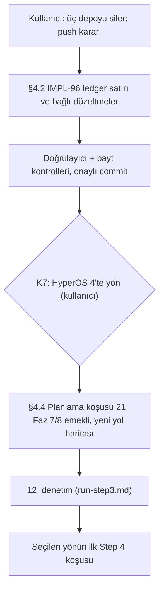

# NEXT_PROMPT — ishtar (yeni oturum için)

> **Kullanım notu:** Yeni pencereyi depo kökünde (`C:\Users\ahmet\Documents\Projeler\ishtar`) aç, omp'u buradan başlat, iki `---` çizgisi arasını ilk mesaj olarak yapıştır.
> 2026-11-13'te yazıldı; aynı gün kullanıcının K1–K6 yanıtları, `O2` onayı ve telefondaki HyperOS 4 ölçümüyle güncellendi. Bu bir özettir: nihai kaynak dosyalardır. Kanonik kayıt `Planner-docs/Planing-Ledger.md`, tarihçe `PROJECT_LOG.md`.

---

## 0. Rol, proje kimliği ve ilk kural

Bu projede çalışmaya devam ediyorsun. `ishtar`, kullanıcının kendi Xiaomi 13 Ultra'sı (SM8550, Sony IMX989) için root tabanlı kamera özelleştirmesidir: `ishtar-cam-modes` KernelSU modülü (v2.2, versionCode 13), `ishtar-aon-fix` (v1.1) ve yapılandırılmış AGC (Google Camera portu `org.codeaurora.snapcam`). Yöntem: disassemble, md5 korumalı offset tablosu, bind-mount. Bu işlerin hepsi AOSPA Android 15 (Vauxite) üzerinde kuruldu ve ölçüldü.

**2026-11-13 dönüm noktası.** Kullanıcı ROM derleme fikrinden vazgeçti; telefon artık HyperOS 4 çalıştırıyor. Aynı gün salt-okunur ölçüldü (`snapshots/20261113-1819__IMPL96__hyperos4-readonly-probe.txt`):
- Kamera HAL'i (`camera.qcom.so`) farklı bir ikili; 16 noktalı 50MP yaması uymaz.
- IMX989 sensör dosyası AOSPA'dakiyle aynı.
- Projenin modülleri kurulu değil; AGC'nin yamasız V9.6 sürümü kurulu.

Faz 7/8'in (kiralık sunucuda derleme, Android 16 kamera işi, kernel LTS) amacı kalmadı; resmî kapanışı planlama koşusu 21 yapacak.

Cihazın tek doğru kaynağı cihazdır; iddia yalnız ölçümle kurulur.

**İlk kural:** süreklilik sohbette değil, depodaki dosyalardadır. Bu prompt özettir; her kritik önermeyi önce dosyadan teyit et ("handoff'tan değil ölçümden güven"). Prompt ile dosya çelişirse dosya kazanır; çelişkiyi kullanıcıya söyle.

Kullanıcıyla **Türkçe** konuş (kullanıcı bunu açıkça istedi). `Planner-docs/` ve `docs/` gövdeleri İngilizce'dir (ClaudeQB sözleşmesi). `ishtar-cam-modes/` içindeki kullanıcı yüzeyleri (`Kullanim.txt`, `webroot/index.html`, `module.prop`) bilinçli olarak TR/EN'dir; bu bir tasarım kararıdır (`Main-Planing.md` R11).

## 1. Süreklilik sistemi

ClaudeQB adımları: Step 1 (ana plan) → Step 1.5 (otopsi, ontoloji, kavrayış) → Step 2 (alt planlar) → Step 3 (denetim) → Step 4 (uygulama koşuları). Değişen alt plan, Step 3 denetimi onu okumadan Step 4 kuyruğuna girmez. Kimlikler: `IMPL-NN` uygulama koşusu, `DEC-NN` karar, `FIND-…` bulgu, `AUDIT-FIX-NN` denetim bulgusu, `Faz n.m` / `Fn.m-NN` alt plan ve iş kalemi (şema ve sözlük: PROJECT_LOG §10). Durum yalnız sabit sözlükten yazılır (`planned`, `implemented`, `verified`, `superseded` …); bileşik değer ayrıştırıcıyı bozar (`AUDIT-FIX-11`).

| Seri | Son | Sıradaki |
|---|---|---|
| Uygulama koşusu | `IMPL-95` (2026-09-14) | **`IMPL-96`**: 2026-11-13 oturumunun ledger satırı; iş yapıldı, satır henüz yazılmadı (§4.2) |
| Planlama koşusu | 20 (2026-09-14) | **21** |
| Step 3 denetimi | 11. (2026-09-14; `7fa0a51` ile commit'lendi) | **12.** |
| Karar | `DEC-26` | **`DEC-27`**. Önerilen sıra: 27 depo taşıma, 28 ROM derlemenin bırakılması ve HyperOS 4, 29 K1, 30 K5+K6 depo silme; K7 sonraki numarayı alır |

| Dosya | Rol |
|---|---|
| `Planner-docs/Planing-Ledger.md` | **Kanonik kayıt** (CRLF): §2 planlama koşuları, §4 durum matrisi, §5 IMPL satırları, §6 durum, §7 yeniden planlama girdileri, §8 kararlar. 2026-11-13 oturumunu henüz anmıyor |
| `PROJECT_LOG.md` | Proje günlüğü (özet): §2 durum (§2.3 HyperOS 4 ölçümü), §4 kararlar, §8 bayat belgeler, §11 oturum günlüğü |
| `NEXT_PROMPT.md` | Bu dosya; bir adım temiz bitince sonraki için yeniden yazılır |
| `snapshots/20261113-1819__IMPL96__hyperos4-readonly-probe.txt`, `…-1821__IMPL96__hyperos4-smoke-baseline.txt` | HyperOS 4'ün ilk ölçümü (commit `37edb5f`) |
| `Planner-docs/Main-Planing.md`, `Sub-Planing-Index.md`, `Faz-*-Plans/`, `Project-Ontology.md` | 9 faz ve R1–R12; 42 alt planın haritası; alt planlar; sözlük ve §7'de 11 değişmez. Faz 7/8 artık amaçsız (koşu 21) |
| `Planner-docs/Sub-Planing-Audit.md` | 11. denetim. Kuyruğu (`Faz7.2` → `7.3` → `8.1` → `8.3`) ve §14 kiralama promptu 2026-11-13'ten beri geçersiz |
| `docs/build-environment.md`, `docs/pre-rental-plan.md` | Kiralama runbook'u ve planı; başlarında "Historical as of 2026-11-13" notu var (`6a20999`) |
| `docs/rom-build-device-notes.md` | AOSPA A15'in 2026-09-20 ölçümü; §10'da 2026-11-13 notları (ROM değişimi, §7 düzeltmesi, kutucuk zincirinin yönetici bağımlılığı) |
| `docs/agc-12mp-configuration.md`, `docs/recovery-runbook.md`, `docs/release-checklist.md`, `docs/release-manifest.md` | AGC pin kaydı; kurtarma yolu; C/PC kontrol listesi; üretilmiş manifest (elle düzenlenmez). Hepsi AOSPA A15 dönemi |
| `scripts/smoke.sh`, `ishtar-cam-modes/post-fs-data.sh` | Salt-okunur cihaz enstrümanı (alanları modül kuruluyken anlamlı); modülün boot betiği ve md5 korumaları |
| `C:/Users/ahmet/.claude/plugins/cache/claudeqb/claudeqb/0.2.1/skills/claudeqb/` | `SKILL.md`, `scripts/validate_planner_docs.py`, `references/handoffs/run-step2.md`, `run-step3.md`, `run-step4.md` |

**Adlandırma.** Bu projede tek başına "Faz N" her zaman ClaudeQB proje fazıdır (`Main-Planing.md` Faz 1–9; alt plan `Faz n.m`; iş maddesi `Fn.m-NN`). `50MP-Entegrasyon-Plani.md`'deki ClaudeQB öncesi "Faz 1–12" ayrı bir numaralamadır; onun Faz 10'u yalnız planlanmış, hiç yapılmamıştır (PROJECT_LOG §3.4). 2026-11-13 oturumunun orkestrasyon aşamaları `O0`–`O5` diye yazılır; o oturumun sohbetindeki "Faz 2", `O2` demekti (proje Faz 2'si 2026-09-06'da kapandı). Koşu 21 yeni bir ClaudeQB fazı açarsa adı günlüğün fazlarıyla karışmayacak biçimde seçilir. Ayrıntı: PROJECT_LOG §10.

## 2. Okuma sırası

İlk ~15 dakika:
1. `PROJECT_LOG.md` §2 (özellikle §2.1 ve §2.3), §4, §8.
2. `git status`, `git log --oneline -8`, `git branch -vv`, `git remote -v`.
3. İki HyperOS 4 snapshot'ı.
4. Ledger: §4 (satır 66–107), §5 son satır 524 (`IMPL-95`), §6 525–545, §7 547–567, §8 569–601.
5. `Planner-docs/Main-Planing.md` §6 yol haritası ve Faz 7/8 bölümleri (koşu 21 için).
6. `Planner-docs/Project-Ontology.md` §7 (satır 398–429).
7. `ishtar-cam-modes/post-fs-data.sh` ve `scripts/smoke.sh`.
8. Gerektiğinde: `docs/rom-build-device-notes.md` (§9–§10), `docs/agc-12mp-configuration.md`, `docs/recovery-runbook.md`.

**Ledger uyarısı:** satırlar 1–3 KB'dır, numaralar her düzenlemede kayar (yukarıdakiler 2026-11-13 ağacına aittir). Dosyayı asla bütün okuma; `read` aracında `:raw:N-M` (ör. `Planner-docs/Planing-Ledger.md:raw:100-101`) kullan.

## 3. Mevcut durum (2026-11-13 oturum sonu)

Ayrıntı PROJECT_LOG §2.

- **Git:** `main` 63 commit, HEAD `7fa0a51` (planlama koşusu 20 + 11. denetim, değiştirilmeden). Çalışma dalı **`integrate/impl-96`**, `main`'den 3 commit önde: `37edb5f` (HyperOS 4 kanıtı), `6a20999` (tarihsel notlar + cihaz notları) ve oturum belgeleri (`PROJECT_LOG.md`, `NEXT_PROMPT.md`). Ağaç temiz. Etiket yok.
- **GitHub:** `origin` = özel `https://github.com/ahmetxa/ishtar_cam_modes.git`; `origin/main` = `587e3b5` (62 commit, hash'ler aynı). `7fa0a51` ve dal **push edilmedi** (kullanıcı kararı). Eski `ishtar-eski` remote'u kaldırıldı.
- **Silinecek depolar (K5/K6):** `ahmetxa/ishtar`, `ahmetxa/android_local_manifests`, `ahmetxa/android_device_xiaomi_ishtar`. Silmeyi kullanıcı yapar; `gh` belirtecinde `delete_repo` yok. İki açık deponun ayna yedeği `C:/Users/ahmet/Documents/Projeler/ishtar-arsiv/` altında (`git fsck` temiz). `ahmetxa/ishtar`'ın tek dalı `main@f8a05ca` yerel geçmişte zaten var.
- **Plan:** 42 alt plan: 34 `verified`, 3 `implemented` (`Faz4.6`, `Faz6.1`, `Faz8.1`), 3 `planned` (`Faz7.2`, `Faz7.3`, `Faz8.3`), 2 `superseded` (`Faz4.1`, `Faz4.7`). 11. denetim `PASS_WITH_WARNINGS`; kuyruğu ROM derlemesine bağlıydı, artık geçersiz. Ledger'da açık kararlar: `DEC-07`, `DEC-08` (Android 16'ya bağlı, artık konusuz), `DEC-09` (koşullu).
- **Telefon (ölçüldü, 2026-11-13, yalnız `dc27e5d0`):**

| Konu | Değer |
|---|---|
| ROM | HyperOS `OS4.0.0.44.WMACNXM`, Android 17 (SDK 37), yama 2026-09-01; vendor/odm parmak izi ishtar `OS4.0.0.44.WMACNXM` |
| Kernel / root | `5.15.215-KylinKernel`; KernelSU `4.3.0-r1`, kabukta `su` çalışıyor (`u:r:ksu:s0`); SELinux Enforcing; kilit açık |
| Kamera HAL | `/odm/lib64/hw/camera.qcom.so` md5 `2a955e68ad043380675529edb64a40f7`, 27.305.440 B (AOSPA stoku `c3fa63a8…`'den farklı) |
| Sensör | `/odm/lib64/camera/com.qti.sensormodule.ishtar_semco_imx989_wide.bin` md5 `9e4d0fe1a8bf2eb4146c9917a0ac2c4c` (`EXPECT_MD5` ile aynı) |
| AON | `/vendor/lib64/camera/aon_front.pb` → `/odm/…` symlink'i ROM'da hazır |
| Modüller | `ishtar_cam_modes`, `ishtar_aon_fix` kurulu değil; 13 başka modül (FreePPS, NeoZygisk, box_for_root, Morphe uygulamaları …) |
| Kameralar | 13 aygıt; hal0 standart akışlarda en fazla 4096x3072; 8192x6144 yalnız vendor etiketlerinde |
| AGC | `org.codeaurora.snapcam` = yamasız `AGC8.4.300_V9.6_snap.apk` (md5 `fa4066eb…`); `pref_camera_resolution=full` → 12,58 MP türetiliyor; **`prefs.trap.armed = 10`** |
| Diğer | Open Camera (`com.xiaomi.module.evaluation` 1.55) ve Xiaomi kamerası kurulu; kutucuk uygulaması yok |

- **Sürüm:** v2.2 / versionCode 13, `dist/ishtar-cam-modes-v2.2.zip` md5 `e95789572311cc95266d3ab4045cdcba`. `Kullanim.txt` hâlâ v1.9 içeriği; K1=(b) gereği bir sonraki sürümde düzeltilecek.
- **Eski taban (AOSPA A15) tarihseldir:** kanonik iddia `F3.11-09`, `docs/agc-12mp-configuration.md` ve `docs/rom-build-device-notes.md` §1–§9 o ROM'a aittir.

## 4. Sıradaki faz



### 4.1 Depo: yapılanlar ve kalanlar

Yapıldı (2026-11-13): `7fa0a51` (`main`), `integrate/impl-96` dalı, `37edb5f`, `6a20999`, oturum belgeleri commit'i, ayna yedekler, `ishtar-eski` remote'unun kaldırılması.

Kalan:
1. **Silme (kullanıcı):** üç deponun her biri için GitHub'da *Settings → General → Danger Zone → Delete this repository*. Alternatif: kullanıcı kendi terminalinde `"C:\Users\ahmet\AppData\Local\Microsoft\WinGet\Packages\GitHub.cli_Microsoft.Winget.Source_8wekyb3d8bbwe\bin\gh.exe" auth refresh -h github.com -s delete_repo` çalıştırıp tarayıcıda onaylar; ardından ajan `gh repo delete ahmetxa/<ad> --yes` ile siler. Her silmeden sonra `gh api repos/ahmetxa/<ad>` 404 vermeli. Sonuç IMPL-96'ya yazılır.
2. **Push (kullanıcı kararı):** `main` (`7fa0a51`) ve `integrate/impl-96`. Yalnız kabuktan `git push`; ardından `git ls-remote origin` ile hash karşılaştırması (§10).

### 4.2 IMPL-96 ledger satırı (yeni pencerenin ilk büyük işi)

`O2` 2026-11-13'te onaylandı; bu iş onun parçasıdır. Ama ledger commit'i yine kullanıcıya gösterilip onayla atılır. Çalışma dalı `integrate/impl-96`.

**Bayt kuralları (önce bunlar):** ledger CRLF'dir. Düzenlemeden önce ve sonra CRLF satır sayısını ve NUL baytı say. Her §4 satırı 10 boru içermeli. Her çapa (değiştirilecek metin) benzersiz olmalı. Satır sonu dönüştürme yapma. `read`/`edit` aracının CRLF'yi koruduğunu ilk değişiklikten sonra bayt sayımıyla doğrula; korumuyorsa dur ve kullanıcıya söyle.

İçerik (önerilen DEC numaralarıyla; kullanıcıya teyit ettir):
1. **§5 IMPL-96 satırı** (`Run ID | Date | Sub-plan | Slice performed | Validation evidence | Outcome`). Alt plan değişmedi. Satıra girecekler:
   - Depo taşıma (`DEC-27`): özel `ahmetxa/ishtar_cam_modes`; 62 commit aynı hash'lerle (`git ls-remote origin` = `587e3b5`; kök `ff6934e` API'de); push öncesi tüm geçmişte sır taraması temiz.
   - K4 silinenleri (PROJECT_LOG §2.1).
   - `7fa0a51`: run 20 + 11. denetim, değiştirilmeden.
   - Kullanıcı hükümleri: `DEC-28` (ROM derleme bırakıldı, telefon HyperOS 4'te), `DEC-29` (`Kullanim.txt` bir sonraki sürümde), `DEC-30` (üç ROM deposu silinir; yedekler `ishtar-arsiv/`).
   - HyperOS 4 salt-okunur ölçümü (`37edb5f`): bulgular §3'teki tablodan.
   - `6a20999` ve oturum belgeleri commit'i.
   - Kanıt: snapshot adları, `ls-remote` eşitliği, yedeklerin `fsck`'si, doğrulayıcı sonucu.
2. **§4:** `Faz7.2`, `Faz7.3`, `Faz8.1`, `Faz8.3` engel ve sıradaki eylem hücrelerine "2026-11-13: ROM build abandoned (`DEC-28`); planning run 21 pending". `Faz6.1` hücresine: "HyperOS 4 carries the `aon_front.pb` vendor symlink natively (`37edb5f`); run 21 decides". Durum değerleri koşu 21'e kadar değişmez; 11. denetimin 2026-09-14'te yapıldığı kaydedilir.
3. **§6:** depo paragrafı (yeni remote, `main` 63 commit, dal) ve cihaz paragrafı (HyperOS 4 ölçümü); eski metin "Previous, kept" olarak kalır. Build-environment paragrafına "2026-11-13: derleme bırakıldı".
4. **§7:** yeni girdi "ROM build abandoned; the phone runs HyperOS 4" (`DEC-28`). Duran tetikleyici "vendor blobs change through a system update" ateşlendi (HAL `2a955e68…`). `DEC-24` ve `DEC-26` girdilerindeki "outstanding" metinleri konusuz kapanır. 2026-09-20 kernel girdisi kapanır (K3).
5. **§8:** `DEC-27`…`DEC-30` satırları; `DEC-01` satırına "superseded by `DEC-27`"; `DEC-07`, `DEC-08`, `DEC-22`, `DEC-24`, `DEC-25`, `DEC-26` satırlarına "moot by `DEC-28`".
6. **Doğrula:** §8'deki doğrulayıcı komutu (`p0_findings=0`, `p1_findings=0`, `subplan_count=42`, bilinen strict uyarısı). CRLF ve NUL sayıları değişmemiş olmalı. Sonra `git diff --stat`.
7. **Commit** (onayla): `IMPL-96: repository move, ROM-build retirement, HyperOS 4 baseline`. Ardından `integrate/impl-96` → `main` (fast-forward) ve push, her biri ayrı onayla.

### 4.3 K7 için gerçekler ve seçenekler

Kullanıcıya sorulacak tek büyük soru budur. Yönü kullanıcı seçer.

| Seçenek | Ne gerektirir | İlk somut adım |
|---|---|---|
| (a) Modülü HyperOS 4'e uyarla | Sensör katmanı (DCG/LN varyantları): blob aynı, koruma geçer; işlevsel etkisi yeni HAL/CamX ile ölçülmedi. 50MP katmanı: yeni HAL'de (`2a955e68…`) yama noktalarının baştan türetilmesi (Faz 3/4 benzeri statik analiz; R10). Kutucuk/WebUI zinciri `com.rifsxd.ksunext`'e bağlı; bu ROM'da yok (`docs/rom-build-device-notes.md` §9–§10). AON fix gereksiz. Yeni sürüm v2.3 (`Kullanim.txt` K1=(b) ile birlikte) | Önce plan (koşu 21 + denetim). Sonra kullanıcı onayıyla, smoke bracket içinde v2.2'nin yalnız sensör katmanıyla denenmesi; kurulumu kullanıcı yapar |
| (b) Yalnız AGC'yi sürdür | Yamasız V9.6 kurulu; `pref_camera_resolution=full` ile 12,58 MP türetiliyor; tuzaklar kurulu (10) | Kullanıcı AGC ile bir fotoğraf çeker, ajan IMPL-40 yöntemiyle (siyah oranı < 0.01) ölçer. Tuzakları temizlemek AGC tercihlerine yazmak demektir: yedek + `docs/agc-12mp-configuration.md` prosedürü + açık onay |
| (c) Projeyi kapat | Koşu 21'de "AOSPA A15 dönemi tamamlandı" kaydı; modüller ve belgeler arşiv olarak kalır | Koşu 21 |

Önerilen sıra (kullanıcı onaylarsa): önce (b)'nin ilk adımı (ucuz, günlük kullanım için değerli), sonra (a)'nın sensör katmanı testi. 50MP'nin yeniden türetilmesi ayrı bir karardır.

### 4.4 Planlama koşusu 21 ve 12. denetim

K7'den sonra. ClaudeQB Step 1 değişikliği; metnini kullanıcı onaylar.
- `Main-Planing.md`'de Faz 7 ve Faz 8 `DEC-28` ile emekliye ayrılır: `Faz7.2`, `7.3`, `8.1`, `8.3` → `superseded`; `Faz7.1` ve `8.2` `verified` kalır.
- R9 konusuz kapanır; R8 (tek vendor sürümüne bağımlılık) gerçekleşmiş sayılır.
- §6 yol haritası ve hedef son durum K7'ye göre yeniden yazılır. Eski Hetzner→Scaleway metin düzeltmeleri (`AUDIT-FIX-41`, `-42`, `-57`) emekliye ayrılan bölümlerle birlikte kapanır.
- `Faz6.1`'in akıbetine karar verilir (HyperOS 4'te symlink zaten var).
- Gerekirse Step 2 (yeni alt planlar), ardından `run-step3.md` ile 12. denetim.

## 5. Kullanıcı kararları

| Karar | Durum | Not |
|---|---|---|
| K1 `Kullanim.txt` | Yanıtlandı (b): bir sonraki sürüm | `DEC-29` (önerilen) |
| K2 ROM derleme | Yanıtlandı: bırakıldı; telefon HyperOS 4'te | `DEC-28` (önerilen); Faz 7/8 koşu 21'de kapanır |
| K3 kernel iddiası | Düştü | §7 girdisi kapanır |
| K4 temizlik | Uygulandı | PROJECT_LOG §2.1 |
| K5/K6 üç depo | Yanıtlandı: sil | Silmeyi kullanıcı yapar (§4.1); `DEC-30` (önerilen) |
| `O2` | Onaylandı | IMPL-96 ledger satırı kaldı (§4.2) |
| **Push** | **Açık** | `7fa0a51` ve `integrate/impl-96` |
| **K7** | **Açık** | §4.3 |
| `DEC-07`, `DEC-08` | Konusuz | `DEC-28` ile kapanır |
| `DEC-09` | Koşullu | Yalnız tetiklenirse |

## 6. Değişmezler — asla yapma listesi

Madde 1–10, modülün ve AGC'nin AOSPA A15'te ölçülmüş kurallarıdır. HyperOS 4'te geçerlilikleri ölçülmeden varsayılmaz, ama ihlal de edilmez.

1. AGC'de 50 MP hedefini yeniden açma (`DEC-14`, Ontology değişmez 6); yalnız bir duvar hakkında yeni kanıtla. `FIND-3.10-03` bir istisnadır, yetenek değil.
2. Geniş RAW tablosunu daraltma (`IMPL-49`/`-50`).
3. `pref_camera_picturesize_back_key`'i doğrudan yazma (türetilmiş, `IMPL-52`). Pin: `pref_48m_key=0` + `pref_camera_resolution=full`, iki soğuk başlatma, sonra oku (`FIND-3.10-04`); prefs'e `sed -i` yok.
4. Kökteki `.agc` dosyalarını içe aktarma; tuzak değere göre denetlenir (değişmez 8; `FIND-3.10-02` açık). HyperOS 4'te tuzaklar zaten kurulu (`prefs.trap.armed = 10`): temizlemek yazma işlemidir, onay ister.
5. Kamera yığınını yanlış sırada yeniden başlatma: istemci HAL'den önce (değişmez 3).
6. `50mp` ↔ DCG/LN dışlamasını kaldırma: DCG için kaldırılabilir (`dcgB-m0-12bit.bin`, md5 `80b53215356c57b156f2bb2918cf067a`) ama kullanıcı korudu (değişmez 4).
7. Ölçmeden iddia bildirme: arka kamera kanıtından ön kameraya, AOSPA A15 kanıtından HyperOS 4'e genelleme yapma.
8. Sapmaları sessizce yutma (§7).
9. Depoya ya da pakete sokma: 27 MB `camera.qcom.so` (HyperOS 4'ünki dahil), `*.keystore`, `*.jks`, `*.apk`, `*.zip`, `blobs/*.bin`, `candidates/*.bin` (`.gitignore`, değişmez 9).
10. `Faz4.1`/`Faz4.7`'yi canlandırma, `Faz4.6`'yı yeni karar olmadan tamamlama; `ln2`/`ln4` çökmesi ve AGC'nin siyah videosu bilinen sınırdır (`FIND-2.3-02`, `-03`).
11. Fiziksel cihaz eylemi yapma (flaş, deklanşör, izin diyaloğu, kayıt, kurulum, modül etkinleştirme ya da devre dışı bırakma); yalnız salt-okunur adb devredilir.
12. Yanlış cihaza komut gönderme: bilgisayara birden çok cihaz bağlı olabilir; her adb komutu `-s dc27e5d0` ile, betikler `ANDROID_SERIAL=dc27e5d0` ile çalışır.
13. HyperOS 4'te onaysız ve smoke bracket'ı olmadan modül kurma, mod değiştirme, `setmode.sh` / `action.sh` çalıştırma ya da AGC tercihlerine yazma.
14. ROM ya da kernel derlemesi başlatma: fikir 2026-11-13'te bırakıldı; yeniden açmak kullanıcının yeni kararıdır.
15. Depoya sır yazma: token, anahtar, parola, sunucu adresi; imza varsayılanı adıyla anılmaz (`DEC-10`). Başka cihazların seri numaralarını kayda geçirme.
16. Git geçmişini yeniden yazma (rebase, amend, force-push): ledger commit hash'lerini anar.
17. GitHub'a geçmişi MCP dosya araçlarıyla gönderme (§10); silinmesine karar verilen depolara push yapma; `ahmetxa/ishtar_cam_modes` özel kalır.
18. `Kullanim.txt`, sürüm yerlerini (`module.prop`, `customize.sh`, `CHANGELOG.md`) ve `docs/release-manifest.md`'i sürüm prosedürü dışında değiştirme.

## 7. Çalışma disiplini

- **Oturum kuralı:** her adım taze pencerede; dosya + `git status` ile başla, yalnız kendi adımını yap, raporla. Temiz bittiyse bu dosyayı sonraki adım için yeniden yaz. Bağlam çok büyürse yarıda bırakma: işi doğrulanmış bir noktada kapat, bu dosyayı güncelle ve yeni pencere öner (2026-11-13'te böyle yapıldı).
- **Öncelik:** depo ledger'a üstündür; çelişki kaydedilir (ledger §1).
- **Kayıt:** koşu sonunda ledger §5'e tek satır (kanıt dosya adlarıyla), değişen §4 satırı (eski durum "Previous status, kept"), gerekirse §6–§8. Uygulama koşusu alt plan değiştirmez.
- **Bayt kuralları:** ledger CRLF, bayt olarak ve benzersiz çapayla düzenlenir; boru sayısı korunur. Alt planlar ve `docs/` LF; satır sonu dönüştürme yok; Ontology bayt-korumalıdır (`AUDIT-FIX-22`).
- **Ölçüm:** cihaz değişikliği `smoke.sh` ile önce ve sonra ölçülür; yalnız `BEGIN COMPARABLE`…`END COMPARABLE` diff'lenir. Öngörü ve karar kuralı önceden yazılır. Snapshot adı `YYYYMMDD-HHMM__<etiket>__<açıklama>`.
- **"Declare, don't absorb":** sapma ledger'a ya da yeni bir `DEC`'e yazılır; kullanıcı hükmeder.
- **Commit:** kanıt ve değişiklik tek açıklayıcı mesajla, yalnız onayla. Ledger, denetim, `Main-Planing.md`, `CHANGELOG.md`, sürüm yerleri, `.gitignore` ve git işlemleri alt ajana verilmez.
- **ClaudeQB oturumları:** Step 4 için `/claudeqb:claudeqb Read and return the exact canonical handoff from references/handoffs/run-step4.md, then execute it.`, Step 3 için `run-step3.md`. Önkoşul: strict doğrulayıcıda `p0_findings=0`, `p1_findings=0`. 11. denetimin §14 kiralama promptu kullanılmaz.

## 8. Doğrulama komutları

```bash
py -3 C:/Users/ahmet/.claude/plugins/cache/claudeqb/claudeqb/0.2.1/skills/claudeqb/scripts/validate_planner_docs.py --root . --mode step4 --strict
py -3 scripts/build-release.py --self-test
ANDROID_SERIAL=dc27e5d0 MSYS_NO_PATHCONV=1 "C:/Program Files/Git/bin/bash.exe" scripts/smoke.sh -o AD
```

| Komut | Beklenen (2026-11-13) |
|---|---|
| Doğrulayıcı `--mode all` | `error_count=0`, `warning_count=1` (`step4_has_nonblocking_warnings=P2:1,P3:9`), `p0_findings=0`, `p1_findings=0`, `subplan_count=42`, `secret_findings=0` |
| Doğrulayıcı `--strict` | O uyarı `error=strict_warning=…` olur: **beklenen baseline, regresyon değil**; geçit `p0_findings=0`, `p1_findings=0` |
| `--self-test` | `SELF-TEST: PASS`; VAL-BUILD2 byte-identical, sha256 `407fb9be180d96ff0fc6d409d27ad35d4b3de10e0ea3dea8e53a1daee33cb2e0`; A1, A2, A3 PASS; yalnız geçici dizinlere yazar |
| `smoke.sh` (HyperOS 4, modül yokken) | `agc.apk.md5 = fa4066eb…`, `prefs.trap.armed = 10`, `agc.pref_48m = absent`, `agc.pref_resolution = full`, `agc.photo_size.back.derived = 4096x3072`. `sensor.*`/`hal.*` alanları geçersiz (`d41d8cd9…` boş girdinin md5'i) |

`smoke.sh -o` yalnız **ad** alır ve `snapshots/` önekini kendisi ekler (`scripts/smoke.sh` satır 282–285); önek verme (`docs/release-checklist.md:165` örneği yanlıştır). Düz `py -3 scripts/build-release.py` `docs/release-manifest.md`'nin üzerine yazar.

## 9. Ortam

- **İşletim sistemi:** Windows (win32 10.0.28000), NTFS; WSL yok; ROM derleme yok.
- **Python:** `py -3` = CPython 3.14.10; `python`/`python3` bu kabukta Store stub'ıdır.
- **Git Bash:** `C:/Program Files/Git/bin/bash.exe`; `smoke.sh` bununla, `MSYS_NO_PATHCONV=1` ve `ANDROID_SERIAL=dc27e5d0` ile çalışır.
- **adb:** `platform-tools/adb.exe` 37.0.1 (vendored, PATH'te başka adb yok). 2026-11-13'te bilgisayara üç cihaz bağlıydı (ishtar `dc27e5d0`, başka bir telefon, bir emülatör).
- **Telefon:** HyperOS 4, KernelSU `4.3.0-r1`; `su` kabukta çalışıyor.
- **GitHub CLI:** `gh` 2.100.0 PATH'te değil ama tam yolla çalışıyor ve `ahmetxa` olarak giriş yapmış: `C:/Users/ahmet/AppData/Local/Microsoft/WinGet/Packages/GitHub.cli_Microsoft.Winget.Source_8wekyb3d8bbwe/bin/gh.exe`. Kapsamlar: `repo`, `workflow`, `gist`, `read:org` (`delete_repo` yok).
- **Git kimlik yardımcısı:** Git Credential Manager; push çalışıyor.
- **git-lfs** 3.8.1 kurulu, kullanılmıyor.

## 10. Bilinen tuzaklar

- `python` Store stub'ıdır, `py -3` kullan. Doğrulayıcı depoda yok; `SKILL.md`'deki `python3` komutu burada çalışmaz.
- Birden çok adb cihazı: `-s`/`ANDROID_SERIAL` olmadan adb "more than one device/emulator" hatası verir ve betikler yarıda kalır. `ANDROID_SERIAL` yanlış seri numarasına ayarlıysa komutlar o cihaza gider; her oturumda `adb devices -l` ile kontrol et.
- `smoke.sh` modül kurulu değilken `sensor.*`/`hal.*` için anlamsız değer üretir; gerçek md5'ler probe snapshot'ındadır.
- `dumpsys media.camera`'da statik metadata "Camera HAL device … static information" bölümlerindedir ("dynamic info" başlıklarında değil).
- Ledger satırları 1–3 KB: `:raw:N-M` ile parça parça oku; numaralar kayar.
- `Project-Ontology.md`'de 2 NUL bayt var: `grep` sessizce sonuç vermeyebilir (`AUDIT-FIX-22`).
- Cihaza dair belgelerin çoğu AOSPA A15 dönemine aittir; bayat belgelerin listesi PROJECT_LOG §8.
- **GitHub'a geçmiş aktarımı yalnız kabuktan `git push <remote> <dal>` ile yapılır.** GitHub MCP'nin `push_files` / `create_or_update_file` araçları yeni API commit'leri üretir; hash'ler değişir ve ledger atıfları kırılır. MCP yalnız boş depo oluşturmada kullanılır. Push'tan sonra `git ls-remote` ile hash karşılaştırılır.

## 11. İlk mesajda ne yapmalı

Kullanıcıya kısa bir Türkçe "hazırım" özeti ver: ne okudun, §3'ün neyini teyit ettin (ölçmediğini "teyit edilmedi" diye işaretle), sıradaki adım (§4.2 IMPL-96 ledger satırı) ve bekleyen kararlar (push, K7; depoların silindiği teyit edilmediyse o da). Kuyruktaki ipliklere ve kararlara kendiliğinden başlama; seçim kullanıcınındır. Kullanıcının verdiği ilk somut görevi ek onay beklemeden yürüt (görevin kendisi onaydır). Görevin açıkça kapsamadığı commit, push, depo silme, cihaz eylemi ya da AGC tercihlerine yazma için yine sor.

---
