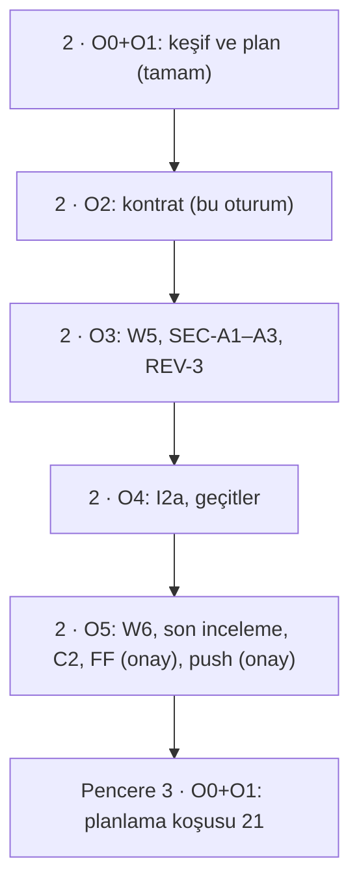

# NEXT_PROMPT — ishtar (yeni oturum için)

> **Kullanım notu:** Yeni pencereyi depo kökünde (`C:\Users\ahmet\Documents\Projeler\ishtar`) aç, omp'u buradan başlat, iki `---` çizgisi arasını ilk mesaj olarak yapıştır.
> 2026-11-14'te, Pencere 2 · O0+O1 kapanışında yazıldı. Bu oturum **Pencere 2 · O2 — Kontrat** aşamasını yürütür (`ORCHESTRATION_PLAN.md` §0, §6). Bu bir özettir: nihai kaynak dosyalardır. Plan döngüyü, durumu, görevleri ve sözleşmeyi (Ek A) tutar; kanonik kayıt `Planner-docs/Planing-Ledger.md`, tarihçe `PROJECT_LOG.md`.

---

## 0. Rol, proje kimliği ve ilk kurallar

Bu projede çalışmaya devam ediyorsun. `ishtar`, kullanıcının kendi Xiaomi 13 Ultra'sı (SM8550, Sony IMX989) için root tabanlı kamera özelleştirmesidir: `ishtar-cam-modes` KernelSU modülü (v2.2, versionCode 13), `ishtar-aon-fix` (v1.1) ve yapılandırılmış AGC (Google Camera portu `org.codeaurora.snapcam`). Yöntem: ikili dosya sökümü (disassembly), md5 korumalı offset tablosu, bind-mount. Bu işlerin hepsi AOSPA Android 15 (Vauxite) üzerinde kuruldu ve ölçüldü.

**2026-11-13 dönüm noktası.** Kullanıcı ROM derleme fikrinden vazgeçti; telefon HyperOS 4 çalıştırıyor (`OS4.0.0.44.WMACNXM`). Bu **gözlemlendi** (2026-11-13); ROM 2026-09-23 derlemesi. Aynı gün salt-okunur ölçüldü (`snapshots/20261113-1819__IMPL96__hyperos4-readonly-probe.txt`):
- Kamera HAL'i (`camera.qcom.so`) farklı bir ikili; AOSPA'daki 16 noktalı 50MP yaması uymaz.
- IMX989 sensör dosyası AOSPA'dakiyle aynı.
- Projenin modülleri kurulu değil; AGC'nin yamasız V9.6 sürümü kurulu.

Bu olgular Pencere 1 açılışında (2026-11-13 17:22–17:25 UTC) yeniden okundu (Ek A `OPN`). Pencere 2 cihaza komut göndermez: telefonun bugünkü durumu bu fazda teyit edilmedi. Faz 7/8'in (kiralık sunucuda derleme, Android 16 kamera işi, kernel LTS) amacı kalmadı; resmî kapanışı planlama koşusu 21 yapacak.

**Dört ilke:**
1. **Her oturum planın tek aşamasını yürütür** (plan §0). Aşama, `ORCHESTRATION_PLAN.md` §1'deki ilk `pending` satırdır; bu oturum için `2 · O2`. Bu dosya yalnız giriş özetidir.
2. **Süreklilik sohbette değil, depodaki dosyalardadır.** Prompt ile dosya çelişirse dosya kazanır; çelişkiyi kullanıcıya söyle.
3. **Cihazın tek doğru kaynağı cihazdır;** iddia yalnız ölçümle kurulur.
4. **Döngü (kullanıcı kararı, 2026-11-14; plan §0):** aşama beklenmedik bir durum olmadan biterse sıradaki aşamanın devir metnini bu dosyaya kendiliğinden yaz, yerel kapanış commit'ini onay sormadan at ve kullanıcıya yeni pencere açmasını söyle. Beklenmedik bir durum olursa kapanış yapma: kullanıcıya sade bir dille ne olduğunu, neden önemli olduğunu ve iki ya da üç seçeneği önerinle birlikte sor. `main`'in fast-forward'ı ve push her zaman ayrı onay ister.

Kullanıcıyla **Türkçe** konuş; soruları kısa, açık ve teknik terime boğmadan yaz. `Planner-docs/` ve `docs/` gövdeleri İngilizce'dir (ClaudeQB sözleşmesi). `ishtar-cam-modes/` içindeki kullanıcı yüzeyleri (`Kullanim.txt`, `webroot/index.html`, `module.prop`) bilinçli olarak TR/EN'dir (`Main-Planing.md` R11).

## 1. Süreklilik sistemi ve adlandırma

ClaudeQB adımları: Step 1 (ana plan) → Step 1.5 (otopsi, ontoloji, kavrayış) → Step 2 (alt planlar) → Step 3 (denetim) → Step 4 (uygulama koşuları). Değişen alt plan, Step 3 denetimi onu okumadan Step 4 kuyruğuna girmez. Kimlikler: `IMPL-NN` uygulama koşusu, `DEC-NN` karar, `FIND-…` bulgu, `AUDIT-FIX-NN` denetim bulgusu, `Faz n.m` / `Fn.m-NN` alt plan ve iş kalemi (şema ve sözlük: PROJECT_LOG §10). Durum yalnız sabit sözlükten yazılır (`planned`, `ready`, `ready_with_warnings`, `in_progress`, `implemented`, `verified`, `blocked`, `superseded`); bileşik değer ayrıştırıcıyı bozar (`AUDIT-FIX-11`).

| Seri | Son | Sıradaki |
|---|---|---|
| Uygulama koşusu | `IMPL-96` (2026-11-13, Pencere 1, C1) | **`IMPL-97`** (Pencere 5+) |
| Planlama koşusu | 20 (2026-09-14) | **21** (Pencere 3) |
| Step 3 denetimi | 11. (2026-09-14, `PASS_WITH_WARNINGS`) | **12.** (Pencere 4) |
| Karar | `DEC-32` (ledger §8'e Pencere 1'de yazıldı) | **`DEC-33`** (sonraki boş numara) |

Karar eşlemesi (plan §2): `DEC-27` depo taşıma; `DEC-28` ROM derleme bırakıldı, HyperOS 4; `DEC-29` K1 (`Kullanim.txt`); `DEC-30` K5+K6 (üç depo silinir); `DEC-31` K8 (kimlik redaksiyonu); `DEC-32` K7 = (a).

**Pencere, aşama, oturum (plan §0).** *Pencere N*, §1'deki plan fazıdır (ad tarihseldir). Her faz aşamalarla yürür: `O0` keşif, `O1` plan (kullanıcı onayına kadar), `O2` kontrat, `O3` paralel uygulama, `O4` entegrasyon ve geçitler, `O5` son inceleme ve kapanış. *Oturum* bir sohbet penceresidir: `O0`+`O1` bir oturumda, `O2`–`O5` her biri ayrı oturumda. Kimlik biçimi `Pencere 2 · O2` (kısaca `2 · O2`). Tek başına "Faz N" hep ClaudeQB proje fazıdır (1–9); alt plan `Faz n.m`, iş maddesi `Fn.m-NN`. `50MP-Entegrasyon-Plani.md`'deki ClaudeQB öncesi "Faz 10" ayrı bir numaralamadır (PROJECT_LOG §3.4). Görev kimlikleri (`W1`–`W6`, `T3`, `I1`, `REV`, `SEC`; Pencere 2'de ayrıca `K0`, `SEC-A1`–`SEC-A3`, `SEC-B`, `REV-1`–`REV-3`, `I2a`, `I2b`, `GATE`, `FIX`, `RID`, `PUSH`, `LSR`) ve Ek A olgu kimlikleri (A.2: `G`, `D`, `V`, `REL`, `T3`, `TRAP`, `M1`, `E`, `AUD11`, `OPN`; A.6: `OPN2`, `G4b`, `G8b`, `L653`, `LSH`, `SH8`, `CDATE`, `RID0`, `SEC0`, `SMK-O`) yalnız plana aittir; Ek A'daki `K3` ve `K4` satırları kullanıcı karar etiketlerini (`K1`–`K9`) yeniden kullanır. `R1`–`R12` Main-Planing risk kimlikleridir (plan §3, Adlandırma).

| Dosya | Rol |
|---|---|
| `ORCHESTRATION_PLAN.md` | **Plan** (kök, LF): §0 döngü ve protokol, §1 durum (aşama satırları dahil), §2 kararlar, §3 kurallar, §4–§9 fazlar, §10 kapsam dışı bulgular, Ek A sözleşme. Pencere 2: §6 (6.1 kararlar, 6.2 keşif envanteri ve `O2` girdileri, 6.3 aşamalar ve görevler, 6.4 sıra, kapanış başlıkları ve yeniden üretilecek girdiler); Ek A.5 kimlik kontrolü ve betiği; A.6 Pencere 2 olguları. `2 · O0+O1`'de §0, §1, §2, §3, §6, A.5 ve A.6 güncellendi |
| `Planner-docs/Planing-Ledger.md` | **Kanonik kayıt** (CRLF, 653 satır): §5'te IMPL-96 (`:525`), §8'de `DEC-27`…`DEC-32` (`:605`–`:610`). Pencere 2'de **düzenlenmez** |
| `PROJECT_LOG.md` | Proje günlüğü (özet). `2 · O3`'te W5, §1–§10'daki bayat ifadeleri düzeltir (§2.6 ve §11 hariç); her oturum sonunda §11'e girdi eklenir |
| `NEXT_PROMPT.md` | Bu dosya; her oturum sonunda sıradaki aşama için yeniden yazılır (döngü). Pencere 3 devri `2 · O5`'te (W6) yazılır |
| `snapshots/20261113-1819__IMPL96__hyperos4-readonly-probe.txt`, `…-1821__IMPL96__hyperos4-smoke-baseline.txt` | HyperOS 4'ün ilk ölçümü (commit `70946ff`; probe satır 42, 190, 191 redakte). Snapshot adındaki saat güvenilmez (UTC ya da UTC+3; bu çiftte UTC+3); esas olan başlıktaki UTC zaman damgasıdır: smoke'ta `taken` satırı, probe'da 1. satır (E7) |
| `Planner-docs/Main-Planing.md`, `Sub-Planing-Index.md`, `Faz-*-Plans/`, `Project-Ontology.md` | 9 faz ve R1–R12; 42 alt planın haritası; alt planlar; sözlük ve §7'de 11 değişmez. Faz 7/8 artık amaçsız (Pencere 3) |
| `Planner-docs/Sub-Planing-Audit.md` | 11. denetim. Kuyruğu (`Faz7.2` → `7.3` → `8.1` → `8.3`) 2026-11-13'ten beri geçersiz; 12. denetim Pencere 4 |
| `docs/build-environment.md`, `docs/pre-rental-plan.md` | Kiralama runbook'u ve planı; başlarında "Historical as of 2026-11-13" notu (`03b0898`; 8 satır, eski satır atıfları +8 kayar: Ek A.6 `SH8`) |
| `docs/rom-build-device-notes.md` | AOSPA A15'in 2026-09-20 ölçümü; §10'da 2026-11-13 notları. Açık girdi `:79-84` (K3) IMPL-96 satırında kapandı |
| `docs/agc-12mp-configuration.md`, `docs/recovery-runbook.md`, `docs/release-checklist.md`, `docs/release-manifest.md` | AGC pin kaydı; kurtarma yolu; C/PC kontrol listesi; üretilmiş manifest (elle düzenlenmez). Hepsi AOSPA A15 dönemi |
| `scripts/smoke.sh`, `ishtar-cam-modes/post-fs-data.sh` | Salt-okunur cihaz enstrümanı (alanları modül kuruluyken anlamlı); modülün boot betiği ve md5 korumaları |
| `README.md`, `UNTRACKED-BY-DESIGN.md` | Pencere 1'de düzeltildi; kalan kayma plan §10'da |
| `../ishtar-arsiv/` (repo dışı) | Yedekler: `impl-96-unredacted.bundle` (redakte edilmemiş dal ucu, §3), iki açık deponun aynaları |
| `C:/Users/ahmet/.claude/plugins/cache/claudeqb/claudeqb/0.2.1/skills/claudeqb/` | `SKILL.md`; Step 1 ve Step 2 yönergeleri (`First-Planner.md`, `Second-Planner.md`); `references/handoffs/run-step2.md`, `run-step3.md`, `run-step4.md` (Step 1 için handoff dosyası yok); `scripts/validate_planner_docs.py` |

## 2. Okuma sırası (Pencere 2 · O2)

1. Bu dosya; sonra `ORCHESTRATION_PLAN.md`: §0 (döngü), §1 (ilk `pending` satır: `2 · O2`), §3 (kurallar), §6'nın tamamı, §7 ve §10 (K0 bunları günceller), Ek A.2, A.5 ve A.6.
2. `git status`, `git log --oneline -8`, `git branch -vv`.
3. `PROJECT_LOG.md` bütün okunmaz. K0'ın envanter doğrulaması betikle yapılır (§4.1); gerekirse yalnız dar aralıklar okunur.
4. Ledger okunmaz; gerekirse yalnız `:raw:N-M`. Ek A.4 çapaları Pencere 1'e aitti; güncel satırlar için Ek A.6 `LSH`.
5. ClaudeQB dosyaları yalnız §7'ye yazılacak bir satır atfını doğrulamak gerekirse, mutlak yolla okunur.

**Büyük dosya uyarısı:** ledger satırları 1–9 KB arasındadır (en büyüğü ≈ 8,8 KB) ve numaralar her düzenlemede kayar; `read` aracında `:raw:N-M` kullan. `PROJECT_LOG.md` ≈ 1.030 satır, ≈ 140 KB.

## 3. Mevcut durum (2026-11-14, Pencere 2 · O0+O1 sonu)

Ayrıntı: plan Ek A.2 ve A.6.

- **Git:** çalışma dalı **`integrate/impl-96`**; ucu `2 · O0+O1` kapanış commit'i `Window 2 O0-O1: approved plan, discovery facts, stage-per-session loop` (hash bu dosyaya yazılmaz; `git log --grep 'Window 2 O0-O1'`). Altında C1 `IMPL-96: repository move, ROM-build retirement, HyperOS 4 baseline`, `c2abd46`, `b603516` (C0), `775b321`, `03b0898`, `70946ff`, `7fa0a51`. Dal 70 commit; `main` 63 commit (`7fa0a51`, değiştirilmedi); `origin/main` = `587e3b5` (62). Push edilmemiş 8 commit. Etiket yok. Ağaç temiz olmalı.
- **Redaksiyon:** K8 (`DEC-31`) ile dal yeniden kuruldu. Eski hash'ler (`37edb5f`, `6a20999`, `fcceaab`) yalnız redakte edilmemiş bundle'da (`../ishtar-arsiv/impl-96-unredacted.bundle`, 77.094 B, sha256 `b9fa9c5cd5d0ae78f9f051ab62ecbfc2d9b2fa2fecd33f40247ef88bf58f6cd3`, `git bundle verify` OK, önkoşulu `7fa0a51`) ve yerel reflog'da durur; yeni yazılan hiçbir belge eski hash'i atamaz.
- **GitHub:** `origin` özel `ahmetxa/ishtar_cam_modes`; `git ls-remote origin` yalnız `HEAD` ve `refs/heads/main` = `587e3b5` gösteriyor (G4b, 2026-11-14). Silinecek üç depo (`ahmetxa/ishtar` özel; `ahmetxa/android_local_manifests` ve `ahmetxa/android_device_xiaomi_ishtar` açık) 2026-11-14T07:23:21Z'de hâlâ 200 (G8b); silmeyi kullanıcı yapar, ajan yalnız ölçer (404 = silinmiş). Aynalar `../ishtar-arsiv/` altında (G9).
- **Ledger:** 653 satır, CRLF, NUL 0 (L653). C1'in eklediği 9 satır yüzünden eski atıflar kayar: `:524`'e kadar aynı, `:525`–`:548` için +1, `:549`–`:601` için +3, `:602` ve sonrası için +9 (LSH).
- **Kimlik kontrolü tabanı (RID0):** plan Ek A.5 betiğiyle, `git log --all -p` ve 350 izlenen dosya üzerinde: değer taşıyan 6 anahtar satırının hepsi `<redacted>`; Luhn adayı 0; anahtarı yalnız düzyazıda anan 9 satır (karar 5a gereği hata sayılmaz). Geçti.
- **Push aralığı ön taraması (SEC0):** 7 commit'in bütün ara hâllerinde sır, özel anahtar, parola ataması, sunucu adresi, MAC adresi ya da Luhn adayı yok; IPv4 biçimli iki eşleşme sürüm dizgisi; probe öteki telefonun serisini kaydetmemiş, emülatör yalnız adb port adıyla geçiyor. Bu bir ön taramadır; asıl inceleme SEC-A1–A3 (`2 · O3`) ve SEC-B'dir (`2 · O5`).
- **Plan:** 42 alt plan değişmedi: 34 `verified`, 3 `implemented` (`Faz4.6`, `Faz6.1`, `Faz8.1`), 3 `planned` (`Faz7.2`, `Faz7.3`, `Faz8.3`), 2 `superseded` (`Faz4.1`, `Faz4.7`). Doğrulayıcı taban değeri (V1): `error_count=0`, `warning_count=1` (`P2:1,P3:9`), `subplan_count=42`. 11. denetim `PASS_WITH_WARNINGS`; kuyruğu 2026-11-13'ten beri geçersiz (AUD11, `DEC-28`). Ledger'da açık kararlar: `DEC-09` (koşullu); K9 Pencere 3'te.
- **Pencere 2 planı (onaylı, 2026-11-14):** kararlar 1a–5a ve I2a/I2b ayrımı (plan §6.1); W5 envanteri ≈ 85 madde (plan §6.2; satır numaraları `9ee505f` ağacına göre); aşamalar ve görevler §6.3; sıra, kapanış başlıkları ve SEC/REV girdi komutları §6.4.
- **Telefon (`dc27e5d0`; son ölçüm 2026-11-13; Pencere 2'de teyit edilmedi):**

| Konu | Değer | Kapsam |
|---|---|---|
| ROM | HyperOS `OS4.0.0.44.WMACNXM`, Android 17 (SDK 37), güvenlik yaması 2026-09-01; vendor/odm parmak izi `Xiaomi/ishtar/ishtar:13/TKQ1.221114.001/OS4.0.0.44.WMACNXM:user/release-keys`; build `CP2A.260605.016`; vendor yaması 2026-02-01 | ölçüldü (D1, D2, D11; Pencere 1 açılışında yeniden okundu, OPN) |
| Kernel / root | `5.15.215-KylinKernel-260925-Release`; SELinux Enforcing; `su` bağlamı `u:r:ksu:s0`; verifiedbootstate `orange`; KernelSU `4.3.0-r1` (`ksud 4.3.0-r1 (uapi: 6)`) | ölçüldü (D3; `ksud` Pencere 1 açılışında yeniden okundu) |
| Kamera HAL | `/odm/lib64/hw/camera.qcom.so` md5 `2a955e68ad043380675529edb64a40f7`, 27.305.440 B; AOSPA stoku `c3fa63a8…` (27.268.688 B) değil | ölçüldü (D4; Pencere 1 açılışında yeniden okundu) |
| Sensör | `/odm/lib64/camera/com.qti.sensormodule.ishtar_semco_imx989_wide.bin` md5 `9e4d0fe1a8bf2eb4146c9917a0ac2c4c`, 1.062.250 B (`EXPECT_MD5` ve `EXPECT_SIZE` ile aynı) | ölçüldü (D5; Pencere 1 açılışında yeniden okundu) |
| AON | `/vendor/lib64/camera/aon_front.pb` → `/odm/lib64/camera/aon_front.pb` symlink'i ROM'da hazır | ölçüldü (D6) |
| Modüller | `ishtar_cam_modes`, `ishtar_aon_fix` kurulu değil; 13 başka modül (FreePPS, advsettings-en, box_for_root (devre dışı), NeoZygisk, unlimitedphotos ve sekiz `*-morphe` uygulama modülü) | ölçüldü (D7; `/data/adb/modules` mtime 2026-10-26, Pencere 1 açılışında yeniden okundu) |
| Kameralar | 13 aygıt; hal0 standart akışlarda en fazla 4096x3072; 8192x6144 vendor etiketlerinde ve kullanımdan kalkmış `android.scaler.availableRawSizes`'ta | aygıt sayısı ve hal0 akış satırları ölçüldü (smoke COMPARABLE bloğu); 8192x6144 vendor etiketi taraması **yalnız probe snapshot'ında** (D8) |
| AGC | `org.codeaurora.snapcam` versionName `8.4.300.414775575.18` = yamasız `AGC8.4.300_V9.6_snap.apk` (md5 `fa4066eb…`); `pref_camera_resolution=full` → 12,58 MP türetiliyor (4096x3072); **`prefs.trap.armed = 10`** (değer 37); `agc.pref_48m` prefs dosyasında yok | ölçüldü (D9; smoke COMPARABLE bloğu 15:21:35Z tabanıyla bayt-bayt aynı) |
| Diğer uygulamalar | `com.android.camera` (`1+6.4.000380.1`); `com.xiaomi.module.evaluation` 1.55 (Open Camera kimliği **AOSPA kanıtından**, `FIND-4.4-02`; probe bunu adlandırmıyor); proje kutucuk uygulaması (`com.ishtar.cammodes`) yok; `com.rifsxd.ksunext` ve `me.weishu.kernelsu` paketi yok | paket listesi ölçüldü (D10); Open Camera kimliği **AOSPA kanıtı** |
| Kod okuma (ölçülmedi) | Modül HyperOS 4'te: sensör koruması geçer (`EXPECT_MD5`), yani sensör katmanı bağlanır; HAL koruması (`post-fs-data.sh:101-107`) kapalı başarısız olur ve HAL katmanını atlar; `setmode.sh:52-58`, `:79-83` `cameraserver`, `vendor.camera-provider` ve `vendor.camera-provider-2-7-ext` servislerini durdurup başlatır; probe'da ilk iki servis çalışıyor, üçüncü yerine `vendor.camera-provider-2-7-ext-uvc` var; kutucuk uzun basışı `com.rifsxd.ksunext` ister (`WebUiActivity.java:15`) | [ÇIKARIM] (M1) |

- **Sürüm:** v2.2 / versionCode 13 değişmedi; `dist/ishtar-cam-modes-v2.2.zip` md5 `e95789572311cc95266d3ab4045cdcba` (REL, E6). `Kullanim.txt` hâlâ v1.9 içeriği; K1=(b) (`DEC-29`) gereği bir sonraki sürümde düzeltilecek.
- **Eski taban (AOSPA A15) tarihseldir:** kanonik iddia `F3.11-09`, `docs/agc-12mp-configuration.md` ve `docs/rom-build-device-notes.md` §1–§9 o ROM'a aittir. AOSPA kanıtı HyperOS 4'e genellenmez, tersi de geçerli.

## 4. Sıradaki aşama



### 4.1 Pencere 2 · O2 — Kontrat (bu oturum)

Plan §6.3, K0. Yalnız orkestratör çalışır; alt ajan gerekmez (envanter doğrulaması için isterse salt-okur bir scout). Yazma yetkisi yalnız `ORCHESTRATION_PLAN.md`; kapanışta ayrıca `PROJECT_LOG.md` §11 ve bu dosya.

1. **Envanter doğrulaması:** §6.2'deki her “…” alıntısının `PROJECT_LOG.md`'de geçtiğini, kaç kez geçtiğini ve verilen satır numarasının tuttuğunu `py -3` betiğiyle denetle. Tutmayan satır numarasını düzelt; birden çok kez geçen alıntının çapasını genişlet; alıntı hiç yoksa ya da iddia yanlış çıkarsa maddeyi gerekçesiyle envanterden çıkar. Kapsamı genişletmek gerekirse bu beklenmedik bir durumdur: kullanıcıya sor.
2. **W5 yazım kuralları (yeni §6.5):** şimdiki durum iddiası düzeltilir, tarihsel cümleye tarihli not eklenir (notun biçimini K0 belirler); §8'de çözülen satırlar silinmez, çözüldü diye işaretlenir (biçimi K0 belirler); §3.5'e yeni tarih grupları (`CDATE`); §4 tablosuna `DEC-27`…`DEC-32` satırları; ledger atıfları `LSH`, `docs/pre-rental-plan.md` ve `docs/build-environment.md` atıfları `SH8` ile; commit'ler kısa hash'le, C1 ve C2 yalnız başlıkla; NEXT_PROMPT'a yalnız adıyla atıf; satır numarası yalnız okunmuş güncel satırdan; kimlik değeri yok.
3. **§7 (Pencere 3):** §6.2'deki `O2` girdilerinden düzeltmeler (AUDIT-FIX eşlemesi; `Main-Planing.md:75` ve `:265` için ayrı düzenleme; seçenek (ii)'nin Faz 8'i kısmen emekli etmesi), yeni açılış soruları (Faz 8'in kısmi emekliliği; `Faz6.2`'nin VAL-BUILD bağı; `Project-Comprehension.md` ve `docs/reverse-engineering-toolchain.md:220` sahipliği; Step 1 ile Step 2'nin aynı oturumda yapılması ve sınırlı Step 2) ve doğrulayıcı tuzakları.
4. **§10:** §6.2'deki yeni kapsam dışı bulgular.
5. **Alt ajan ortak bağlamı (§6.5):** olgu kaynakları (Ek A, A.6), dil ve bayt kuralları, kimlik ve atıf kuralları, sahiplik, dönüş bloğu (`status`, `changed_files`, `acceptance`, `contract_deviations`, `open_issues`). `2 · O3`'teki görev metinleri bunu kopyalar.
6. **Doğrulama:** plan LF, CR 0, NUL 0; düzenlenen tablolarda boru sayısı sabit; `git diff --stat` yalnız plan ve kapanış dosyalarını gösterir; kimlik taraması (§8) geçer.
7. **Kapanış (döngü, plan §0 adım 4):** §1'de `2 · O2` `done` ve commit başlığı `Window 2 O2: contract for the project log sweep and the run 21 handoff`; `PROJECT_LOG.md` §11'e oturum girdisi; bu dosya `2 · O3` için yeniden yazılır; kimlik taraması; yerel commit onay sorulmadan; kullanıcıya `git show --stat` özeti ve yeni pencere çağrısı.

Kabul: plan §6.3'teki K0 satırı; ledger, `Planner-docs/`, `docs/` ve `PROJECT_LOG.md` §1–§10 dokunulmamış.

### 4.2 Sonraki aşamalar (özet; plan §6.3–§6.4)

- **`2 · O3` Paralel uygulama:** W5 (`ProjectLogUpdate`; `PROJECT_LOG.md` §1–§10, §2.6 hariç) ∥ SEC-A1, SEC-A2, SEC-A3 (security-reviewer; `origin/main..HEAD`, ara hâller dahil; girdiler §6.4'teki komutlarla yeniden üretilir) ∥ REV-3 (C1 diff'i). P0/P1 bulguları FIX'e ya da kullanıcıya; ledger bulguları §10'a.
- **`2 · O4` Entegrasyon ve geçitler:** I2a (W5 sahiplik kontrolü, §2.6, depoların yeniden ölçümü) → GATE (doğrulayıcı `all` ve `step4 --strict`, `--self-test`, bayt/boru).
- **`2 · O5` Son inceleme ve kapanış:** W6 (`NEXT_PROMPT.md` → Pencere 3 · O0+O1) ∥ REV-1 → REV-2 ∥ SEC-B → FIX (gerekirse) → I2b → C2 `Window 2: project log sweep and handoff for planning run 21` (onay sorulmadan) → FF (**onay**) → RID → PUSH (**onay**) → LSR.

### 4.3 Kullanıcıya kalan eylemler

1. **Depo silme (kullanıcı, `DEC-30`):** üç depo için iki yol.
   - GitHub'da *Settings → General → Danger Zone → Delete this repository*.
   - Ya da kullanıcı kendi terminalinde `"C:/Users/ahmet/AppData/Local/Microsoft/WinGet/Packages/GitHub.cli_Microsoft.Winget.Source_8wekyb3d8bbwe/bin/gh.exe" auth refresh -h github.com -s delete_repo` çalıştırır, tarayıcıda onaylar ve üç depoyu kendisi `gh repo delete ahmetxa/<ad> --yes` ile siler. **Ajan hiçbir depoyu silmez;** yalnız ölçer.
   - Her silmeden sonra `gh api repos/ahmetxa/<ad>` 404 vermeli. Sonuç PROJECT_LOG'a ve koşu 21 ledger'ına yazılır.
2. **Push kararı (`2 · O5`):** `main` (C2'ye fast-forward edildikten sonra; şimdi `7fa0a51`) ve `integrate/impl-96`. Yalnız açık refspec: `git push origin main integrate/impl-96`; sonra `git ls-remote origin` ile hash karşılaştırması. Push öncesi SEC-A, SEC-B ve RID.

### 4.4 Pencere 3–5+ (özet; ayrıntı plan §7–§9)

Her faz plan §0'daki aşama döngüsüyle yürür.

- **Pencere 3 — planlama koşusu 21 (Step 1 + Step 2):** Açık sorular kullanıcıya **başta** sorulur: (1) K9 — 50MP HAL katmanı HyperOS 4 HAL'inde yeniden türetilsin mi (R10 bağlam riski); (2) kutucuk/WebUI zinciri (`com.rifsxd.ksunext`, bu ROM'da yok): kurulu KernelSU `4.3.0-r1` yöneticisi ve WebUI önce ölçülür; (3) yeni, korumalı AGC tuzak temizleme prosedürü kapsama girsin mi; (4) v2.3 kapsamı (`Kullanim.txt`, modül içindeki bayat yorumlar, tile-app `versionName`). K0 (`2 · O2`) bu listeye yeni sorular ekler (plan §7). Faz 7/8 "Retired 2026-11-13 by `DEC-28`" notuyla emekliye ayrılır; K7 = (a) için iki seçenek (yeni Faz 10 ya da Faz 8'in kamera yarısının yeniden hedeflenmesi) kullanıcı seçer.
- **Pencere 4 — 12. denetim (Step 3):** `run-step3.md`; yalnız `Sub-Planing-Audit.md` yazılır. Beklenen: `Faz7.2`, `7.3`, `8.1`, `8.3` SUPERSEDED; `Faz4.6` DEFERRED.
- **Pencere 5+ — K7 = (a) Step 4 dilimleri:** `run-step4.md`; 12. denetimin kuyruğu, pencere başına bir dilim; kimlikler `IMPL-97`'den devam eder.

## 5. Kullanıcı kararları

Kaynak: plan §2 ve §6.1.

| Karar | Durum | Karar kaydı / pencere |
|---|---|---|
| K1 `Kullanim.txt` | **(b)**: bir sonraki sürümde düzeltilir | `DEC-29` (ledger §8, Pencere 1'de yazıldı) |
| K2 ROM derleme | **Bırakıldı**; telefon HyperOS 4'te, 2026-11-13'te gözlendi (ROM 2026-09-23) | `DEC-28` (ledger §8, Pencere 1) |
| K3 kernel iddiası | **Kapandı** (düştü); `docs/rom-build-device-notes.md:79-84` açık girdisi IMPL-96 satırında kapandı | IMPL-96 satırı (Pencere 1) |
| K4 temizlik | **Uygulandı** (beş öğe; PROJECT_LOG §2.1, plan Ek A K4) | IMPL-96 satırı (Pencere 1) |
| K5/K6 üç depo | **Silinecek**; silmeyi kullanıcı yapar; 2026-11-14'te üçü de duruyordu | `DEC-30` (ledger §8, Pencere 1); yürütme notu koşu 21'de (ledger) |
| K7 HyperOS 4 yönü | **(a)**: modülü HyperOS 4'e uyarla; kapsam planlama koşusu 21'de kesinleşir | `DEC-32` (ledger §8, Pencere 1) |
| K8 probe'daki cihaz kimlikleri | **A, yürütüldü**: push'tan önce redaksiyon; push edilmemiş üç commit yeniden kuruldu; tek kayıtlı istisna (değişmez 16) | `DEC-31` (ledger §8, Pencere 1) |
| `DEC-07`, `DEC-08`, `DEC-22`, `DEC-24`, `DEC-25`, `DEC-26` | **Konusuz** (`DEC-28` ile) | ledger §8 notları (Pencere 1); PROJECT_LOG §4 (W5, `2 · O3`) |
| `DEC-09` | Koşullu; yalnız tetiklenirse | — |
| **K9** 50MP HAL yeniden türetme | **Açık**; Pencere 3'ün başında sorulur | sonraki DEC (`DEC-33` ya da sonrası) |
| Pencere 2 planı | **Onaylandı** (2026-11-14, "onaylıyorum"): kararlar 1a–5a; I2a/I2b ayrımı | plan §6.1 |
| Döngü | **Kabul edildi** (2026-11-14): her aşama ayrı oturumda (`O0`+`O1` birlikte); kapanışta `NEXT_PROMPT.md` ve yerel commit sorulmadan; FF ve push ayrı onay; beklenmedik durumda sade soru | plan §0 |
| **Push** `main` ve `integrate/impl-96` | **Açık**; `2 · O5`'te sorulur (C2 ve fast-forward'dan sonra) | — |
| `Pencere 0 · O2` (depo hijyeni ve IMPL-96 kurulumu) | Onaylandı | IMPL-96 satırı (Pencere 1) |

## 6. Değişmezler — asla yapma listesi

Madde 1–10, modülün ve AGC'nin AOSPA A15'te ölçülmüş kurallarıdır. HyperOS 4'te geçerlilikleri ölçülmeden varsayılmaz, ama ihlal de edilmez.

1. AGC'de 50 MP hedefini yeniden açma (`DEC-14`, Ontology değişmez 6); yalnız bir duvar hakkında yeni kanıtla. `FIND-3.10-03` bir istisnadır, yetenek değil.
2. Geniş RAW tablosunu daraltma (`IMPL-49`/`-50`).
3. `pref_camera_picturesize_back_key`'i doğrudan yazma (türetilmiş, `IMPL-52`). AOSPA pin'i: `pref_48m_key=0` + `pref_camera_resolution=full`, iki soğuk başlatma, sonra oku (`FIND-3.10-04`); prefs'e `sed -i` yok. HyperOS 4'te `agc.pref_48m` anahtarı prefs dosyasında **yok** (D9); pin yazımı yedek ve açık onay gerektirir.
4. Kökteki `.agc` dosyalarını içe aktarma; tuzak değere göre denetlenir (değişmez 8; `FIND-3.10-02` açık). HyperOS 4'te tuzaklar zaten kurulu (`prefs.trap.armed = 10`, değer 37). **Tek kayıtlı temizleme prosedürü `docs/phase3-preconditions.md:71-119`'dadır ve güvenli değildir** (TRAP): yedek adımı yok; `:99`'daki `cat /data/local/tmp/p.xml > $PREFS` yönlendirmesi orijinal dosyayı yazmadan önce keser; süzülmüş geçici dosyanın (`:96-97`) boş olmadığı hiçbir yerde denetlenmez; sahip ve SELinux etiketi AOSPA'ya özel sabit (`:83-85`, `:110`). `docs/agc-12mp-configuration.md`'de temizleme prosedürü yoktur. Temizlemek AGC tercihlerine yazmaktır: yedek + onay ister.
5. Kamera yığınını yanlış sırada yeniden başlatma: istemci HAL'den önce (değişmez 3).
6. `50mp` ↔ DCG/LN dışlamasını kaldırma: DCG için kaldırılabilir (`dcgB-m0-12bit.bin`, md5 `80b53215356c57b156f2bb2918cf067a`) ama kullanıcı korudu (değişmez 4).
7. Ölçmeden iddia bildirme: arka kamera kanıtından ön kameraya, AOSPA A15 kanıtından HyperOS 4'e genelleme yapma.
8. Sapmaları sessizce yutma (§7).
9. Depoya ya da pakete sokma: 27 MB `camera.qcom.so` (HyperOS 4'ünki dahil), `*.keystore`, `*.jks`, `*.apk`, `*.zip`, `blobs/*.bin`, `candidates/*.bin` (`.gitignore`, değişmez 9). `.gitignore`'da `*.so` kuralı yok (§10).
10. `Faz4.1`/`Faz4.7`'yi canlandırma, `Faz4.6`'yı yeni karar olmadan tamamlama; `ln2`/`ln4` çökmesi ve AGC'nin siyah videosu bilinen sınırdır (`FIND-2.3-02`, `-03`).
11. Fiziksel cihaz eylemi yapma (flaş, deklanşör, izin diyaloğu, kayıt, kurulum, modül etkinleştirme ya da devre dışı bırakma); yalnız salt-okunur adb devredilir.
12. Yanlış cihaza komut gönderme: bilgisayara birden çok cihaz bağlı olabilir; her adb komutu `-s dc27e5d0` ile, betikler `ANDROID_SERIAL=dc27e5d0` ile çalışır.
13. HyperOS 4'te onaysız ve smoke öncesi/sonrası ölçümü olmadan modül kurma, mod değiştirme, `setmode.sh` / `action.sh` çalıştırma ya da AGC tercihlerine yazma.
14. ROM ya da kernel derlemesi başlatma: fikir 2026-11-13'te bırakıldı; yeniden açmak kullanıcının yeni kararıdır.
15. Depoya sır yazma: token, anahtar, parola, sunucu adresi; imza varsayılanı adıyla anılmaz (`DEC-10`). Başka cihazların seri numaralarını kayda geçirme.
16. Git geçmişini yeniden yazma (rebase, amend, force-push): ledger commit hash'lerini anar. **Tek kayıtlı istisna K8'dir (`DEC-31`):** push edilmemiş üç commit, redaksiyon için yeniden kuruldu; başka hiçbir yeniden yazma yapılmaz.
17. GitHub'a yalnız açık refspec ile push: `git push origin main integrate/impl-96`. `--all` ve `--mirror` asla. Geçmiş GitHub MCP dosya araçlarıyla gönderilmez (§10). Silinmesine karar verilen depolara push yapılmaz; `ahmetxa/ishtar_cam_modes` özel kalır.
18. `Kullanim.txt`, sürüm yerlerini (`module.prop`, `customize.sh`, `CHANGELOG.md`) ve `docs/release-manifest.md`'i sürüm prosedürü dışında değiştirme.
19. Redakte edilmiş kimlik değerlerini hiçbir dosyaya, rapora ya da mesaja yazma. Değerlerin yerine anahtarı ve satırı yaz (IMEI ve `persist.sys.miui.sno`). Redaksiyonsuz özgün yalnız `../ishtar-arsiv/impl-96-unredacted.bundle`'da ve yerel reflog'da durur; bu değerleri geri kazanmaya çalışma. Kimlik taraması yalnız sayıları ve konumları basar (plan Ek A.5).

## 7. Çalışma disiplini

- **Oturum döngüsü (plan §0):**
  1. **Açılış:** bu dosya → plan; `git status`, `git log --oneline -8`, `git branch -vv`; §1'deki ilk `pending` satır ve fazın bölümü. Önkoşul tutmuyorsa bu beklenmedik bir durumdur. Tutuyorsa aşamayı ayrı bir "başla" beklemeden yürüt.
  2. **Yürütme:** yalnız o aşamanın görevleri. Sonraki aşamaların ihtiyaç duyduğu her çıktı oturum bitmeden depoya yazılır; `local://` oturumlar arasında taşınmaz.
  3. **Doğrulama:** aşamanın kabul kriterleri; geçitler fazın belirttiği aşamada (Pencere 2: `O4`, düzeltme olursa `O5`).
  4. **Kapanış (beklenmedik durum yoksa, sorulmadan):** §1 satırı `done` ve commit başlığı; `PROJECT_LOG.md` §11 girdisi (`O4`'ten itibaren §2.6 da); bu dosya sıradaki aşama için yeniden yazılır; bayt/boru kontrolü ve kimlik taraması; yerel commit; kullanıcıya `git show --stat` özeti ve yeni pencere çağrısı. Oturum kendiliğinden sıradaki aşamaya geçmez.
  5. **Onay kapıları (her zaman sorulur):** `O1` plan onayı, `main` fast-forward'ı, her push, cihaz eylemleri, AGC tercihlerine yazma. Depoları kullanıcı siler.
  6. **Beklenmedik durum:** kapanış yok, commit yok, bu dosya yeniden yazılmaz. Kullanıcıya sade bir dille: ne oldu, neden önemli, iki ya da üç seçenek ve önerin. Liste plan §0 adım 6'da.
  7. **Aşama sığmazsa:** doğrulanmış noktada dur; §1'de `in_progress` ve kalan iş; bu dosyayı aynı aşamanın devamı için yaz; commit.
- **Alt ajan sınırı (plan §3):** her ajan yalnız sahip olduğu dosyaya yazar; başka dosyada sorun görürse raporlar. Doğrulayıcı, test ya da format ajanlar tarafından çalıştırılmaz. Aynı anda en fazla 4 uygulama ajanı. Dönüş bloğu zorunlu.
- **Öncelik:** depo ledger'a üstündür; çelişki kaydedilir (ledger §1).
- **Kayıt:** koşu sonunda ledger §5'e tek satır (kanıt dosya adlarıyla); değişen §4 satırı; eski durum **`Previous status, kept:`** ile §8'de tutulur; §6'da değişiklikler **tarihli `Superseded …` notlarıyla** eklenir. Uygulama koşusu alt plan değiştirmez. Pencere 2 ledger'a yazmaz.
- **Bayt kuralları:** ledger CRLF, bayt olarak ve benzersiz çapayla düzenlenir; boru sayısı korunur (§4 satırları 10, §8 satırları 7 boru). Alt planlar, `docs/`, `README.md`, `UNTRACKED-BY-DESIGN.md` ve kökteki belgeler LF; satır sonu dönüştürme yok; Ontology bayt-korumalıdır (`AUDIT-FIX-22`).
- **Ölçüm:** cihaz değişikliği `smoke.sh` ile önce ve sonra ölçülür; yalnız `BEGIN COMPARABLE`…`END COMPARABLE` karşılaştırılır. Öngörü ve karar kuralı önceden yazılır. Snapshot adı `YYYYMMDD-HHMM__<etiket>__<açıklama>`; ad saati güvenilir değildir, başlıktaki `taken` (UTC) esas alınır (E7).
- **"Declare, don't absorb":** sapma ledger'a ya da yeni bir `DEC`'e yazılır; kullanıcı hükmeder.
- **Commit:** aşama kapanış commit'i döngü kuralıyla onay sorulmadan; başka her commit onayla. Ledger, denetim, `Main-Planing.md`, `CHANGELOG.md`, sürüm yerleri, `.gitignore` ve git işlemleri alt ajana verilmez.
- **ClaudeQB oturumları:** Step 2 için `/claudeqb:claudeqb Read and return the exact canonical handoff from references/handoffs/run-step2.md, then execute it.`, Step 3 için `run-step3.md`, Step 4 için `run-step4.md` aynı kalıpla. Step 1'in handoff dosyası yoktur. Slash komutunu Claude Code'da kullanıcı yazar; omp altında dosyalar mutlak yolla okunur. Step 4 önkoşulu: strict doğrulayıcıda `p0_findings=0`, `p1_findings=0` ve 12. denetim; Pencere 4'ten önce Step 4 başlatılmaz. 11. denetimin §14 kiralama promptu kullanılmaz.

## 8. Doğrulama komutları

```bash
py -3 C:/Users/ahmet/.claude/plugins/cache/claudeqb/claudeqb/0.2.1/skills/claudeqb/scripts/validate_planner_docs.py --root . --mode all
py -3 C:/Users/ahmet/.claude/plugins/cache/claudeqb/claudeqb/0.2.1/skills/claudeqb/scripts/validate_planner_docs.py --root . --mode step4 --strict
py -3 scripts/build-release.py --self-test
ANDROID_SERIAL=dc27e5d0 MSYS_NO_PATHCONV=1 "C:/Program Files/Git/bin/bash.exe" scripts/smoke.sh -o AD
```

| Komut | Beklenen (2026-11-13'ten beri taban) |
|---|---|
| Doğrulayıcı `--mode all` | `error_count=0`, `warning_count=1` (`step4_has_nonblocking_warnings=P2:1,P3:9`), `p0_findings=0`, `p1_findings=0`, `subplan_count=42`, `secret_findings=0` |
| Doğrulayıcı `--mode step4 --strict` | Yalnız bilinen `strict_warning=step4_has_nonblocking_warnings=P2:1,P3:9`: **beklenen taban değer, regresyon değil**; geçit `p0_findings=0`, `p1_findings=0` |
| `--self-test` | `SELF-TEST: PASS`; VAL-BUILD2 sha256 `407fb9be180d96ff0fc6d409d27ad35d4b3de10e0ea3dea8e53a1daee33cb2e0`; A1, A2, A3 PASS; yalnız geçici dizinlere yazar |
| `smoke.sh` (HyperOS 4, modül yokken) | `agc.apk.md5 = fa4066eb…`, `prefs.trap.armed = 10`, `agc.pref_48m = absent`, `agc.pref_resolution = full`, `agc.photo_size.back.derived = 4096x3072`. `sensor.*`/`hal.*` alanları geçersiz (`d41d8cd9…` boş girdinin md5'i) |
| Kimlik taraması (plan Ek A.5 betiği) | `NOT_REDACTED=0`, `LUHN15=0` → `PASS`; taban (RID0): `value_lines=6`, `prose_mentions=9`. Düzyazıda anahtar anan yeni satırlar `prose_mentions`'ı artırabilir; bu hata değildir |

`2 · O2` doğrulayıcı ve self-test çalıştırmaz (geçitler `2 · O4`'te; plan §6.3); yalnız bayt/boru kontrolü ve kimlik taraması yapar. `smoke.sh` Pencere 2'de çalıştırılmaz: faz cihaza komut göndermez.

**Kimlik taraması:** betik plan Ek A.5'tedir. Git Bash'te depo kökünde `py -3 - <<'EOF'` … `EOF` arasına betiği koyarak çalıştır. Betik değer basmaz; yalnız sayıları ve `not redacted:` / `luhn candidate:` satırlarında dosya adı ile satır numarasını yazar. Değerleri hiçbir çıktıya yazma ve geri kazanmaya çalışma.

`smoke.sh -o` yalnız **ad** alır ve `snapshots/` önekini kendisi ekler (`scripts/smoke.sh` `:38`, `:284`); önek verilmez. Önekle verilirse `snapshots/snapshots/` dizini olmadığı için dosya yazılmaz ama betik yine `stored:` basar [ÇIKARIM: çalıştırılmadı] (Ek A.6 `SMK-O`). Düz `py -3 scripts/build-release.py` `docs/release-manifest.md`'nin üzerine yazar; sürüm prosedürü dışında çalıştırılmaz.

## 9. Ortam

- **İşletim sistemi:** Windows (win32 10.0.28000), NTFS; WSL yok; ROM derleme yok.
- **Python:** `py -3` = CPython 3.14.10; `python`/`python3` bu kabukta Store stub'ıdır.
- **Git Bash:** `C:/Program Files/Git/bin/bash.exe`; `smoke.sh` bununla, `MSYS_NO_PATHCONV=1` ve `ANDROID_SERIAL=dc27e5d0` ile çalışır.
- **adb:** `platform-tools/adb.exe` 37.0.1 (vendored, PATH'te başka adb yok). 2026-11-13'te bilgisayara üç cihaz bağlıydı (ishtar `dc27e5d0`, başka bir telefon, bir emülatör).
- **Telefon:** HyperOS 4, KernelSU `4.3.0-r1`; `su` kabukta çalışıyor.
- **GitHub CLI:** `gh` 2.100.0 PATH'te değil ama tam yolla çalışıyor ve `ahmetxa` olarak giriş yapmış: `C:/Users/ahmet/AppData/Local/Microsoft/WinGet/Packages/GitHub.cli_Microsoft.Winget.Source_8wekyb3d8bbwe/bin/gh.exe`. Kapsamlar: `repo`, `workflow`, `gist`, `read:org` (`delete_repo` yok).
- **Git kimlik yardımcısı:** Git Credential Manager; push `2 · O5`'te onaylandıktan sonra çalıştırılır ve `git ls-remote origin` ile doğrulanır.
- **git-lfs** 3.8.1 kurulu, kullanılmıyor.
- **omp araç notları (2026-11-14):** `eval` aracının Python çekirdeği yok (JS/Bun var); Python işleri bash'ten `py -3` ile yapılır. `bash` aracı komut içindeki `grep`'i kimi zaman engelliyor; arama için `grep` aracını kullan. Scout ajanlarının kabuğu yoktur.

## 10. Bilinen tuzaklar

- `python` Store stub'ıdır, `py -3` kullan. Doğrulayıcı depoda yok; `SKILL.md`'deki `python3` komutu burada çalışmaz.
- **`local://` taslakları oturumlar arasında taşınmaz.** `2 · O0`'ın scout raporları ve SEC/REV girdi dosyaları bu oturumda yok: gerekli olgular plan §6.2 ve Ek A.6'ya yazıldı; SEC/REV girdileri plan §6.4'teki komutlarla yeniden üretilir.
- **`NEXT_PROMPT.md` her aşamada yeniden yazılır.** Pencere 3 devri ancak `2 · O5`'te (W6) yazılabilir; daha önce yazılırsa sonraki aşamanın devri onu siler.
- **Satır kaymaları:** C1 ledger'a 9 satır ekledi (Ek A.6 `LSH`); `03b0898` iki belgeye 8 satır ekledi (`SH8`); README ve UNTRACKED atıfları C1 öncesine göre numaralı. Eski bir satır atfını içerikle yeniden eşle; numarayı tahmin etme.
- **Kimlik kontrolü harfiyen okunursa düzyazı satırlarında kalır:** plan ve ledger anahtar adlarını düzyazıda anıyor. Kural değer taşıyan satırlar içindir (karar 5a, Ek A.5).
- **`smoke.sh` `-s` seçeneğine sahip değil.** Birden çok adb cihazı bağlıyken `ANDROID_SERIAL` verilmezse alanlar boş kalır ve betik yine 0 ile çıkar [ÇIKARIM]. Her komutu `ANDROID_SERIAL=dc27e5d0` ile çalıştır; `adb devices -l` ile kontrol et.
- **Snapshot adlarındaki saat güvenilir değildir (E7):** ad, operatörün yazdığı saattir (UTC ya da UTC+3); esas olan başlıktaki UTC zaman damgasıdır (smoke'ta `taken`, probe'da 1. satır).
- **`.gitignore`'da `*.so` ya da `camera.qcom.so` kuralı yok;** değişmez 9 yalnız build-release A2 kontrolü ve disiplinle korunuyor. HyperOS 4 HAL'i analiz için kopyalanacaksa (K9) önce kural eklenmesi önerilir.
- `smoke.sh` modül kurulu değilken `sensor.*`/`hal.*` için anlamsız değer üretir; gerçek md5'ler probe snapshot'ındadır.
- `dumpsys media.camera`'da statik metadata "Camera HAL device … static information" bölümlerindedir ("dynamic info" başlıklarında değil).
- Ledger satırları 1–9 KB (en büyüğü ≈ 8,8 KB): `:raw:N-M` ile parça parça oku.
- `Project-Ontology.md`'de 2 NUL bayt var (`:313`, `:316`, §6 tablosunda); `grep` orada sessizce sonuç vermeyebilir (`AUDIT-FIX-22`).
- Cihaza dair belgelerin çoğu AOSPA A15 dönemine aittir; bayat belgelerin listesi PROJECT_LOG §8.
- **Koşu 21 doğrulayıcı tuzakları:** özeti plan §6.2'deki `O2` girdilerinde; K0 bunları §7'ye taşır. En önemlileri: Faz 7/8 satırları silinmez, tarihli notla emekli edilir; `superseded` dolu `Superseded By` ister; denetim durumu dosyadaki ilk `status:` eşleşmesinden okunur; klasörü olmayan yeni yol haritası satırı `--strict` olmadan da hatadır.
- **GitHub'a geçmiş aktarımı yalnız kabuktan `git push origin main integrate/impl-96` ile yapılır.** GitHub MCP'nin `push_files` / `create_or_update_file` araçları yeni API commit'leri üretir; hash'ler değişir ve ledger atıfları kırılır.
- **Plan §10'daki kapsam dışı bulgular** (ledger kayma listesi, `docs/patch-table-format.md:57`, `docs/recovery-runbook.md:68-70`, modül içi bayat yorumlar, `build-release.py --self-test` geçici dizinleri, `docs/agc-12mp-configuration.md:380-381`, README ve UNTRACKED'deki Pencere 1 keşif listesi, AGC ve Open Camera `lastUpdateTime` tarihi, probe'daki vendor etiketi notu) Pencere 2'de düzeltilmez; koşu 21 ya da 12. denetimde ele alınır.

## 11. İlk mesajda ne yapmalı

1. Bu dosyayı, sonra `ORCHESTRATION_PLAN.md`'nin §0, §1, §3, §6, §7, §10 ve Ek A.5–A.6 bölümlerini oku.
2. Açılış kontrolleri (salt-okur):
   - `git status` temiz; dal `integrate/impl-96`; `git log -1 --format=%s` = `Window 2 O0-O1: approved plan, discovery facts, stage-per-session loop`; `main` = `7fa0a51`.
   - `git ls-remote origin` → `refs/heads/main` = `587e3b5`.
   - Üç depo için `gh api repos/ahmetxa/<ad>`: 200 ya da 404 (ikisi de beklenen sonuçtur; yalnız kaydedilir).
   - Tutmayan her şey beklenmedik durumdur: kapanış yapma, kullanıcıya sade bir dille sor.
3. Kullanıcıya kısa bir Türkçe "hazırım" özeti ver: bu oturumda neyi ölçtüğün, neyi yalnız dosyalardan bildiğin (cihaz olguları: teyit edilmedi), sıradaki iş `2 · O2` (K0).
4. Kontroller tutuyorsa K0'ı ayrı bir "başla" beklemeden yürüt (§4.1); bitince kapanışı döngüyle yap (§7) ve kullanıcıya yeni pencere açmasını söyle. Sonraki aşamaya bu oturumda geçme.

---
